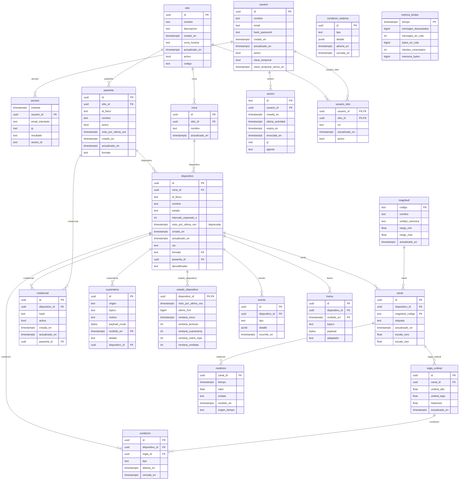

# Modelo de datos (Etapa 2 — Diseño)

> **Sustenta:** OE3 · criterio «diseña según estándares de calidad» (55 %) de la Etapa 2.
> **Notación:** entidad-relación (Chen/crow's foot). El diagrama se renderiza con Mermaid.
> Versión: borrador 1 — 8 de septiembre de 2026.

---

## 1. Qué modela y qué no

El modelo cubre el **estado de la plataforma**: sitios, dispositivos, sus mediciones, su estado de
salud y quién puede verlos. No modela el firmware del nodo ni la red de radio (lado del compañero),
que quedan del otro lado de la frontera (el tópico MQTT).

Principio rector: **el modelo interno es único**. No importa por qué vía ni en qué formato llegó una
trama; una vez pasado el pipeline de normalización, todo se guarda con la misma forma. Esa
uniformidad es la que resuelve la causa C1 (formatos dispares).

## 2. Entidades

| # | Entidad | Qué representa | Notas |
|---|---|---|---|
| 1 | **sitio** | Organización o instalación que agrupa dispositivos | Declara su **zona horaria** (IANA) y su **código**, el segmento del tópico (`sitio/<codigo>/…`, migración 11); el caso de validación es el Campus Dr. Luis Rivas del Canto (código `uct`) |
| 2 | **zona** | Subdivisión lógica de un sitio (edificio, sector, sala) | Un sitio tiene muchas zonas |
| 3 | **magnitud** | Catálogo de lo que se puede medir (temperatura, humedad, nivel…) | Define la unidad canónica y el rango válido |
| 4 | **dispositivo** | Un nodo físico que reporta (ESP32, sensor LoRa…) | Pertenece a una zona; se identifica por un id físico (MAC/DevEUI, lista blanca `[a-z0-9-]`); declara su **vía** (mqtt, http, lorawan), su **formato** (`senml` o `plano` si llega directo; en la vía lorawan, el de su pasarela: `milesight` o `chirpstack`) y, si llega por LoRaWAN, su **pasarela** (migraciones 11 y 15) y, si su pasarela entrega la trama sin decodificar, su **perfil de decodificación** (`decodificador`, migración 17) |
| 5 | **canal** | Una magnitud concreta que un dispositivo reporta | Un dispositivo puede tener varios canales (temp + humedad) |
| 6 | **credencial** | Secreto de autenticación de un dispositivo o de una pasarela (exactamente uno de los dos es su titular, migración 16) | Permite rotación sin borrar al titular |
| 7 | **medicion** | Una lectura: valor + unidad + tiempo | **Hypertable** de TimescaleDB (serie de tiempo) |
| 8 | **regla_umbral** | Límite que, al cruzarse, abre una condición | Con histéresis (umbral de disparo y de restauración) |
| 9 | **condicion** | Un estado anómalo abierto de un dispositivo | Se abre y se cierra; guarda inicio, fin y duración |
| 10 | **evento** | Registro histórico de algo que pasó | Alta, baja, mantenimiento, apertura/cierre de condición, calibración de un canal (`canal_calibrado`); alta y cambios de usuarios (`usuario_alta`, `usuario_cambio`) y cambio de clave (`usuario_clave`), desde el 08/11/2026 |
| 11 | **cuarentena** | Trama rechazada por los filtros 1 a 3 (desconocida, malformada o inválida) o por el tope por emisor (`tope`: no cabía en el presupuesto de lecturas de la hora, migración 19) | Cruda, con motivo y detalle, una fila por trama; no contamina las series. **Hypertable** desde la migración 09 (retención 30 días). Por dispositivo y hora se guardan completas las primeras `TOPE_CUARENTENA_HORA` (60); las demás solo se cuentan (`docs/10 §8.4` punto 53). Lo que no tiene credencial no llega: lo corta el broker |
| 12 | **usuario** | Persona que accede a la plataforma | Con hash de contraseña (`scrypt`, N = 2¹⁷), nunca en claro; el email, en minúsculas, es su nombre de inicio de sesión; baja lógica (`activo`) y, desde la migración 22, `clave_temporal` con su vencimiento a las 24 h (la asigna un administrador; debe cambiarla al entrar, `docs/20 §4`) |
| 13 | **usuario_sitio** | Qué usuario puede ver qué sitio y con qué rol | Multi-tenencia: aísla los datos entre sitios. `rol` es `administrador` o `consulta` (RF-44); desde la migración 22, `activo`: quitarle un sitio a una persona es una baja lógica |
| 14 | **trama** | Trama cruda de un mensaje aceptado (al menos una lectura guardada) | **Hypertable**, solo inserción, retención 30 días: auditoría y re-decodificación si un adaptador tuvo un error (migración 09) |
| 15 | **pasarela** | Quien publica en nombre de los nodos LoRaWAN: una pasarela con servidor de red embebido (ruta B) o un servidor de red externo (ruta C, `docs/10 §8.4` punto 45) | Una sirve a muchos nodos; su id físico es su usuario del broker, único también frente a los dispositivos (migración 11); **declara el formato** de lo que publica (`milesight` o `chirpstack`, migración 15) y sus nodos lo heredan: lo garantiza la base con una clave foránea compuesta `(pasarela_id, formato)` en cascada (`docs/10 §8.4` punto 47) |
| 16 | **estado_dispositivo** | Lo que el sistema escribe sobre cada dispositivo: la última trama aceptada | Una fila por dispositivo y sin `actualizado_en`: la fila de `dispositivo` queda para lo que edita una persona (migración 11). Se borra en cascada con su dispositivo: es un derivado, sin historia propia. Desde la migración 17 guarda también el contador de la última trama LoRaWAN guardada (`ultimo_fcnt`), con el que el filtro 3 descarta la repetida (`docs/10 §4.1`); desde la 19, los contadores de la hora en curso del tope por emisor (`ventana_inicio`, `ventana_lecturas`, `ventana_cuarentena`, `ventana_sobre_tope`, `ventana_omitidas`), que el filtro 6 escribe en el mismo `INSERT … ON CONFLICT` (`docs/10 §8.4` punto 53) |
| 17 | **metrica_broker** | Una muestra por minuto de los contadores `$SYS` del broker: descartes acumulados, mensajes y bytes en cola, clientes conectados, memoria | **Hypertable**, retención 90 días; la toma la conexión administradora del backend (migración 13, `docs/10 §8.4` punto 43) |
| 18 | **condicion_sistema** | Un estado anómalo de la plataforma, sin dispositivo (`broker_descarte`: el broker descarta o la cola pasa el 80 % del tope) | Misma forma que `condicion` (abierta/cerrada, una abierta por tipo); se abre y se cierra sola desde el muestreo del broker (migración 13) |
| 19 | **sesion** | Una sesión abierta de una persona en el panel (M7, `docs/20 §3`) | Su `id` es el hash SHA-256 del identificador que viaja en la cookie: la base nunca guarda lo que autentica. Vence a los 30 min sin actividad o a las 8 h de creada; cerrar la revoca (`revocada_en`). La limpia una función del dueño (`fn_limpiar_sesiones`) con el plazo de `acceso` (migración 22) |
| 20 | **acceso** | Un intento de inicio de sesión o un cierre (RF-46): instante, usuario si existe, email intentado, IP, resultado (`ok`, `clave_incorrecta`, `bloqueado`, `inactivo`, `cierre`) y sesión | **Hypertable**, solo inserción, retención 90 días (`RETENCION_ACCESO_DIAS`, migración 22) |

20 entidades (OE3 pide ≥ 8). Cinco son hypertables, particionadas por tiempo: `medicion` (la serie de tiempo),
desde la migración 09 `trama` y `cuarentena`, desde la 13 `metrica_broker` y desde la 22 `acceso` (para borrar lo vencido por
fragmentos enteros con `drop_chunks`). El resto son tablas relacionales normales de PostgreSQL.

## 3. Diagrama entidad-relación

> Diagrama **generado desde la base de datos real** por `informe-oficial/figuras/generar-figuras.sh` (`db/pruebas/er-mermaid.sql`). No editar a mano: si el esquema cambia, se regenera.

## 4. Decisiones de diseño (y su porqué)

| Decisión | Razón |
|---|---|
| **`medicion` referencia a `canal`, no a `dispositivo`** | Un dispositivo mide varias magnitudes; el canal es la unidad real de una serie de tiempo (dispositivo 007 + temperatura) |
| **`magnitud` es un catálogo con unidad canónica y rango** | Permite validar en el pipeline (filtro 3): un valor fuera del rango o con unidad que no calza va a cuarentena |
| **`credencial` es una entidad aparte, no un campo del dispositivo** | Permite **rotar** la credencial sin borrar ni recrear el dispositivo, y llevar histórico |
| **`condicion` tiene `abierta_en` y `cerrada_en`** | Modela un estado con duración (sensor caído desde las 14:00, restaurado a las 16:30), no un evento puntual |
| **`cuarentena` está separada de `medicion`, atribuida al dispositivo cuando se sabe cuál es** | Lo rechazado nunca entra a las series; se conserva crudo, con motivo y detalle, para diagnóstico (resuelve la pregunta de defensa «¿y si mandan cualquier cosa?») |
| **`usuario_sitio` como tabla intermedia con rol** | Multi-tenencia: un usuario ve solo sus sitios; el aislamiento se aplica en la capa de datos (RNF-08/RF-41) |
| **`sitio.zona_horaria` con nombre IANA** | Los filtros por día se resuelven en la zona del sitio dentro de la base; un desfase fijo fallaría con el horario de verano (`docs/13`) |
| **Identificadores `uuid`** | Evitan colisiones al fusionar datos de varios sitios y no revelan volumen (a diferencia de un id secuencial) |
| **`medicion` como hypertable de TimescaleDB** | Particionado por tiempo + `time_bucket` para agregación rápida (ver `docs/07`) |

## 5. Cómo se conecta con el resto del diseño

- El **pipeline de recepción** (`docs/06`) escribe en `medicion` (si la trama es válida) o en
  `cuarentena` (si no), y actualiza `estado_dispositivo.visto_por_ultima_vez` y las `condicion`.
- La **API REST** (patrón B) lee de estas tablas para el dashboard: histórico desde `medicion` con
  `time_bucket`, estado desde `dispositivo`, `estado_dispositivo` y `condicion`.
- La **supervisión de salud** compara `estado_dispositivo.visto_por_ultima_vez` contra `intervalo_esperado_s` —el **silencio máximo normal** del dispositivo, no su periodo: periodo más las pérdidas que admite el medio, regla práctica 2 × periodo (decisión del 07/10/2026, `docs/10 §8.4` punto 23, migración 10)— para abrir
  condiciones de tipo `sin_comunicacion`.

## 6. Convenciones del esquema (aplicadas en la migración 05)

Reglas que rigen toda tabla nueva o modificada. Provienen de práctica de la industria sobre esquemas
PostgreSQL en producción y se verificaron contra la base real (`plataforma/pruebas/verificar-todo.sh`).

| Convención | Regla | Por qué | Estado |
|---|---|---|---|
| Nombres | Español, `snake_case`, singular; PK `id` (uuid) salvo catálogos con código natural (`magnitud.codigo`) | Consistencia con el dominio del informe | ✅ |
| Restricciones con nombre | Toda restricción se nombra con prefijo: `pk_`, `fk_<tabla>_<destino>`, `uq_`, `ck_`, `idx_`, `trg_`, `fn_` | Un nombre autogenerado (`canal_dispositivo_id_fkey`) no dice qué protege ni se puede citar en un informe o en un error | ✅ restricciones; 🟡 índices, disparadores y funciones: 5 objetos anteriores a la convención o que se le escaparon, listados como excepción en el paso 1b del guardián, se renombran en la próxima migración de esquema (los índices que crea TimescaleDB llevan el nombre que él les pone) |
| Índice por cada FK | Cada clave foránea lleva su índice | Postgres no lo crea solo; sin él cada `JOIN` y cada `ON DELETE` recorre la tabla | ✅ paso 1b del guardián |
| Tipos | `text` (nunca `varchar(n)`), `timestamptz` (nunca `timestamp`), `uuid`, `boolean`. `double precision` **solo** para mediciones físicas, que tienen incertidumbre propia; `numeric(p,s)` para dinero o cantidades exactas (no hay hoy) | Un límite arbitrario obliga a migrar; un `timestamp` sin zona es ambiguo; el flotante binario no sirve para dinero | ✅ paso 1b del guardián |
| Auditoría | `creado_en` y `actualizado_en` con disparador `trg_<tabla>_actualizado_en` en toda tabla mutable (salvo `estado_dispositivo`, a propósito: la escribe el sistema en cada trama, `docs/10 §8.4` punto 27; y `sesion`, por lo mismo: la renueva el guardia en cada petición, y `ultima_actividad` y `revocada_en` dicen cuándo cambió, migración 22); las de solo inserción (`medicion`, `evento`, `cuarentena`, `trama`, `acceso`) llevan solo su instante | Saber cuándo cambió algo sin depender de la aplicación. `creado_por`/`actualizado_por` llegarán con M7 (usuarios) | ✅ paso 1b del guardián |
| Baja lógica | `dispositivo.estado = 'baja'`, `sitio.activo`, `usuario.activo`, `usuario_sitio.activo` (migración 22), `credencial.activa`; nunca `DELETE` sobre entidades con historia (la aplicación no tiene `DELETE` en ninguna tabla; las sesiones vencidas las borra `fn_limpiar_sesiones`, una función del dueño acotada, como `fn_retencion_drop_chunks`) | Conserva la historia y no rompe las filas que referencian el registro | ✅ |
| Dominios cerrados | Si el **código** interpreta los valores (`estado`, `condicion.tipo`, `rol`, `cuarentena.motivo` desde la migración 07) → `CHECK`. Si el **usuario** los administra (magnitudes) → tabla catálogo con código estable y nombre visible | Un `CHECK` exige `ALTER` para crecer y no guarda etiqueta ni orden; un catálogo para valores que solo entiende el código sería una indirección vacía | ✅ |
| Foto por valor | Lo que un registro **posee** se copia (`medicion.unidad`, `evento.detalle` con el umbral vigente); lo que **referencia** se lee por FK (`condicion.regla_id` como procedencia) | Cambiar el catálogo o una regla no debe reinterpretar el pasado | ✅ |
| JSON solo para fotos | `jsonb` únicamente para capturar un contenido tal como fue (`evento.detalle`); nunca para datos de dominio consultables | Lo consultable va en columnas con tipo y FK | ✅ |
| Ledger sobre contador | Las series (`medicion`) y los hechos (`evento`, `condicion`) son registros que se acumulan; `visto_por_ultima_vez` es un derivado recalculable, no la fuente | Un contador se corrompe en silencio; un registro se audita y se recalcula | ✅ |
| Comentarios en el modelo | `COMMENT ON` en toda columna cuya razón de ser no es obvia (qué es, quién la escribe, qué no hacer con ella) | El comentario viaja con la base y lo ve quien lea el esquema sin abrir el informe | ✅ cada migración comenta sus columnas (el conteo lo da la base: `pg_description`; el «10» escrito a mano el 23/09 llevaba semanas desactualizado) |
| Migraciones idempotentes | Cada `NN-*.sql` puede reejecutarse sin duplicar ni pisar nada (`IF NOT EXISTS`, `ON CONFLICT DO NOTHING`, `CREATE OR REPLACE`). La 14 (permisos del rol de la aplicación) es la única que se **edita y reaplica** cuando una migración posterior agrega tablas o columnas que la aplicación escribe (16, 21, 22). Una regla que redefinen varias migraciones: la última la reemplaza y las anteriores solo la crean si no existe (los motivos de cuarentena: 07, 09 y 12) | Permite aplicar el mismo archivo en cualquier ambiente sin miedo | ✅ desde el 16/10, de la 02 a la última en cada `banco.sh encender`: se reaplican y el esquema (con permisos y comentarios) y el catálogo deben quedar idénticos (`banco.sh migraciones`, `docs/16 §37`); antes, 02–06 y 07, 09, 11 y 12 a mano en bases desechables (`docs/16 §13`). La 01 es el esquema base y no se repite |
| Tercera forma normal | Cada hecho vive en una sola tabla; las relaciones muchos a muchos se resuelven con entidades de asociación con identidad propia (`canal` = dispositivo × magnitud, `usuario_sitio` = usuario × sitio); ningún atributo depende de otro que no sea la clave | Sin redundancia no hay anomalías de actualización: cambiar el nombre de un dispositivo se hace en una fila. **¿Por qué no más allá?** Más formas normales no es mejor por sí solo: cada una elimina un tipo específico de anomalía. La 4FN y la 5FN resuelven dependencias multivaluadas o de reunión, que en este modelo no existen; no aportarían nada y cada tabla extra agregaría un JOIN a cada consulta. No es una ley universal: es que aquí no están las anomalías que esas formas resuelven | ✅ |
| Redundancia solo como foto | Las únicas copias son las «fotos por valor» (fila anterior): están **desnormalizadas a propósito** porque el pasado no debe reinterpretarse | Una desnormalización se documenta con su razón; si no tiene razón, es un error | ✅ |
| Clave natural única | Además del `id`, cada tabla declara qué la hace única en el dominio: `medicion (canal_id, tiempo)`, `canal (dispositivo_id, magnitud_codigo)`, `dispositivo.id_fisico`, `usuario.email`, `usuario_sitio (usuario_id, sitio_id)` | El `id` evita duplicar filas por accidente solo si existe la clave natural; en `medicion` sostiene la idempotencia ante reentregas QoS 1 (migración 06) | ✅ |
| Cambio sobre datos reales | Todo script que modifique una base con datos: `BEGIN` → `SELECT` de preflight (cuántas filas, qué valores) → cambio → **el mismo** `SELECT` → `COMMIT` o `ROLLBACK`; `SET lock_timeout` antes de un `ALTER`; si un disparador depende de la columna, se suelta y recrea **en la misma transacción** | Ver el antes y el después en la misma sesión es la única prueba de que el cambio hizo lo que se creía | regla (aplica desde el primer despliegue) |
| Parámetros con tipo | Todo `$N` que no se compare directo con una columna lleva cast (`$1::int`, `$2::timestamptz`, `ANY($3::uuid[])`): en `INSERT … SELECT` y en expresiones Postgres asume `text` y TypeScript no lo atrapa | El error aparece en producción con un dato que en desarrollo no existía | regla |
| Deprecación | Una columna en uso no se borra: se comenta como DEPRECADA con fecha y reemplazo, y se elimina en una migración posterior | El código que la lee puede estar desplegado | regla |
| Qué NO va en la base | Validaciones de negocio, transiciones de estado, permisos y cálculos con reglas cambiantes viven en el backend (el pipeline). En la base quedan integridad referencial, unicidad, rangos fijos, `actualizado_en`. Hay **diez disparadores** y ninguno tiene lógica de negocio: los nueve `trg_*_actualizado_en` y `sitio_zona_horaria_valida` (rechaza una zona que no sea IANA, `docs/13`). La compresión de TimescaleDB **no** es un disparador: es un trabajo del planificador de la extensión, que corre cada 12 h (`timescaledb_information.jobs`) | Las reglas cambian con el negocio; la integridad no | ✅ |

## 7. Estado derivado, estado persistido y foto

Tres tipos de dato que se confunden y que aquí tienen destino distinto:

| Tipo | Ejemplo | Dónde vive | Cuándo se calcula |
|---|---|---|---|
| **Derivado al leer** | `en_linea` (¿última trama hace menos de 2 × intervalo?) | se calcula en la consulta, no se guarda | cada lectura de la API; nunca escribe |
| **Persistido por proceso** | `condicion` tipo `sin_comunicacion` | fila en `condicion`, la abre el barrido periódico (M4) | cada 60 s, una sola vez por transición |
| **Persistido por trama** | `condicion` tipo `tope_superado` y los contadores `ventana_*` de `estado_dispositivo` | los escribe el pipeline (filtros 3 y 6) al rechazar una trama que no cabe en el presupuesto de la hora y al cerrar la hora dentro del presupuesto (`docs/10 §8.4` punto 53) | en cada trama; la condición, una sola vez por transición |
| **Persistido por trama** | `condicion` tipo `reloj_desviado` | la abre el pipeline (filtro 4) cuando la marca de una pasarela difiere más de 10 min de la llegada y la cierra con la primera marca de pasarela plausible del mismo dispositivo (`docs/10 §8.4` punto 54, migración 20) | en cada trama; la condición, una sola vez por transición |
| **Persistido por proceso** | `condicion_sistema` tipo `broker_descarte` y las muestras de `metrica_broker` | las escribe el muestreo de la cola del broker (`docs/10 §8.4` punto 43) | cada 60 s; abre al descartar o al 80 % de la cola, cierra tras dos muestras normales |
| **Exigido en la transición** | «un dispositivo dado de baja no acepta tramas» | el pipeline lo evalúa contra el dato del momento | en cada trama |
| **Foto** | `evento.detalle` (valor y umbral al dispararse), `medicion.unidad` | columna copiada | una vez, al ocurrir |

Regla operativa: **una lectura nunca escribe** (un `GET` que hace `UPDATE` no se puede cachear y toma
bloqueos en tablas que todos leen); lo que deba persistirse lo hace un proceso programado; lo que deba
cumplirse se exige en la transición. El panel muestra el derivado al instante y la base queda
consistente para reportes.

## 8. Pendiente

- [x] Retención con `drop_chunks` desde una tarea programada (`RetencionService`, 07/10/2026: `trama` y `cuarentena` 30 días;
      `medicion` sin límite salvo que se defina `RETENCION_MEDICION_DIAS`; cada corrida queda en `evento`; los agregados como vistas materializadas siguen pendientes) y agregados como vistas materializadas (edición Apache
      de TimescaleDB, decisión del 06/10/2026: `docs/14 §2`, `docs/10 §8.4` punto 11).
- [ ] Validar el modelo contra el catálogo de magnitudes real, cuando se acuerden los sensores con el
      compañero.
- [x] Llevar el diagrama al informe (generado desde la base real por `generar-figuras.sh`).
- [x] **Entidad `pasarela`** (migración 11, 08/10/2026; gateway LoRaWAN; decisión del 06/10, `docs/10 §8.4`; desde el 08/10 es la vía LoRaWAN del sistema, punto 24): `id`, `sitio_id`, identificador
      físico (EUI o número de serie), nombre, `visto_por_ultima_vez`; `dispositivo.pasarela_id` opcional (un
      dispositivo puede llegar por celular sin pasarela). Es una entidad, no un atributo del dispositivo, porque
      una pasarela sirve a muchos dispositivos y tiene estado propio. Se autentica en el broker con su propia
      credencial y publica solo bajo su tópico, con el DevEUI de cada nodo en el tópico y en el cuerpo (`docs/10 §8.4` puntos 24 y 47).
- [x] **Declarar vía, formato y pasarela en el alta (HU-11, hecho el 12/10) y que el filtro 2 use el formato declarado** (15/10,
      `docs/10 §8.4` punto 47, `docs/16 §27`): un dispositivo directo declara `senml` o `plano`; uno lorawan no lo envía y copia el de su
      pasarela. La demostración pasó a publicar solo SenML, que es lo que declara `dev-0001` (`docs/15` §3 y §4).
- [ ] **Alias de claves en el catálogo (`magnitud.alias`), Etapa 4, obligatorio** (decidido el 15/10/2026; `docs/10 §8.4` punto 47). Hoy
      el mapa «clave del JSON decodificado → magnitud» vive en el código (`mapa-claves.ts`) detrás de una sola función (`resolverClave`),
      porque solo hay dos decodificadores que importen y nadie puede editar el catálogo hasta que el panel lo administre. Entonces el
      mapa pasa a una columna `alias text[]` del catálogo, sembrada desde la misma lista del código, y la función lee de la base: los
      adaptadores no cambian. Es la regla de §4: lo que administra el usuario vive en un catálogo.
- [x] **Vía, formato y pasarela: el esquema** (decidido el 08/10/2026, `docs/10 §8.4` punto 25; migración 11):
      `dispositivo.via` (`CHECK`: `mqtt`, `http`, `lorawan`), `dispositivo.formato` (`CHECK`: el código de un
      adaptador: `senml`, `plano`, `milesight` y, desde la migración 15, `chirpstack`; lo interpreta el código, §6) y `dispositivo.pasarela_id` (FK opcional,
      con un `CHECK` que la exige si la vía es `lorawan`). La credencial depende de la vía (`docs/11 §7`). El modelo
      interno sigue siendo único (§1): cambia cómo se identifica y autentica un dispositivo, no cómo se guarda.
- [ ] **Ubicación geográfica**: `dispositivo.latitud` y `dispositivo.longitud` (`double precision`, opcionales,
      `CHECK` de rango). Sin PostGIS: no hay consultas espaciales, solo un mapa; se agrega si algún día las hay.
- [x] **Tabla `trama`** (implementada en la migración 09, 07/10/2026; trama cruda aceptada; `docs/10 §8.4`): `dispositivo_id`, `recibido_en`, `topico`,
      `payload bytea`, `adaptador text`. Solo inserción, sin `actualizado_en`; hypertable por `recibido_en` con
      retención configurable (30 días). La trama es «foto por valor» (§7): nunca se reinterpreta.
- [x] **Perfil de decodificación y contador de trama** (migración 17, 16/10/2026; `docs/10 §8.4` punto 47 y §4.1): `dispositivo.decodificador`
      (texto, nulo; `CHECK` contra la lista de perfiles del código, `campus-heltec-v3-v1`, y otro que lo admite solo en la vía `lorawan`),
      `estado_dispositivo.ultimo_fcnt` (`bigint`, nulo, de 0 a 2³²−1: el contador de 32 bits del servidor de red) y la magnitud
      `tension` (`V`, de 0 a 5), la tensión de batería que reportan los nodos de la red del campus. Los perfiles pasan al catálogo
      editable en la Etapa 4, como el mapa de claves.
- [x] **Suelo del nodo propio** (migración 18, 16/10/2026; `docs/10 §8.4` punto 51): `temperatura_suelo` (`Cel`, −55 a 125) y
      `humedad_suelo` (`V`, 0 a 3,3: la tensión cruda del sensor capacitivo; el % se calcula), y la calibración por canal
      `canal.escala_cero` y `canal.escala_cien` (las dos o ninguna, distintas).
- [x] **Calibración por API con bloqueo optimista** (migración 21, 22/10/2026; `docs/10 §8.4` punto 51 (ii) a (iv); `docs/16 §51`):
      `canal.actualizado_en` (`timestamptz NOT NULL DEFAULT now()`, con el disparador `trg_canal_actualizado_en` que lo pone en `now()` en
      cada `UPDATE`; ambos existían desde la migración 05, que la 21 asegura y documenta) es la marca que exige `PATCH /canales/{id}`, y
      `plataforma_app` recibe `UPDATE` solo en `escala_cero` y `escala_cien`. Cada cambio deja un `evento` de tipo **`canal_calibrado`** del
      dispositivo, con la foto `{canal_id, magnitud, antes: {cero, cien}, despues: {cero, cien}, origen: 'api'}` (§7: foto por valor).
- [ ] **Magnitudes nuevas** del caso de uso (entrevista del 05/10): `radon` (`Bq/m3`, unidad propia: el catálogo
      es el «application context» de RFC 8428 §4.5.2) e `hidrogeno` (`ppm`). Cada una con su rango físico.
- [ ] **Tercera forma normal, revisada con cada cambio**: al agregar `pasarela` y `trama`, comprobar que ningún
      atributo dependa de otro que no sea la clave y que no aparezcan dependencias multivaluadas (lo que
      justificaría 4FN). Si aparecieran, se documenta aquí y se normaliza; mientras no, 3FN basta (§6).
- [x] **Hora de medición frente a hora de recepción (decidido el 06/10/2026; `docs/10 §8.4` punto 12; migración 08).** `medicion.tiempo` guarda el
      instante de la medición según la regla 7 de `docs/13` (marca del emisor si es plausible; si no, la de
      recepción), pero la fila **no registra cuál de las dos se usó ni cuánto difieren**. El broker no marca la
      hora (MQTT no la añade); la hora de llegada al backend hoy solo queda en `cuarentena.recibido_en` y quedará en
      `trama.recibido_en` (30 días). Decisión: `medicion.recibido_en timestamptz` (8 bytes
      por fila) y `medicion.origen_tiempo` (`dispositivo` | `pasarela` | `recepcion`), con la deriva
      `recibido_en − tiempo` por dispositivo en la vista de salud (RF-47). Para LoRaWAN, la hora de la pasarela
      (`time` del mensaje Milesight; `rxInfo` de ChirpStack) es más confiable que la del nodo: el adaptador la
      declara como `pasarela`. La hora de guardado es la del COMMIT y, con la confirmación tras persistir
      (`docs/10 §8.4` punto 4), queda a milisegundos de `recibido_en`: no hace falta una cuarta columna. **Implementado** en `db/init/08-hora-recepcion.sql`
      (CHECK `ck_medicion_recepcion`, `NOT VALID`: rige para toda fila nueva; las anteriores quedan NULL).
- [x] **Permisos por rol** (decidido el 08/10/2026, `docs/10 §8.4` punto 36; hecho el 08/11/2026 con la sesión, M7): la tabla de permisos
      por acción para los roles de `usuario_sitio` vive en el backend (`sesion/permisos.ts`, la matriz de `docs/20 §6`) y la consulta un
      solo guardia; el esquema suma `sesion`, `acceso` (hypertable), la clave temporal de `usuario` y `usuario_sitio.activo` (migración 22).
- [x] **Código del sitio e identificador del broker** (migración 11, 08/10/2026; `docs/10 §8.4` punto 24): `sitio.codigo` es el
      segmento del tópico y el filtro 1 lo compara con el sitio registrado; `id_fisico` lleva la lista blanca `[a-z0-9-]` y es
      único entre dispositivos y pasarelas (disparador con un bloqueo por identificador; las reglas las comprueba el guardián, paso 1c, y la carrera de dos altas
      simultáneas se probó a mano, `docs/16 §13`).
- [ ] **Historial de ubicaciones** (decidido el 09/10/2026, `docs/10 §8.4` punto 39): tabla `ubicacion_dispositivo`
      (`dispositivo_id`, `zona_id`, `desde`, `hasta`), con una sola ubicación vigente por dispositivo; las consultas por sitio
      filtran la historia por período. Se implementa con la pantalla de mudanza (HU-12, Etapa 4).
- [ ] **Alertas (decidido el 15/10/2026, `docs/10 §8.4` punto 49; si sobra tiempo, si no Etapa 4):** `regla_umbral.retardo_s` (entero ≥ 0,
      0 por defecto) y una tabla de reconocimientos (condición, usuario, instante, clasificación con `CHECK`: `real`, `falso_positivo`,
      `mantenimiento_no_avisado`). El resumen del episodio no se guarda: se deriva de `medicion` entre `abierta_en` y `cerrada_en`.
- [ ] **Estado de la pasarela**: `pasarela.visto_por_ultima_vez` vive en una tabla editable con disparador. Por eso la recepción
      LoRaWAN (HU-02, `docs/10 §8.4` punto 47) no la escribe: la «última vez vista» de una pasarela se deriva de sus nodos. Cuando se
      supervise la pasarela por sí misma (HU-15), pasa a una tabla de estado, como la del dispositivo (punto 27).
- [ ] **Motivo de cuarentena propio para el sitio ajeno** (`sitio_ajeno`; hoy cae en `no_registrado` con el detalle) y
      **nombres reservados del broker** (`backend`, `sonda`, `admin`) fuera de `id_fisico` (revisión del 09/10): en la
      próxima migración de esquema.
- [ ] **Eliminar `dispositivo.visto_por_ultima_vez`** (DEPRECADA desde la migración 11) en una migración posterior, cuando
      ningún backend desplegado la lea (convención de deprecación, §6).
- [x] **Marcas del sistema frente a edición humana** (decidido el 08/10/2026, `docs/10 §8.4` punto 27; implementado en la
      migración 11): el sistema escribía `visto_por_ultima_vez` sobre `dispositivo` y el disparador movía `actualizado_en`
      en cada trama; con bloqueo optimista en el panel, cada barrido habría dado «otro usuario lo modificó» falsos. Se
      eligió una tabla propia, `estado_dispositivo` (una fila por dispositivo, sin disparador de `actualizado_en`);
      `dispositivo` queda con lo que edita una persona. `dispositivo.visto_por_ultima_vez` quedó DEPRECADA y se elimina en
      una migración posterior.
