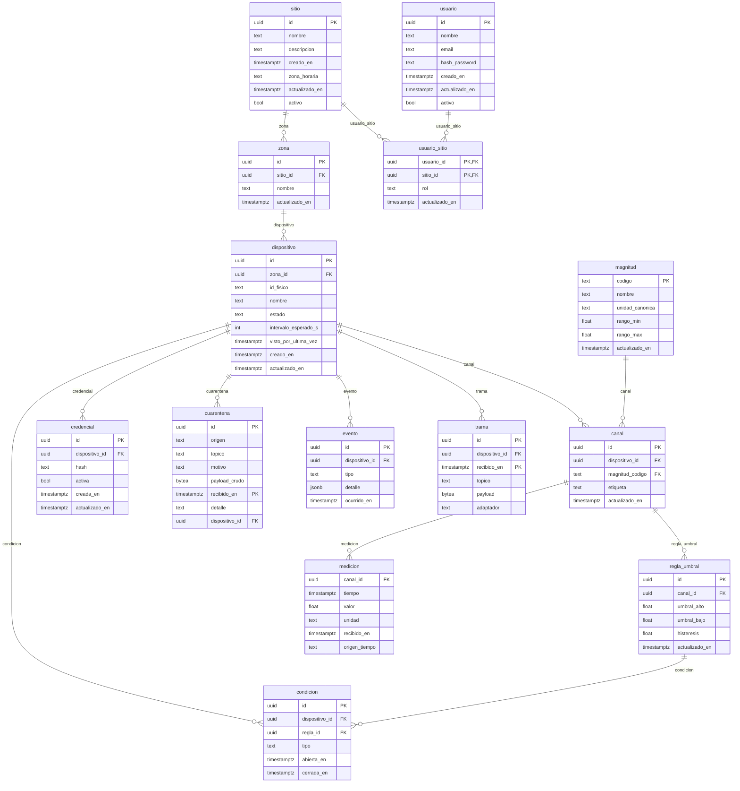

# Modelo de datos (Etapa 2 — Diseño)

> **Sustenta:** OE3 · criterio «diseña según estándares de calidad» (55 %) de la Etapa 2.
> **Notación:** entidad-relación (Chen/crow's foot). El diagrama se renderiza con Mermaid.
> Versión: borrador 1 — 8 de septiembre de 2026.

---

## 1. Qué modela y qué no

El modelo cubre el **estado de la plataforma**: sitios, dispositivos, sus mediciones, su estado de
salud y quién puede verlos. No modela el firmware del nodo ni la red de radio (lado del compañero),
que quedan del otro lado de la frontera (el tópico MQTT).

Principio rector: **el modelo interno es único**. No importa por qué vía ni en qué formato llegó una
trama; una vez pasado el pipeline de normalización, todo se guarda con la misma forma. Esa
uniformidad es la que resuelve la causa C1 (formatos dispares).

## 2. Entidades

| # | Entidad | Qué representa | Notas |
|---|---|---|---|
| 1 | **sitio** | Organización o instalación que agrupa dispositivos | Declara su **zona horaria** (IANA); el caso de validación es el Campus Dr. Luis Rivas del Canto |
| 2 | **zona** | Subdivisión lógica de un sitio (edificio, sector, sala) | Un sitio tiene muchas zonas |
| 3 | **magnitud** | Catálogo de lo que se puede medir (temperatura, humedad, nivel…) | Define la unidad canónica y el rango válido |
| 4 | **dispositivo** | Un nodo físico que reporta (ESP32, sensor LoRa…) | Pertenece a una zona; se identifica por un id físico (MAC/DevEUI) |
| 5 | **canal** | Una magnitud concreta que un dispositivo reporta | Un dispositivo puede tener varios canales (temp + humedad) |
| 6 | **credencial** | Secreto de autenticación de un dispositivo | Permite rotación sin borrar el dispositivo |
| 7 | **medicion** | Una lectura: valor + unidad + tiempo | **Hypertable** de TimescaleDB (serie de tiempo) |
| 8 | **regla_umbral** | Límite que, al cruzarse, abre una condición | Con histéresis (umbral de disparo y de restauración) |
| 9 | **condicion** | Un estado anómalo abierto de un dispositivo | Se abre y se cierra; guarda inicio, fin y duración |
| 10 | **evento** | Registro histórico de algo que pasó | Alta, baja, mantenimiento, apertura/cierre de condición |
| 11 | **cuarentena** | Trama rechazada por los filtros 1 a 3 (desconocida, malformada o inválida) | Cruda, con motivo y detalle, una fila por trama; no contamina las series. **Hypertable** desde la migración 09 (retención 30 días). Lo que no tiene credencial no llega: lo corta el broker |
| 12 | **usuario** | Persona que accede a la plataforma | Con hash de contraseña, nunca en claro |
| 13 | **usuario_sitio** | Qué usuario puede ver qué sitio y con qué rol | Multi-tenencia: aísla los datos entre sitios |
| 14 | **trama** | Trama cruda de un mensaje aceptado (al menos una lectura guardada) | **Hypertable**, solo inserción, retención 30 días: auditoría y re-decodificación si un adaptador tuvo un error (migración 09) |

14 entidades (OE3 pide ≥ 8). Tres son hypertables, particionadas por tiempo: `medicion` (la serie de tiempo)
y, desde la migración 09, `trama` y `cuarentena` (para borrar lo vencido por fragmentos enteros con
`drop_chunks`). El resto son tablas relacionales normales de PostgreSQL.

## 3. Diagrama entidad-relación

> Diagrama **generado desde la base de datos real** por `informe-oficial/figuras/generar-figuras.sh` (`db/pruebas/er-mermaid.sql`). No editar a mano: si el esquema cambia, se regenera.

## 4. Decisiones de diseño (y su porqué)

| Decisión | Razón |
|---|---|
| **`medicion` referencia a `canal`, no a `dispositivo`** | Un dispositivo mide varias magnitudes; el canal es la unidad real de una serie de tiempo (dispositivo 007 + temperatura) |
| **`magnitud` es un catálogo con unidad canónica y rango** | Permite validar en el pipeline (filtro 3): un valor fuera del rango o con unidad que no calza va a cuarentena |
| **`credencial` es una entidad aparte, no un campo del dispositivo** | Permite **rotar** la credencial sin borrar ni recrear el dispositivo, y llevar histórico |
| **`condicion` tiene `abierta_en` y `cerrada_en`** | Modela un estado con duración (sensor caído desde las 14:00, restaurado a las 16:30), no un evento puntual |
| **`cuarentena` está separada de `medicion`, atribuida al dispositivo cuando se sabe cuál es** | Lo rechazado nunca entra a las series; se conserva crudo, con motivo y detalle, para diagnóstico (resuelve la pregunta de defensa «¿y si mandan cualquier cosa?») |
| **`usuario_sitio` como tabla intermedia con rol** | Multi-tenencia: un usuario ve solo sus sitios; el aislamiento se aplica en la capa de datos (RNF-08/RF-41) |
| **`sitio.zona_horaria` con nombre IANA** | Los filtros por día se resuelven en la zona del sitio dentro de la base; un desfase fijo fallaría con el horario de verano (`docs/13`) |
| **Identificadores `uuid`** | Evitan colisiones al fusionar datos de varios sitios y no revelan volumen (a diferencia de un id secuencial) |
| **`medicion` como hypertable de TimescaleDB** | Particionado por tiempo + `time_bucket` para agregación rápida (ver `docs/07`) |

## 5. Cómo se conecta con el resto del diseño

- El **pipeline de recepción** (`docs/06`) escribe en `medicion` (si la trama es válida) o en
  `cuarentena` (si no), y actualiza `dispositivo.visto_por_ultima_vez` y las `condicion`.
- La **API REST** (patrón B) lee de estas tablas para el dashboard: histórico desde `medicion` con
  `time_bucket`, estado desde `dispositivo` y `condicion`.
- La **supervisión de salud** compara `visto_por_ultima_vez` contra `intervalo_esperado_s` —el **silencio máximo normal** del dispositivo, no su periodo: periodo más las pérdidas que admite el medio, regla práctica 2 × periodo (decisión del 07/10/2026, `docs/10 §8.4` punto 23, migración 10)— para abrir
  condiciones de tipo `sin_comunicacion`.

## 6. Convenciones del esquema (aplicadas en la migración 05)

Reglas que rigen toda tabla nueva o modificada. Provienen de práctica de la industria sobre esquemas
PostgreSQL en producción y se verificaron contra la base real (`plataforma/pruebas/verificar-todo.sh`).

| Convención | Regla | Por qué | Estado |
|---|---|---|---|
| Nombres | Español, `snake_case`, singular; PK `id` (uuid) salvo catálogos con código natural (`magnitud.codigo`) | Consistencia con el dominio del informe | ✅ |
| Restricciones con nombre | Toda restricción se nombra con prefijo: `pk_`, `fk_<tabla>_<destino>`, `uq_`, `ck_`, `idx_`, `trg_`, `fn_` | Un nombre autogenerado (`canal_dispositivo_id_fkey`) no dice qué protege ni se puede citar en un informe o en un error | ✅ 32/32 |
| Índice por cada FK | Cada clave foránea lleva su índice | Postgres no lo crea solo; sin él cada `JOIN` y cada `ON DELETE` recorre la tabla | ✅ 0 FK sin índice |
| Tipos | `text` (nunca `varchar(n)`), `timestamptz` (nunca `timestamp`), `uuid`, `boolean`. `double precision` **solo** para mediciones físicas, que tienen incertidumbre propia; `numeric(p,s)` para dinero o cantidades exactas (no hay hoy) | Un límite arbitrario obliga a migrar; un `timestamp` sin zona es ambiguo; el flotante binario no sirve para dinero | ✅ |
| Auditoría | `creado_en` y `actualizado_en` con disparador `trg_<tabla>_actualizado_en` en toda tabla mutable; las de solo inserción (`medicion`, `evento`, `cuarentena`, `trama`) llevan solo su instante | Saber cuándo cambió algo sin depender de la aplicación. `creado_por`/`actualizado_por` llegarán con M7 (usuarios) | ✅ 9 tablas |
| Baja lógica | `dispositivo.estado = 'baja'`, `sitio.activo`, `usuario.activo`, `credencial.activa`; nunca `DELETE` sobre entidades con historia | Conserva la historia y no rompe las filas que referencian el registro | ✅ |
| Dominios cerrados | Si el **código** interpreta los valores (`estado`, `condicion.tipo`, `rol`, `cuarentena.motivo` desde la migración 07) → `CHECK`. Si el **usuario** los administra (magnitudes) → tabla catálogo con código estable y nombre visible | Un `CHECK` exige `ALTER` para crecer y no guarda etiqueta ni orden; un catálogo para valores que solo entiende el código sería una indirección vacía | ✅ |
| Foto por valor | Lo que un registro **posee** se copia (`medicion.unidad`, `evento.detalle` con el umbral vigente); lo que **referencia** se lee por FK (`condicion.regla_id` como procedencia) | Cambiar el catálogo o una regla no debe reinterpretar el pasado | ✅ |
| JSON solo para fotos | `jsonb` únicamente para capturar un contenido tal como fue (`evento.detalle`); nunca para datos de dominio consultables | Lo consultable va en columnas con tipo y FK | ✅ |
| Ledger sobre contador | Las series (`medicion`) y los hechos (`evento`, `condicion`) son registros que se acumulan; `visto_por_ultima_vez` es un derivado recalculable, no la fuente | Un contador se corrompe en silencio; un registro se audita y se recalcula | ✅ |
| Comentarios en el modelo | `COMMENT ON` en toda columna cuya razón de ser no es obvia (qué es, quién la escribe, qué no hacer con ella) | El comentario viaja con la base y lo ve quien lea el esquema sin abrir el informe | ✅ 10 comentarios |
| Migraciones idempotentes | Cada `NN-*.sql` puede reejecutarse sin duplicar ni pisar nada (`IF NOT EXISTS`, `ON CONFLICT DO NOTHING`, `CREATE OR REPLACE`) | Permite aplicar el mismo archivo en cualquier ambiente sin miedo | ✅ 02–06 |
| Tercera forma normal | Cada hecho vive en una sola tabla; las relaciones muchos a muchos se resuelven con entidades de asociación con identidad propia (`canal` = dispositivo × magnitud, `usuario_sitio` = usuario × sitio); ningún atributo depende de otro que no sea la clave | Sin redundancia no hay anomalías de actualización: cambiar el nombre de un dispositivo se hace en una fila. **¿Por qué no más allá?** Más formas normales no es mejor por sí solo: cada una elimina un tipo específico de anomalía. La 4FN y la 5FN resuelven dependencias multivaluadas o de reunión, que en este modelo no existen; no aportarían nada y cada tabla extra agregaría un JOIN a cada consulta. No es una ley universal: es que aquí no están las anomalías que esas formas resuelven | ✅ |
| Redundancia solo como foto | Las únicas copias son las «fotos por valor» (fila anterior): están **desnormalizadas a propósito** porque el pasado no debe reinterpretarse | Una desnormalización se documenta con su razón; si no tiene razón, es un error | ✅ |
| Clave natural única | Además del `id`, cada tabla declara qué la hace única en el dominio: `medicion (canal_id, tiempo)`, `canal (dispositivo_id, magnitud_codigo)`, `dispositivo.id_fisico`, `usuario.correo`, `usuario_sitio (usuario_id, sitio_id)` | El `id` evita duplicar filas por accidente solo si existe la clave natural; en `medicion` sostiene la idempotencia ante reentregas QoS 1 (migración 06) | ✅ |
| Cambio sobre datos reales | Todo script que modifique una base con datos: `BEGIN` → `SELECT` de preflight (cuántas filas, qué valores) → cambio → **el mismo** `SELECT` → `COMMIT` o `ROLLBACK`; `SET lock_timeout` antes de un `ALTER`; si un disparador depende de la columna, se suelta y recrea **en la misma transacción** | Ver el antes y el después en la misma sesión es la única prueba de que el cambio hizo lo que se creía | regla (aplica desde el primer despliegue) |
| Parámetros con tipo | Todo `$N` que no se compare directo con una columna lleva cast (`$1::int`, `$2::timestamptz`, `ANY($3::uuid[])`): en `INSERT … SELECT` y en expresiones Postgres asume `text` y TypeScript no lo atrapa | El error aparece en producción con un dato que en desarrollo no existía | regla |
| Deprecación | Una columna en uso no se borra: se comenta como DEPRECADA con fecha y reemplazo, y se elimina en una migración posterior | El código que la lee puede estar desplegado | regla |
| Qué NO va en la base | Validaciones de negocio, transiciones de estado, permisos y cálculos con reglas cambiantes viven en el backend (el pipeline). En la base quedan integridad referencial, unicidad, rangos fijos, `actualizado_en`. Hay **diez disparadores** y ninguno tiene lógica de negocio: los nueve `trg_*_actualizado_en` y `sitio_zona_horaria_valida` (rechaza una zona que no sea IANA, `docs/13`). La compresión de TimescaleDB **no** es un disparador: es un trabajo del planificador de la extensión, que corre cada 12 h (`timescaledb_information.jobs`) | Las reglas cambian con el negocio; la integridad no | ✅ |

## 7. Estado derivado, estado persistido y foto

Tres tipos de dato que se confunden y que aquí tienen destino distinto:

| Tipo | Ejemplo | Dónde vive | Cuándo se calcula |
|---|---|---|---|
| **Derivado al leer** | `en_linea` (¿última trama hace menos de 2 × intervalo?) | se calcula en la consulta, no se guarda | cada lectura de la API; nunca escribe |
| **Persistido por proceso** | `condicion` tipo `sin_comunicacion` | fila en `condicion`, la abre el barrido periódico (M4) | cada 60 s, una sola vez por transición |
| **Exigido en la transición** | «un dispositivo dado de baja no acepta tramas» | el pipeline lo evalúa contra el dato del momento | en cada trama |
| **Foto** | `evento.detalle` (valor y umbral al dispararse), `medicion.unidad` | columna copiada | una vez, al ocurrir |

Regla operativa: **una lectura nunca escribe** (un `GET` que hace `UPDATE` no se puede cachear y toma
bloqueos en tablas que todos leen); lo que deba persistirse lo hace un proceso programado; lo que deba
cumplirse se exige en la transición. El panel muestra el derivado al instante y la base queda
consistente para reportes.

## 8. Pendiente

- [x] Retención con `drop_chunks` desde una tarea programada (`RetencionService`, 07/10/2026: `trama` y `cuarentena` 30 días;
      `medicion` sin límite salvo que se defina `RETENCION_MEDICION_DIAS`; cada corrida queda en `evento`; los agregados como vistas materializadas siguen pendientes) y agregados como vistas materializadas (edición Apache
      de TimescaleDB, decisión del 06/10/2026: `docs/14 §2`, `docs/10 §8.4` punto 11).
- [ ] Validar el modelo contra el catálogo de magnitudes real, cuando se acuerden los sensores con el
      compañero.
- [x] Llevar el diagrama al informe (generado desde la base real por `generar-figuras.sh`).
- [ ] **Entidad `pasarela`** (gateway LoRaWAN; decisión del 06/10, `docs/10 §8.4`): `id`, `sitio_id`, identificador
      físico (EUI o número de serie), nombre, `visto_por_ultima_vez`; `dispositivo.pasarela_id` opcional (un
      dispositivo puede llegar por celular sin pasarela). Es una entidad, no un atributo del dispositivo, porque
      una pasarela sirve a muchos dispositivos y tiene estado propio.
- [ ] **Ubicación geográfica**: `dispositivo.latitud` y `dispositivo.longitud` (`double precision`, opcionales,
      `CHECK` de rango). Sin PostGIS: no hay consultas espaciales, solo un mapa; se agrega si algún día las hay.
- [x] **Tabla `trama`** (implementada en la migración 09, 07/10/2026; trama cruda aceptada; `docs/10 §8.4`): `dispositivo_id`, `recibido_en`, `topico`,
      `payload bytea`, `adaptador text`. Solo inserción, sin `actualizado_en`; hypertable por `recibido_en` con
      retención configurable (30 días). La trama es «foto por valor» (§7): nunca se reinterpreta.
- [ ] **Magnitudes nuevas** del caso de uso (entrevista del 05/10): `radon` (`Bq/m3`, unidad propia: el catálogo
      es el «application context» de RFC 8428 §4.5.2), `hidrogeno` (`ppm`), `temperatura_suelo` (`Cel`),
      `humedad_suelo` (unidad por confirmar con el instrumento). Cada una con su rango físico.
- [ ] **Tercera forma normal, revisada con cada cambio**: al agregar `pasarela` y `trama`, comprobar que ningún
      atributo dependa de otro que no sea la clave y que no aparezcan dependencias multivaluadas (lo que
      justificaría 4FN). Si aparecieran, se documenta aquí y se normaliza; mientras no, 3FN basta (§6).
- [x] **Hora de medición frente a hora de recepción (decidido el 06/10/2026; `docs/10 §8.4` punto 12; migración 08).** `medicion.tiempo` guarda el
      instante de la medición según la regla 7 de `docs/13` (marca del emisor si es plausible; si no, la de
      recepción), pero la fila **no registra cuál de las dos se usó ni cuánto difieren**. El broker no marca la
      hora (MQTT no la añade); la hora de llegada al backend hoy solo queda en `cuarentena.recibido_en` y quedará en
      `trama.recibido_en` (30 días). Decisión: `medicion.recibido_en timestamptz` (8 bytes
      por fila) y `medicion.origen_tiempo` (`dispositivo` | `pasarela` | `recepcion`), con la deriva
      `recibido_en − tiempo` por dispositivo en la vista de salud (RF-47). Para LoRaWAN, la hora de la pasarela
      (`time` del mensaje Milesight; `rxInfo` de ChirpStack) es más confiable que la del nodo: el adaptador la
      declara como `pasarela`. La hora de guardado es la del COMMIT y, con la confirmación tras persistir
      (`docs/10 §8.4` punto 4), queda a milisegundos de `recibido_en`: no hace falta una cuarta columna. **Implementado** en `db/init/08-hora-recepcion.sql`
      (CHECK `ck_medicion_recepcion`, `NOT VALID`: rige para toda fila nueva; las anteriores quedan NULL).
- [ ] **Marcas del sistema frente a edición humana** (kit de método, 06/10/2026): `visto_por_ultima_vez` y
      `en_linea` las escribe el supervisor sobre `dispositivo`, y el disparador mueve `actualizado_en` en cada UPDATE.
      Si el panel usa control optimista sobre `dispositivo`, un barrido provocará «otro usuario lo modificó» falsos.
      Decidir antes de HU-10/HU-18: tabla `estado_dispositivo` propia (una fila por dispositivo, sin disparador) o
      excluir esas columnas del disparador y de la comparación optimista.
