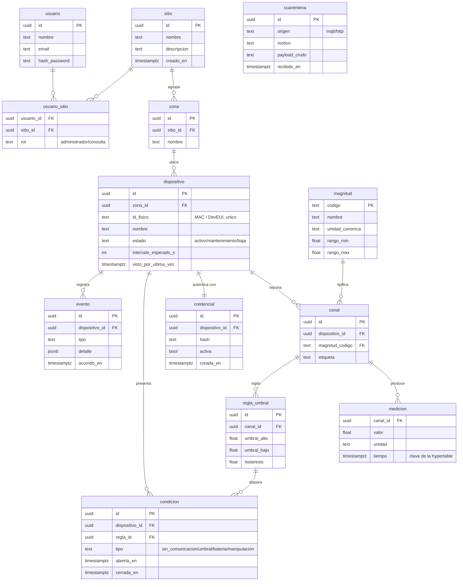

# Modelo de datos (Etapa 2 — Diseño)

> **Sustenta:** OE3 · criterio «diseña según estándares de calidad» (55 %) de la Etapa 2.
> **Notación:** entidad-relación (Chen/crow's foot). El diagrama se renderiza con Mermaid.
> Versión: borrador 1 — 8 de septiembre de 2026.

---

## 1. Qué modela y qué no

El modelo cubre el **estado de la plataforma**: sitios, dispositivos, sus mediciones, su estado de
salud y quién puede verlos. No modela el firmware del nodo ni la red de radio (lado del compañero),
que quedan del otro lado de la frontera (el tópico MQTT).

Principio rector: **el modelo interno es único**. No importa por qué vía ni en qué formato llegó una
trama; una vez pasado el pipeline de normalización, todo se guarda con la misma forma. Esa
uniformidad es la que resuelve la causa C1 (formatos dispares).

## 2. Entidades

| # | Entidad | Qué representa | Notas |
|---|---|---|---|
| 1 | **sitio** | Organización o instalación que agrupa dispositivos | El caso de validación es el Campus Dr. Luis Rivas del Canto |
| 2 | **zona** | Subdivisión lógica de un sitio (edificio, sector, sala) | Un sitio tiene muchas zonas |
| 3 | **magnitud** | Catálogo de lo que se puede medir (temperatura, humedad, nivel…) | Define la unidad canónica y el rango válido |
| 4 | **dispositivo** | Un nodo físico que reporta (ESP32, sensor LoRa…) | Pertenece a una zona; se identifica por un id físico (MAC/DevEUI) |
| 5 | **canal** | Una magnitud concreta que un dispositivo reporta | Un dispositivo puede tener varios canales (temp + humedad) |
| 6 | **credencial** | Secreto de autenticación de un dispositivo | Permite rotación sin borrar el dispositivo |
| 7 | **medicion** | Una lectura: valor + unidad + tiempo | **Hypertable** de TimescaleDB (serie de tiempo) |
| 8 | **regla_umbral** | Límite que, al cruzarse, abre una condición | Con histéresis (umbral de disparo y de restauración) |
| 9 | **condicion** | Un estado anómalo abierto de un dispositivo | Se abre y se cierra; guarda inicio, fin y duración |
| 10 | **evento** | Registro histórico de algo que pasó | Alta, baja, mantenimiento, apertura/cierre de condición |
| 11 | **cuarentena** | Trama rechazada (malformada o de desconocido) | Se guarda cruda con su motivo; no contamina las series |
| 12 | **usuario** | Persona que accede a la plataforma | Con hash de contraseña, nunca en claro |
| 13 | **usuario_sitio** | Qué usuario puede ver qué sitio y con qué rol | Multi-tenencia: aísla los datos entre sitios |

Trece entidades (OE3 pide ≥ 8). La tabla de series de tiempo (`medicion`) es la única hypertable; el
resto son tablas relacionales normales de PostgreSQL.

## 3. Diagrama entidad-relación

## 4. Decisiones de diseño (y su porqué)

| Decisión | Razón |
|---|---|
| **`medicion` referencia a `canal`, no a `dispositivo`** | Un dispositivo mide varias magnitudes; el canal es la unidad real de una serie de tiempo (dispositivo 007 + temperatura) |
| **`magnitud` es un catálogo con unidad canónica y rango** | Permite validar en el pipeline (filtro 3): un valor fuera del rango o con unidad que no calza va a cuarentena |
| **`credencial` es una entidad aparte, no un campo del dispositivo** | Permite **rotar** la credencial sin borrar ni recrear el dispositivo, y llevar histórico |
| **`condicion` tiene `abierta_en` y `cerrada_en`** | Modela un estado con duración (sensor caído desde las 14:00, restaurado a las 16:30), no un evento puntual |
| **`cuarentena` está separada de `medicion`** | Lo malformado nunca entra a las series; se conserva crudo para diagnóstico (resuelve la pregunta de defensa «¿y si mandan cualquier cosa?») |
| **`usuario_sitio` como tabla intermedia con rol** | Multi-tenencia: un usuario ve solo sus sitios; el aislamiento se aplica en la capa de datos (RNF-08/RF-41) |
| **Identificadores `uuid`** | Evitan colisiones al fusionar datos de varios sitios y no revelan volumen (a diferencia de un id secuencial) |
| **`medicion` como hypertable de TimescaleDB** | Particionado por tiempo + `time_bucket` para agregación rápida (ver `docs/07`) |

## 5. Cómo se conecta con el resto del diseño

- El **pipeline de recepción** (`docs/06`) escribe en `medicion` (si la trama es válida) o en
  `cuarentena` (si no), y actualiza `dispositivo.visto_por_ultima_vez` y las `condicion`.
- La **API REST** (patrón B) lee de estas tablas para el dashboard: histórico desde `medicion` con
  `time_bucket`, estado desde `dispositivo` y `condicion`.
- La **supervisión de salud** compara `visto_por_ultima_vez` contra `intervalo_esperado_s` para abrir
  condiciones de tipo `sin_comunicacion`.

## 6. Pendiente

- [ ] Índices y políticas de retención/compresión de la hypertable (detalle de implementación).
- [ ] Validar el modelo contra el catálogo de magnitudes real, cuando se acuerden los sensores con el
      compañero.
- [ ] Llevar el diagrama a la versión TikZ/imagen para el informe LaTeX de la Etapa 2.
