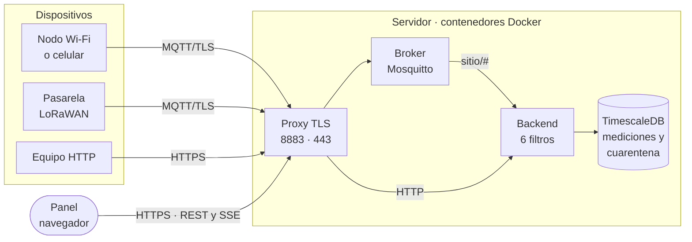
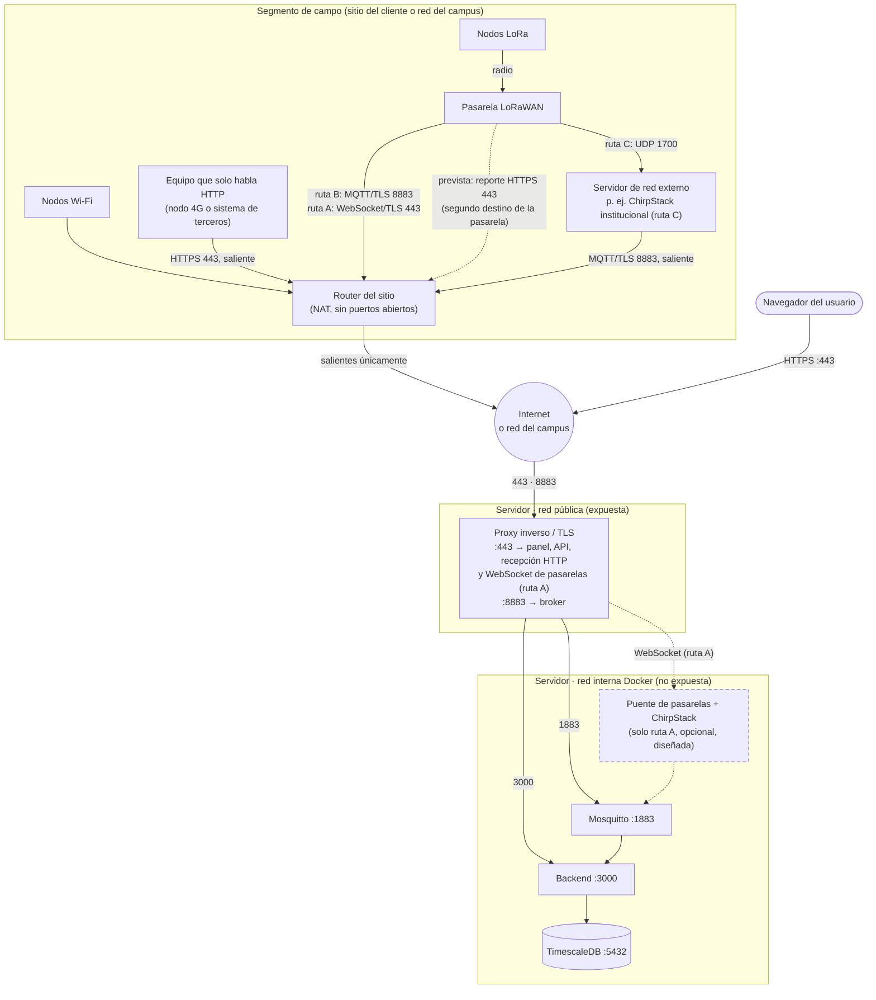
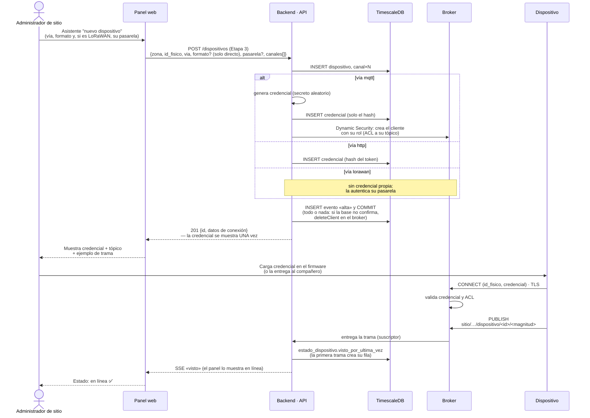
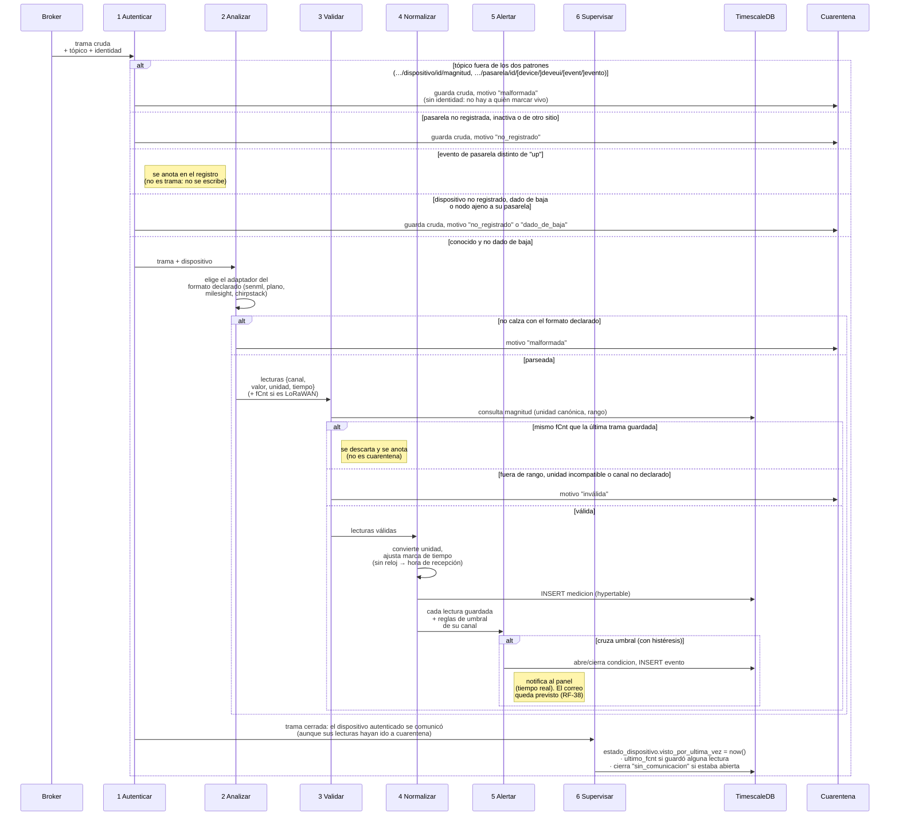
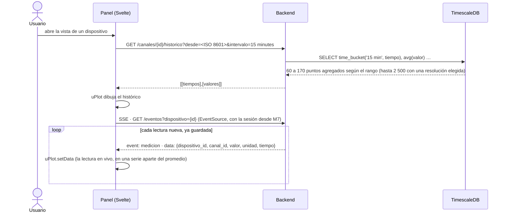
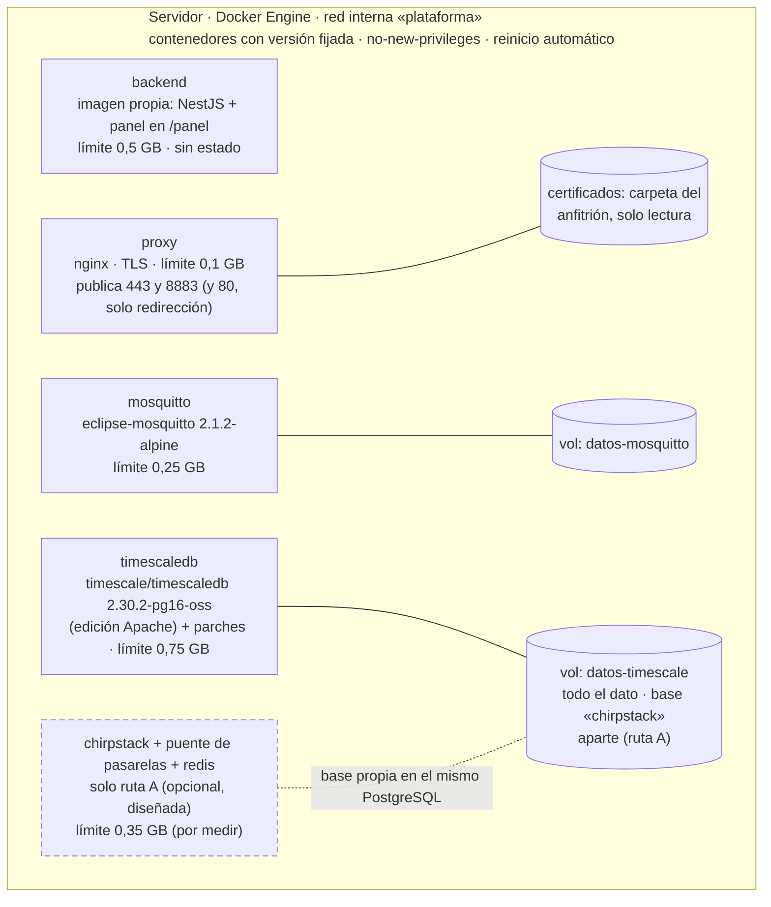

# Arquitectura del sistema (Etapa 2 — Diseño)

> **Sustenta:** OE2 y OE3 · criterio «diseña según estándares de calidad» (55 %) de la Etapa 2.
> **Notación:** vista de contenedores del modelo C4 (Brown) para la estructura; diagramas de
> secuencia UML para el comportamiento; vista de despliegue para la infraestructura. Todos son
> Mermaid: se ven en GitHub y `informe-oficial/figuras/generar-figuras.sh` los renderiza a PDF para el informe
> desde esta misma fuente (el modelo de datos se genera desde la base real). Versión: 8 de septiembre de 2026.
> **Depende de:** `docs/06` (pipeline), `docs/07` (stack y patrón B), `docs/08` (modelo de datos).

---

## 1. Vista de contenedores (C4, nivel 2)

Qué piezas ejecutables existen y cómo se hablan. La **frontera** del trabajo es el tópico MQTT: de un
lado, la red de sensores (lado del compañero: nodos, *gateway* y servidor de red LoRaWAN, que en la ruta
B va embebido en la pasarela —la red del campus hoy: UG65, probada en terreno el 20/10—, en la ruta C es un servidor de red externo
(por ejemplo, un ChirpStack institucional, por confirmar con el profesor guía; hasta el 15/10 se creyó que la red del campus era esta ruta), y en la
ruta A, opcional, es un ChirpStack que aunque se aloja en nuestro servidor publica al broker como un productor más; B y C
entran igual, por MQTT/TLS 8883 con credencial propia, y solo cambia el adaptador); del otro, el broker y el backend. **En las figuras,
lo opcional va con borde y flecha punteados** (desde el 07/10/2026). Hasta el 01/11/2026 no se
describía por posición (izquierda/derecha) porque el dibujo lo generaba Mermaid y su distribución cambiaba
al renderizar; el 23/09/2026 la leyenda del informe decía «a la izquierda… a la derecha» y el dibujo
mostraba los sensores arriba. Desde el 01/11/2026 el dibujo es un `.drawio` con posiciones fijas (abajo). Las cajas del backend llevan el número de los filtros de la figura 3.1 que ejecutan (decidido el 01/11/2026, para que las dos
figuras se lean con los mismos números) y corresponden a los módulos que tocan el dato: M1 Recepción, M2 Normalización, M6 Alertas,
M4 Supervisión y M5 Persistencia y consulta; M3 (aprovisionamiento), M7 (seguridad e identidad) y M8 (interfaz) no aparecen como cajas
porque son transversales o viven en el cliente (`docs/02` §3).

**Vista resumida** (26/10/2026, para presentar): el recorrido de una trama en una línea, sin las rutas LoRaWAN por separado. Resume la
vista de contenedores completa (figura 4.1, en draw.io: ver abajo) y no agrega nada que esa vista no diga; si cambia una, cambia la otra.



**Vista de contenedores completa (figura 4.1 del informe).** Desde el 01/11/2026 es un dibujo en draw.io, fuente única de
esa figura y de la 2.2 (`informe-oficial/figuras/drawio/figura-4.1.drawio` y `figura-2.2.drawio`, con su PDF exportado sin
metadatos de fecha). Hasta entonces era un bloque Mermaid aquí mismo, generado al compilar; se cambió porque el autor dibuja las
figuras y el generador no respetaba su distribución. El texto de esta sección sigue mandando: el guardián (paso 3d de
`verificar-todo.sh`) exige que el dibujo contenga los puertos (443, 8883, 1883, 3000), las vías 1 a 3, las rutas A, B y C, Basics
Station, los filtros 1 a 6 en las cajas del backend, `POST /recepcion/{id}`, la suscripción `sitio/#` y los nombres de los
contenedores, y que el PDF exportado diga lo mismo que el `.drawio`. La vista resumida de arriba sigue en Mermaid para las láminas.

**Decisiones visibles en el diagrama:**

- **Un solo contenedor expuesto (el proxy) y dos puertos, siempre:** 443 para personas, para los equipos que envían por HTTP
  (`POST /recepcion/{id_fisico}`, punto 52) y, en la ruta A, para la pasarela con *Basics Station* (WebSocket sobre TLS, punto 56); y 8883
  para dispositivos y pasarelas MQTT; ambos cifrados y siempre presentes (el 80, también del proxy, solo redirige a 443 y no recibe
  datos). Los dos los publica el proxy; ningún otro contenedor lleva
  `ports`. En la ruta B (pasarela con servidor de red embebido, §8.4 puntos 2 y 24) y en la ruta C (servidor de red externo, como un
  ChirpStack institucional, por confirmar, §8.4 punto 45) el servidor de red no es nuestro y nada más se abre. En la ruta A (ChirpStack en este
  servidor, opcional y **diseñada, no construida**) la pasarela llega por 443 al puente de pasarelas de ChirpStack; hasta el 01/11/2026
  la ruta A usaba el *Semtech UDP Packet Forwarder* en un tercer puerto, 1700/udp, descartado por no autenticar ni cifrar (punto 56).
  Hoy ChirpStack no está desplegado (§8.3). La base de datos y la interfaz de administración de ChirpStack nunca se exponen; su puente
  de pasarelas, cuando exista, se alcanza solo a través del proxy, porque las pasarelas están en el campo, sin VPN, y deben poder
  llegar (RNF-10 al revés: aquí es el servidor el que necesita un puerto alcanzable, no el dispositivo).

  **Escenarios de entrada contemplados (06/10/2026):**

  | Escenario | Transporte hasta el servidor | Puerto | Pasa por el proxy | Estado |
  |---|---|---|---|---|
  | 1. Nodo Wi-Fi (ESP32 u otro) con cliente MQTT | MQTT sobre TLS | 8883 | Sí | Implementado (en desarrollo, 1883 local sin TLS) |
  | 2. Equipo que solo habla HTTP | HTTPS, `POST` con SenML | 443 | Sí | Implementado el 16/10/2026 (HU-01, §8.4 punto 52); en el banco, directo al backend y una comprobación por el proxy con TLS |
  | 3. Pasarela LoRaWAN con servidor de red embebido (Milesight UG6x) | MQTT sobre TLS; JSON decodificado en la pasarela | 8883 | Sí | Ruta B; el 15/10/2026 la red del campus ofreció reenviar desde el servidor embebido de su UG63 para una prueba; adaptador `milesight` hecho y probado en el banco (§8.4 punto 47, `docs/16 §31`); **probada en terreno el 20/10/2026** con la pasarela UG65 del campus (`docs/16 §45`) |
  | 4. Pasarela LoRaWAN con *Basics Station* y ChirpStack en este servidor | WebSocket sobre TLS (protocolo LNS) → ChirpStack → MQTT interno; la pasarela se autentica con certificado de cliente (TLS mutuo; su CN lleva el identificador de la pasarela) | 443 | Sí | Ruta A, opcional, **diseñada, no construida** (01/11/2026, §8.4 punto 56: reemplaza al reenvío Semtech UDP 1700, que no autentica ni cifra); ChirpStack no desplegado |
  | 5. Servidor de red externo (TTN o un ChirpStack institucional) | Integración MQTT del servidor de red hacia este sistema | 8883 | Sí | **Ruta C, por confirmar con el profesor guía** (§8.4 punto 45; el 13/10/2026 se creyó que era la de la red del campus, con ChirpStack v4 y una UG63, y el 15/10 resultó ser la ruta B: UG65 con servidor de red embebido, punto 47); adaptador `chirpstack` hecho y probado en el banco (§8.4 punto 47, `docs/16 §31`); falta en terreno |
  | 6. Equipo celular (NB-IoT, LTE-M) con cliente MQTT | MQTT sobre TLS; trama JSON o binaria hexadecimal | 8883 | Sí | Candidato (entrevista del 05/10); adaptador binario pendiente |
  | 7. Pasarela con *Basics Station* hacia ChirpStack en este servidor (hoy, la forma del escenario 4) | WebSocket sobre TLS (protocolo LNS) | 443 | Sí | Verificado el 06/10: el *Gateway Bridge* expone un manejador WebSocket para Basics Station y la guía de la UG65 (firmware V2.14, p. 134) lista «Basic station» entre sus reenviadores, sin detallar sus campos; desde el 01/11/2026 es la forma de la ruta A: ver el escenario 4 (§8.4 punto 56) |
  | 8. Pasarela LoRaWAN con servidor de red embebido, por su **reporte HTTP(S)** (segundo destino de la aplicación) | HTTPS, `POST` con el mismo JSON del uplink y cabeceras de autenticación | 443 | Sí | **Prevista** (22/10/2026): en terreno (20/10) la UG65 admitió un solo destino MQTT por aplicación y el segundo solo por HTTP(S); es la forma de convivir con el broker del operador sin tocarlo. Exige verificar la autenticación del reporte (cabeceras nombre/valor según la guía de Milesight) y un servidor con dirección pública. Punteada en las figuras |

  **Vías (22/10/2026; renumeradas por protocolo y relevancia el 01/11/2026, y así las citan la figura, su leyenda, el glosario y
  la presentación):** **vía 1**, MQTT sobre TLS, 8883: dispositivo directo (escenarios 1 y 6), pasarela con servidor de red embebido
  (escenario 3, ruta B) y servidor de red externo (escenario 5, ruta C); **vía 2**, HTTPS, 443: equipo directo (escenario 2) y, **prevista
  y punteada**, el reporte HTTPS de la pasarela (escenario 8); **vía 3**, WebSocket sobre TLS, 443: pasarela con *Basics Station* hacia
  el ChirpStack propio de la ruta A (escenarios 4 y 7), **diseñada, no construida**, punteada. Las rutas dicen dónde corre el servidor de
  red; las vías, por dónde entra la trama (no confundir con la vía declarada en el alta, `dispositivo.via`: mqtt, http o lorawan, que
  dice cómo se autentica el emisor). Las personas entran siempre por 443. Hasta el 01/11/2026 las vías eran cuatro (1 MQTT directo,
  2 HTTP directo, 3 LoRaWAN por pasarela, 4 reporte HTTPS previsto) y la ruta A usaba el reenvío Semtech UDP en 1700/udp «solo en red
  local»: ese protocolo no autentica ni cifra el transporte (la carga LoRaWAN sí va cifrada e íntegra de extremo a extremo) y la
  industria recomienda y ofrece como reemplazo *Basics Station* (punto 56; `docs/11 §1`).

  **¿Y «cualquier dispositivo»?** El sistema no promete entender cualquier aparato; promete dos puertas
  estándar: MQTT 3.1.1 o 5 sobre TLS 1.2 o superior, y HTTP/1.1 sobre TLS. Es lo que implementan los módulos
  IoT corrientes (ESP32, pasarelas LoRaWAN, módems celulares); lo que no lo implementa (un microcontrolador
  sin TLS, un instrumento con salida serie) entra a través de una pasarela que sí lo hace, como ocurre con
  LoRa. Lo que un dispositivo debe cumplir se escribe en una guía de conexión (nombre del servidor, puerto,
  raíz de confianza del certificado, tópico, formato) y **se prueba con la matriz de TT-32**: un emulador con
  TLS (TT-28), una pasarela real y la ruta HTTP. Lo que falle ahí se documenta, no se supone.

  **Por qué la ruta A no usa el reenvío UDP (decidido el 01/11/2026, punto 56).** El protocolo que usaban los *gateways* para
  hablarle a ChirpStack (*Semtech UDP Packet Forwarder*) **no tiene autenticación ni cifrado**: un *gateway* se identifica con su EUI,
  un dato público, y cualquiera puede enviar UDP suplantándolo (Semtech/ChirpStack, documentación del *Gateway Bridge*). La defensa no
  podía ser el protocolo. En vez de rodearlo (contenedor sin privilegios, límite de tasa, no confiar en el EUI), se adopta el reemplazo
  que la industria recomienda: *Basics Station*, WebSocket sobre TLS con autenticación de la pasarela por certificado de cliente (TLS
  mutuo), que el puente de pasarelas de ChirpStack admite (`ca_cert`; el CN del certificado lleva el identificador de la pasarela). La autenticación real de cada nodo sigue ocurriendo más adentro, en el filtro 1 del
  pipeline, contra el registro de dispositivos.
- **El navegador nunca toca el broker** (patrón B, `docs/07`): consume la API del backend, que ya
  filtró y normalizó. Así la trama cruda jamás llega al cliente y las credenciales MQTT no viajan en
  JavaScript.
- **La pasarela (ruta B) o ChirpStack (ruta A, si se activa) es un productor más** hacia el broker: para la
  plataforma, una trama LoRaWAN y una trama Wi-Fi son indistinguibles después del filtro 2 (adaptador). Eso es lo que resuelve la causa
  C2 (hardware atado a la plataforma).

## 2. Topología de red y segmentación

Vista de red de la solución: qué segmentos existen, qué puertos cruzan cada frontera y qué queda
aislado. Sustenta los RNF de seguridad (TLS obligatorio, mínimo privilegio, conexión saliente de los
dispositivos para no requerir NAT — RNF-10).



| Frontera | Cruza | No cruza | Por qué |
|---|---|---|---|
| Sitio → Internet | Conexiones **salientes** de nodos y gateway | Nada entrante | Los dispositivos inician la conexión: no hay que abrir puertos en el router del cliente (RNF-10) |
| Internet → servidor | 443 (personas) y 8883 (dispositivos, pasarelas de la ruta B y servidores de red externos de la ruta C), siempre; en la ruta A la pasarela con Basics Station entra también por 443 (WebSocket sobre TLS) | 5432, 1883, 8080, 3000 | Solo se expone lo que necesita hablar con el exterior; todo lo demás vive en la red interna de Docker |
| Red interna | Tráfico entre contenedores por nombre de servicio | Acceso desde fuera | La base de datos no se publica fuera de la red interna; hoy los cuatro servicios comparten una sola red de Compose, así que segmentarla en dos (`borde` y `datos`) queda pendiente para la Etapa 4 |

**Conceptos de la entrada, sin ambigüedad (13/10/2026, a pregunta del estudiante):**

- **Pasarela (*gateway*) LoRaWAN.** Un equipo con radio que escucha a los nodos y reenvía lo que oye por IP (cable, Wi-Fi o
  celular). No tiene las claves de los nodos ni lee el contenido: el cifrado va del nodo al servidor de aplicación (TS001-1.0.4).
  Contempladas: la **Milesight UG63 Mini** de la red del campus (8 canales, AU915 sub-banda 2, según su administrador) y las
  UG65/UG67, evaluadas con su documentación. Sirve para que sensores sin IP, a kilómetros y a batería, lleguen a la red.
- **Servidor de red LoRaWAN.** El programa que recibe lo que reenvían las pasarelas, quita duplicados (varias pasarelas pueden oír
  al mismo nodo), maneja el ingreso de cada nodo a la red y sus claves, descifra y entrega cada lectura decodificada en JSON.
  Siempre existe; lo que cambia es quién lo corre: la propia pasarela (ruta B), la institución (ruta C: el **ChirpStack v4** del
  campus, que administra su encargado y no nosotros; es un servicio aparte con el que solo acordamos a qué broker publica, con qué
  CA y con qué credencial) o nosotros (ruta A, opcional).
- **UDP.** Protocolo de transporte sin conexión: envía y no espera confirmación ni reordena. Es simple y liviano; el *Semtech UDP
  Packet Forwarder* lo usa entre la pasarela y el servidor de red, sin autenticación ni cifrado propios. Por eso la ruta A no lo usa:
  desde el 01/11/2026 la pasarela entra con *Basics Station* por WebSocket sobre TLS (§8.4 punto 56; amenaza A7 en `docs/11 §1`).
- **Proxy inverso.** Recibe conexiones desde fuera y las entrega a un servicio interno. Sabe a dónde mandarlas por su
  configuración: por **puerto** (`plataforma/proxy/nginx.conf`: el 8883 va al broker en su bloque `stream`, que trabaja con TCP y
  termina TLS; el 443 va al backend en su bloque `http`, que entiende HTTP) y, dentro del 443, por **nombre** (solo `PROXY_NOMBRE`;
  otro nombre se rechaza). Existen también el proxy directo (*forward*: lleva a los usuarios de una red hacia Internet, como el
  de una empresa) y el transparente (intercepta sin que el cliente lo sepa); aquí solo hace falta recibir, así que se usa solo el
  inverso, y un único producto (nginx, decisión 10) cubre las dos capas. Pasan por él los dispositivos MQTT, las pasarelas de la
  ruta B, el servidor de red externo de la ruta C y las personas; la pasarela de la ruta C nunca nos habla a nosotros.
- **Toda vía entra con credencial propia y cifrada** (punto 44): `mqtt`, usuario y clave por dispositivo; `http`, un token por
  dispositivo; `lorawan`, el nodo se autentica ante su servidor de red con sus claves LoRaWAN, y el intermediario que nos publica
  (pasarela de la ruta B o servidor de red de la ruta C) entra con su usuario y clave. Registrar cualquiera es lo mismo: el alta
  declara la vía y el formato, y devuelve lo que corresponde. Sumar un medio nuevo es sumar un adaptador, no rehacer el sistema.

**¿Puede una persona entrar directo a la base? (14/10/2026)** Sí, sin abrir ningún puerto. El rol limitado `plataforma_app` es
solo para el backend; quien administra entra como dueño y sin límites. En desarrollo: `bash plataforma/pruebas/pila.sh sql`
(consola dentro del contenedor) o el puerto 5432, publicado solo en `127.0.0.1` del portátil. En el servidor, la base no publica
puertos: se entra por SSH y `docker compose exec`, o con un túnel SSH (`ssh -L 5432:…`) que deja el puerto en la máquina de la
persona y cifrado por SSH. Así se cumplen R1 y R2 del punto 44 sin exponer nada. Para analizar sin riesgo de cambiar datos
(Grafana, un cuaderno) se agregará un rol de solo lectura, pendiente con la auditoría (punto 43, Etapa 4).

**Cómo sabe el proxy a dónde mandar cada cosa, y cómo vuelve la respuesta (14/10/2026; configuración real en
`plataforma/proxy/nginx.conf`):**

1. **Por el puerto en que llega.** nginx escucha en 443, 8883 y 80, y cada puerto tiene su propio bloque de configuración. No
   adivina: lo que entra por el 8883 va siempre al broker y lo que entra por el 443 va siempre al backend.
2. **En el 8883 no lee el contenido.** El bloque `stream` trabaja con TCP: descifra el TLS y copia los bytes tal cual a
   `mosquitto:1883`. No entiende MQTT ni lo necesita; quien autentica y aplica la ACL es el broker.
3. **En el 443 sí lee la petición.** El bloque `http` descifra el TLS y lee la petición HTTP. Solo acepta el nombre del servidor
   (`PROXY_NOMBRE`): con otro nombre rechaza el saludo TLS. Todo lo aceptado va a `backend:3000`, que separa la API, el panel
   (`/panel`) y el canal en vivo (`/eventos`) por la ruta. El 80 solo redirige a HTTPS.
4. **La respuesta vuelve por el mismo camino.** Cada cliente abre una conexión con el proxy, y el proxy abre otra con el servicio
   interno. nginx copia en los dos sentidos mientras ambas viven, así que no hay una «dirección de vuelta» que calcular. Así recibe
   cada usuario su panel, sus datos y su flujo en vivo, y cada dispositivo los acuses de recibo del broker.
5. **Por qué no se satura.** nginx atiende muchas conexiones con pocos procesos, sin un hilo por conexión: un proceso por núcleo
   (`worker_processes auto`), hasta 1024 conexiones cada uno (`worker_connections`). Los plazos son de 5 s para conectar al
   servicio y de 1 h para las conexiones largas (MQTT y SSE), y el contenedor tiene un techo de 100 MB. Medido: 30 MiB en la carga
   combinada de `docs/16 §10`. El límite de tasa por IP lo aplica el proxy desde el 22/10 (`docs/11 §3`).
6. **Navegador y proxy hablan HTTP/2; proxy y backend, HTTP/1.1.** HTTP/2 (`http2 on`) lleva muchas peticiones y flujos por una
   sola conexión del navegador. Hacia el backend va una conexión por petición o por flujo, dentro del mismo servidor.
   **Por qué no HTTP/2 también hacia el backend** (14/10/2026). Lo nuevo no es mejor por ser nuevo: es mejor si resuelve un
   problema que tenemos. nginx podría hacerlo (`proxy_http_version 2`, desde la versión 1.29.4 según su documentación; usamos la
   1.30.6), pero el backend corre sobre Express, que habla HTTP/1.1. Lo que gana HTTP/2 es multiplexar sobre redes con latencia, y
   el tramo proxy→backend no sale del servidor: abrir una conexión ahí es casi gratis (medido: cada flujo SSE abierto cuesta del
   orden de 0,1 a 0,2 MiB, `docs/16 §25`). Cambiarlo exigiría otro servidor HTTP en el backend sin ganancia medible. Se revisa si
   el backend pasa a otra máquina o si los flujos simultáneos llegan a miles.
7. **La ruta A entra por el 443, no por un puerto UDP** (01/11/2026, §8.4 punto 56). El WebSocket de *Basics Station* llega al mismo
   443 y el proxy lo enruta por su ruta (`/router-info` y las rutas de tráfico del protocolo LNS) hacia el puente de pasarelas de ChirpStack; no está configurado hoy
   (ChirpStack no desplegado) y se diseña con el bloque 5 de la Etapa 4 (`docs/04 §8`).

8. **Límite de tasa por dirección en el proxy (22/10/2026; `docs/11 §3`, `docs/16 §47`).** En el 443, `limit_req` de 100 peticiones/s con
   ráfaga 200 para todo el tráfico (el doble de las 50 tramas/s de RNF-01, que una pasarela o un NAT puede enviar por HTTP desde una sola
   dirección) y de 5/s con ráfaga 10 para los métodos que escriben sobre `/dispositivos`, `/pasarelas` y `/canales` (frena también a quien intente
   adivinar la clave de administrador); el exceso recibe 429 y queda en el registro. En el 8883, `limit_conn` de 100 sesiones simultáneas por
   dirección (el doble de los 50 canales del caso de validación); la 101 se corta antes del saludo TLS. En HTTP, además, `limit_conn` de
   100 peticiones en curso por dirección (el límite de tasa cuenta inicios, no duración) y de 20 flujos del canal en vivo `/eventos` por
   dirección (10 pantallas con dos pestañas; el backend admite 50 flujos en total, §5). La zona de administración no distingue mayúsculas,
   como el enrutador de Express (punto 52). El chequeo de salud (127.0.0.1) queda exento. Lo que distingue dispositivos detrás de una misma
   dirección sigue siendo el tope por emisor del backend (punto 53).

**Sobre las alternativas descartadas:** exponer el broker por WebSocket al navegador (patrón A)
habría abierto un puerto más y puesto credenciales en el cliente; una VPN habría exigido
configuración en cada sitio (reintroduce la causa C4, falta de personal técnico).

## 3. Secuencia: aprovisionamiento de un dispositivo (dar de alta)

Cómo un dispositivo pasa de desconocido a reconocido. Es el flujo que ataca directamente la causa
C4: debe poder hacerlo una persona sin perfil técnico, desde el panel.



**Puntos de diseño:**

- La credencial **se muestra una sola vez** y en la base solo queda su **hash** (misma política que
  una contraseña). Si se pierde, se **rota** (nueva fila en `credencial`), no se recupera.
- **Baja y rotación por la misma API** (hechas el 13/10/2026; sin historia de usuario propia: completan HU-11 y RF-45).
  `DELETE /dispositivos/{id}` es una baja lógica: `estado = baja`, credenciales inactivas, condiciones abiertas cerradas (nada
  más iba a cerrarlas: el supervisor solo mira `activo`) y evento `baja`, en una transacción, con el cliente del broker borrado
  dentro de ella; la fila y su historial quedan, y lo que llegue después por otra vía va a cuarentena como `dado_de_baja`.
  `POST /dispositivos/{id}/credencial` rota: nueva fila en `credencial` (la anterior inactiva), evento `rotacion` y
  `setClientPassword` antes de confirmar; si el broker no tenía al cliente, se crea con su rol (rotar es también la
  reparación). Repetir cualquiera de las dos tras un corte deja el mismo estado final: una baja repetida responde 409 y un
  cliente ya borrado cuenta como borrado; una rotación cuya respuesta se perdió se repite (la clave anterior puede haber
  dejado de valer; la nueva nunca se mostró). Las tres rutas comparten la guardia (§8.4 punto 41), el tope de dos operaciones
  a la vez y el bloqueo de la fila (`FOR NO KEY UPDATE`) que ordena dos operaciones sobre el mismo dispositivo sin frenar las
  tramas y eventos que la referencian por clave foránea (con `FOR UPDATE` esperaban hasta 5 s, lo que dura la espera al broker, y
  como la recepción procesa un mensaje a la vez, esperaban las de todos los dispositivos; medido el 15/10/2026, `docs/16 §26`).
- La **ACL del broker** limita a cada dispositivo a publicar solo en su propio tópico: un nodo
  comprometido no puede suplantar a otro. Desde el 12/10/2026 es un rol del plugin Dynamic Security (`dispositivo`: publica solo
  en `sitio/+/dispositivo/%u/+` y tiene denegado todo lo demás, incluida cualquier suscripción) que el backend asigna al crear el
  cliente, en el mismo comando (§8.4 punto 42).
- **La vía se declara en el alta** (§8.4 punto 25): el pipeline usa el formato declarado en vez de adivinarlo, y un
  dispositivo LoRaWAN no tiene credencial propia: lo autentica su pasarela, que solo publica por los dispositivos
  asociados a ella. **La pasarela se registra por API** (`POST /pasarelas`, §8.4 punto 47): misma guardia y mismo todo-o-nada
  que el dispositivo (fila, cliente del broker con rol `pasarela` en una orden, evento, credencial mostrada una sola vez); declara
  el **formato** de lo que publica (`milesight` o `chirpstack`) y sus nodos lo heredan en el alta; rotación y baja con las mismas
  órdenes, y la baja deja a sus nodos sin quien publique por ellos: el broker borra su cliente y corta la sesión abierta (lo comprueba
  `banco.sh lorawan`, `docs/16 §34`), y si algo llegara igual, el filtro 1 lo manda a cuarentena `no_registrado` («pasarela inactiva»). El camino dibujado después del alta es el de la vía `mqtt`; el aviso al panel va por SSE (§8.4
  punto 1).
- El estado "en línea" se deduce del **primer mensaje autenticado**, no de la alta: dar de alta un
  dispositivo que aún no transmite lo deja en "esperando primer contacto".

## 4. Secuencia: recepción de una trama (pipeline de seis filtros)

Comportamiento del núcleo del trabajo. Cada filtro tiene una salida "feliz" (sigue) y una de rechazo
(cuarentena o descarte), y ninguna lectura llega a las series de tiempo sin pasar los cuatro primeros
(el 4 la guarda; el 5 y el 6 abren o cierran condiciones).



**Por qué el orden importa:** autenticar primero evita gastar CPU en tramas de desconocidos
(resistencia a ruido); validar antes de normalizar evita convertir basura.

**Dos granularidades distintas, y por eso «vivo» significa lo que significa.** Los filtros 1 a 4
trabajan sobre la trama y sobre cada lectura que contiene; el de alertas evalúa **cada lectura
guardada**, porque un umbral se cruza por valor, no por trama. El de supervisión, en cambio, se
ejecuta **una sola vez al cerrar la trama**, porque lo que marca no es un dato sino un hecho del
enlace: *este dispositivo se comunicó*. De ahí que `estado_dispositivo.visto_por_ultima_vez` se actualice aunque las
lecturas de esa trama hayan terminado en cuarentena.

La razón es que M4 supervisa la **salud del enlace**, no la calidad del dato. Un nodo que publica
cada cinco minutos una trama malformada está vivo: su radio, su credencial y su conexión funcionan;
lo que falla es su firmware o su configuración. Si lo marcáramos «sin comunicación» estaríamos
levantando una alarma de red por un problema de formato, y el operador buscaría el fallo donde no
está. Los dos problemas se registran por separado: el silencio, como condición `sin_comunicacion`;
el formato inválido, en `cuarentena` con su motivo (ver la propuesta de §8 para convertirlo también
en condición, en lugar de acumular filas).

**Un supervisor aparte, por tiempo:** el filtro 6 solo corre cuando *llega* una trama. Para detectar
el caso contrario —un dispositivo que **dejó de** transmitir— hay una tarea periódica (cada minuto)
que compara `visto_por_ultima_vez` contra `intervalo_esperado_s` (el silencio máximo normal declarado, §8.4 punto 23) y abre la condición
`sin_comunicacion`. Sin ella, un sensor caído sería invisible.

### 4.1 Entrega «al menos una vez», caídas y duplicados (RF-06, RF-10)

**Por qué QoS 1 y no QoS 2.** MQTT ofrece tres niveles: 0 «a lo más una vez» (puede perderse), 1 «al
menos una vez» (llega, pero puede duplicarse) y 2 «exactamente una vez», con un apretón de cuatro
paquetes (PUBLISH, PUBREC, PUBREL, PUBCOMP). La garantía de QoS 2 es **por salto, entre un cliente y el
broker**, no de extremo a extremo: nada en el protocolo sabe si el backend, después de confirmar al
broker, alcanzó a escribir en la base antes de caerse. Por eso el destino tiene que ser idempotente de
todos modos (índice único `canal + instante` y `ON CONFLICT DO NOTHING`), y una vez que lo es, QoS 1 da
el mismo efecto —cada lectura cuenta una sola vez— con la mitad de paquetes por mensaje y sin exigir
QoS 2 a nodos de pocos recursos. «Exactamente una vez» se logra aquí por diseño del receptor, no por el
transporte. Fuente: OASIS, *MQTT Version 5.0*, §4.3 (`mqttoasis` en la bibliografía).

| Situación | Qué pasa | Por qué basta |
|---|---|---|
| El **backend** cae | El broker conserva en cola los mensajes QoS 1 de `sitio/#` (sesión persistente: `clientId` fijo + `clean: false`, `persistence true` en Mosquitto) y los entrega al reconectar | Nada se pierde mientras el broker viva **y la cola no pase de 10 000 mensajes o 20 MB** (`max_queued_messages` y `max_queued_bytes`, fijados el 13/10/2026, §8.4 punto 43; los siguientes se descartan en silencio y lo delata la condición `broker_descarte`). Con el sensor de la demo, cada 5 s, son unas 14 h de backend caído; con 20 sensores cada 60 s, unas 8 h; `restart: unless-stopped` levanta el backend en segundos |
| El **broker** cae | Docker lo reinicia; el backend reintenta cada 2 s. Los nodos Wi-Fi con QoS 1 reintentan la publicación; ChirpStack reintenta según su integración | El broker es la pieza más simple y estable de la pila; su caída es corta |
| La **base** cae | El INSERT falla; el manejador reintenta el mismo mensaje (1, 2, 4 y 8 s) y, si sigue fallando, **no confirma** al broker y reconecta: con sesión persistente el broker lo reenvía al volver y el índice único absorbe la repetición. Mientras tanto, los demás mensajes esperan en la cola del broker (`max_queued_messages`). Nada se pierde en silencio: cada reintento queda en el registro (decisión 4, 07/10/2026) |
| La misma trama llega **dos veces** (reentrega QoS 1 tras reconexión; nodo que reenvía su cola) | El INSERT es idempotente: índice único `(canal_id, tiempo)` + `ON CONFLICT DO NOTHING`; la repetida se ignora y **no** vuelve a evaluar umbrales | «Al menos una vez» + operación idempotente = efecto de exactamente una |

**Probado el 08/10/2026 (`docs/16 §11`, con carga):** backend detenido 20 s y base congelada 15 s, cero lecturas perdidas;
broker reiniciado sin persistencia (banco), 84 perdidas. Falta probar el proxy, el servidor completo y el broker con persistencia.

**La cola del broker, con números** (verificado el 06/10/2026 en el manual `mosquitto.conf(5)` de la 2.0.22, y de nuevo el 12/10/2026 en el manual vigente de la 2.1 con los mismos valores por defecto, y en
`plataforma/mosquitto/config/mosquitto.conf`). Mientras el backend está caído, Mosquitto guarda **por cliente**
hasta `max_queued_messages` = **10 000** mensajes QoS 1 (más `max_inflight_messages` = 20 en vuelo) o `max_queued_bytes`
= **20 MB**, fijados el 13/10/2026 en `mosquitto.conf` (§8.4 punto 43; Mosquitto trae 1000 y sin tope de bytes). Al superarse el límite, los mensajes nuevos **se descartan sin aviso al emisor** (el manual lo dice
en la entrada de `max_queued_bytes`: «messages will be silently dropped»; la de `max_queued_messages` no describe
el caso) y el único rastro es el contador `$SYS/broker/publish/messages/dropped`. Con una trama cada 5 s por
dispositivo y 50 dispositivos, 10 000 mensajes son **≈ 17 min** de backend caído; con la demo (un dispositivo), ≈ 14 h.
La persistencia a disco (`persistence true`) se escribe al cerrar y cada `autosave_interval` = **300 s** (fijado el 13/10/2026; Mosquitto trae 1800): si el
contenedor del broker muere de golpe, se pierde lo encolado desde el último guardado. Consecuencias de diseño, **hechas el 13/10/2026** (§8.4 punto 43, migración 13): topes explícitos, una muestra por minuto del
contador `$SYS` en `metrica_broker` y la condición del sistema `broker_descarte`, que se abre al descartar o al llenar el 80 % de
la cola, viaja por el canal en vivo y se cierra sola; el tope de tamaño por mensaje rige desde el 07/10 (`max_packet_size`).
**Medido el 08/10/2026 (`docs/16 §10`):** a 815 tramas/s el broker descartó 10 169 mensajes, y un ataque de solo peticiones
HTTPS a `/salud` hizo descartar unos 2 800 de un tráfico que sin él se guardaba entero. La pérdida silenciosa ya no es teórica.
| La trama **no trae marca de tiempo** y llega dos veces | Se guarda dos veces: sin marca del emisor no hay forma de saber que es la misma lectura. La hora de recepción se toma en la base con `clock_timestamp()` (microsegundos), así una ráfaga de tramas en cola no colisiona entre sí | Deduplicar exige una identidad; la identidad de una lectura es «canal + instante del emisor». Limitación aceptada: los nodos que quieran «exactamente una» deben marcar `t` (SenML). Una trama LoRaWAN tiene además su contador (fila siguiente) |
| Una trama **LoRaWAN** llega otra vez con el **mismo contador de trama** (`fCnt`): una pasarela o un script que republica, una reentrega con otra hora (16/10/2026, §8.4 punto 47) | Filtro 3: si el `fCnt` es igual al de la última trama guardada del nodo (`estado_dispositivo.ultimo_fcnt`, migración 17), la trama se descarta entera: no va a cuarentena, se anota en el registro y el nodo se marca vivo, porque llegó por su pasarela con su DevEUI verificado. Un `fCnt` **menor** se acepta: el contador vuelve a cero cuando el nodo se une otra vez a la red (OTAA). El `fCnt` **0 nunca se compara** (revisión del 17/10/2026): es la primera trama de cada unión, y la sesión anterior pudo terminar también en 0; de él protege el índice único si trae la misma hora. Un `fCnt` **ausente** (el JSON de Protocol Buffers de ChirpStack omite el 0) no se compara y, si la trama dejó huella, **borra** el contador guardado: la sesión nueva empieza sin contador, en vez de heredar el de la anterior y descartar por error su trama 1. Una trama que repite el contador pero el adaptador no entiende va a cuarentena `malformada`, no se cuenta como repetida. El contador se actualiza en el filtro 6, después de guardar, y solo si la trama dejó huella: al menos una lectura nueva o ya guardada (así una reentrega del broker tras un corte también lo avanza, revisión del 17/10) | Complementa la identidad «canal + instante»: deduplica aunque la copia traiga otra hora, como hacen los servidores de red con el mismo contador. Si el proceso se corta entre guardar y actualizar el contador, la reentrega vuelve a pasar, la absorbe el índice único y esa vez sí avanza el contador: no se pierde nada ni queda atrasado. Compara solo con la última: una repetición no consecutiva (N, N+1, N) pasa, y la absorbe el índice si trae la misma hora. Límite aceptado: una trama repetida que no guardó ninguna lectura vuelve a cuarentena. Leer, comparar y escribir sin bloqueo es correcto porque los mensajes se procesan de a uno (decisión 4); con procesamiento en paralelo haría falta una comparación atómica. Riesgo aceptado: una trama antigua reentregada fuera de orden se acepta (un contador menor parece una re-unión) y deja ese contador como el último; su eventual repetición posterior ya no se descarta por contador, solo por el índice si trae la misma hora |
| Dos gateways LoRaWAN reciben el **mismo uplink** | Rutas A y C: lo deduplica ChirpStack antes de publicar (el evento `up` trae `deduplicationId`: https://www.chirpstack.io/docs/chirpstack/integrations/events.html, consultada el 15/10/2026). Ruta B: cada pasarela es su propio servidor de red; qué ocurre si dos oyen al mismo nodo **está por verificar** en la documentación del fabricante (07/10/2026) | Es responsabilidad del servidor de red, no de la plataforma |
| El **tópico no cumple ninguno de los dos patrones** (`sitio/<sitio>/dispositivo/<id>/<magnitud>`; `sitio/<sitio>/pasarela/<id>/<deveui>/<evento>` desde §8.4 punto 47, o su forma nativa `…/pasarela/<id>/device/<deveui>/event/<evento>` desde el 16/10) | Cuarentena `malformada` con el detalle «tópico fuera del patrón», **antes** del filtro 1; el dispositivo **no** se marca vivo | Sin identidad no hay a quién atribuir la señal de vida; comparte el motivo `malformada` con el filtro 2 y se distingue por el detalle (decisión 23/09: no abrir un cuarto motivo por esto) |
| El tópico trae un **sitio distinto del registrado** para ese dispositivo | Cuarentena `no_registrado` con el detalle «registrado en el sitio X, no en Y»; el dispositivo **no** se marca vivo: no pasó el filtro 1 | La ACL acepta cualquier sitio en ese nivel (`+`): sin esta comparación, un dispositivo podría publicar bajo el sitio de otra sede (punto 24, migración 11) |
| El tópico es de **pasarela** y la pasarela no está registrada, está inactiva o es de otro sitio (§8.4 punto 47) | Cuarentena `no_registrado` con el detalle («pasarela X sin alta», «inactiva», «registrada en el sitio X, no en Y»); nadie se marca vivo | La ACL acota a la pasarela a su propio árbol (`%u`), pero no sabe de altas ni de sitios: eso lo sabe la base (§8.4 puntos 24 y 47) |
| El tópico es de pasarela y el **DevEUI no está asociado a esa pasarela** en el alta, o el nodo está dado de baja | Cuarentena `no_registrado` («DevEUI X no está asociado a la pasarela Y») o `dado_de_baja`; nadie se marca vivo: el nodo no pasó el filtro 1 | Una pasarela comprometida no puede publicar por nodos ajenos (A9 de `docs/11`); un nodo nuevo que aún no se dio de alta queda a la vista en la cuarentena |
| El evento de la pasarela **no es `up`** (`join`, `ack`, `status`, `log`, `location`, o un tipo de dato de Milesight que no es el uplink) | Se anota en el registro de depuración del backend; no es trama, no va a cuarentena y no se escribe en la base (punto 27: la fila de la pasarela la edita una persona) | No es un dato de sensor; llevarlo al historial del dispositivo es de la Etapa 4 (HU-15; §8.4 punto 47) |
| La trama **no calza con el formato declarado** (SenML a un dispositivo `plano`, un `up` sin `object` o un JSON de Milesight sin códec cuando el nodo no tiene perfil de decodificación; una `data` que el perfil no entiende) | Cuarentena `malformada` con el detalle «formato declarado X: …» y, en LoRaWAN, qué activar (decodificador en ChirpStack; códec y Metadata en la pasarela; o un perfil en el alta del nodo, §8.4 punto 47); el dispositivo se marca vivo si su identidad quedó verificada: siempre por su propio tópico, que el broker autenticó, y por el de una pasarela solo si el cuerpo trae el DevEUI del tópico (sí en un `up` sin `object` y en un JSON de Milesight sin códec; lo que no deja verificarlo, en la fila siguiente) | Desde §8.4 punto 47 el filtro 2 no adivina: el formato lo declara el alta del dispositivo o, en la vía `lorawan`, su pasarela |
| Por el tópico de una pasarela, el cuerpo **no deja verificar el DevEUI**: no coincide con el del tópico, no lo trae, trae caracteres que no son letras ASCII, dígitos ni guion, no es un objeto JSON o no tiene la forma del formato declarado | Cuarentena `malformada` («DevEUI del cuerpo X ≠ tópico Y», «sin devEUI: activar Metadata…», «JSON inválido», «la trama no tiene esa forma»); el nodo del tópico **no** se marca vivo | La pasarela está autenticada y el nodo no: sin el DevEUI del cuerpo no hay certeza de que la trama sea suya, así que no es señal de vida del nodo (revisiones del 15/10). Es señal de configuración cruzada en el servidor de red; nunca se atribuye un dato a un nodo por el cuerpo solo |
| **Dos lecturas del mismo canal en la misma trama**, sin marca de tiempo | Se guardan ambas, con instantes de recepción distintos (microsegundos) | Sin marca del emisor no hay identidad de lectura (fila anterior); si un nodo repite un canal por error, corregirlo es del firmware, no de la plataforma. Limitación aceptada el 23/09 |
| El broker **reentrega muchas veces** de golpe (reconexión con cola larga) | Desde la decisión 4 los mensajes se procesan **de a uno**, en orden; la cola queda en el broker, no en el backend, y el pool de 5 conexiones no se disputa. El costo es la latencia por mensaje (2–5 ms medidos en el portátil), que acota la tasa máxima a cientos por segundo: por encima de RNF-01 |
| Un emisor publica con **retención** (`retain`) | Llega una vez en vivo y se procesa. El broker además lo guarda y lo reentrega, con la marca de retenido, a cada suscripción nueva: el backend confirma esa copia sin procesarla y lo anota en el registro (§8.4 punto 50) | Procesar la copia guardaba la misma lectura otra vez con otra hora de recepción (medido: 1 lectura → 2). Límite aceptado: lo publicado con retención mientras el backend no tenía sesión en el broker (primer arranque, sesión perdida) se pierde; ningún componente del sistema publica con retención |
| La marca de tiempo de una **pasarela** difiere en más de 10 minutos de la hora de recepción (reloj de la pasarela sin NTP, 20/10/2026) | Se usa la hora de recepción (`origen_tiempo = recepcion`) y se abre la condición `reloj_desviado` del dispositivo, con la pasarela y el desvío en el evento; se cierra sola con la primera trama de ese dispositivo con marca de pasarela plausible (§8.4 punto 54) | La pasarela publica en línea: si su marca se aleja tanto de la llegada, falla su reloj. La marca de un **dispositivo** antigua se sigue respetando (cola sin cobertura, `docs/13` regla 7) |
| Un emisor manda **más lecturas de las que caben** en su presupuesto de la hora (una trama con miles de lecturas, o miles de tramas) | La trama que no cabe se rechaza entera: cuarentena `tope` y condición `tope_superado`; las rechazadas más allá de la cuota de la hora solo se cuentan (§8.4 punto 53, 17/10/2026) | Un sensor no manda miles de lecturas; un error o un atacante sí. El tope es por emisor y por hora, no por trama, porque lo que hay que acotar es la escritura |
| Dos **sensores distintos** miden lo mismo cerca | **No es duplicado**: son dos canales, dos series, dos evaluaciones de umbral. Correlacionarlos es una función de análisis futura, no del pipeline | La plataforma registra lo que cada sensor dijo; interpretar es otra capa |

El orden del tiempo no importa para la serie: `medicion` se indexa por `(canal_id, tiempo)`, y una lectura
que llega tarde (nodo sin cobertura que reenvía su cola) se inserta en su instante real (regla 7 de `docs/13`).

**Hallazgo al contenedorizar (23/09/2026): el barrido periódico SÍ podía tumbar el proceso.** El
pipeline normal está protegido (`BrokerService` atrapa el rechazo de cada mensaje), pero el
temporizador del supervisor (M4) no tenía quien atrapara el suyo: una consulta fallida durante el
barrido era un rechazo sin manejar y **terminaba todo el proceso**, no solo ese ciclo. Probado
plantando la caída de la base con la pila en contenedores: sin el arreglo, el backend entraba en un
ciclo de reinicios (`docker inspect` mostraba `restarts` subiendo); con `barridoSeguro()`
(`try/catch` alrededor de `barrer()`, con registro de error) el proceso sigue vivo, `GET /salud`
informa el problema con honestidad (código 500, no oculta nada) y el siguiente barrido, un minuto
después, se ejecuta normal en cuanto la base vuelve. Cero reinicios en la prueba repetida.

**Cuánto tarda en detectar un silencio (27/09/2026, medido en el ensayo de la demostración).** El
barrido abre `sin_comunicacion` cuando el silencio de un dispositivo supera **2 × su intervalo
esperado**, y corre cada `SUPERVISION_INTERVALO_S` segundos (60 por defecto). La detección tarda, por
lo tanto, entre 2 intervalos y 2 intervalos **más un período de barrido**. Con los intervalos reales
del caso (5 a 30 minutos) el exceso es de un minuto, menos de 0,2 intervalos. Con el sensor de la
demostración, que reporta cada 5 s, un barrido de 60 s tardó entre 25 y 68 s (hasta 14 intervalos):
por eso el override de desarrollo fija `SUPERVISION_INTERVALO_S=5`. El costo no depende de cuántas
mediciones haya: cada barrido es **una** consulta sobre la tabla `dispositivo` (decenas a miles de
filas), no sobre `medicion`; mil dispositivos son una consulta por período, no mil.
**Decisión pendiente:** RNF-03 dice «≤ 2 intervalos» sin tolerancia, y en rigor el diseño siempre la
excede por hasta un período de barrido. Dos salidas: declarar la tolerancia en el requerimiento
(«≤ 2 intervalos + período de barrido») o adelantar el umbral en un período. Se decide antes de la
prueba formal de la Etapa 4, no en el código de hoy.

**Límite conocido de `/salud` (mismo hallazgo).** El `estado` del endpoint depende solo de la base (desde el 13/10 la respuesta informa además el broker, sin cambiar `estado`); con el broker
caído responde `200 ok` igual, porque `BrokerService` reconecta solo y no lo consulta. No es un error:
hoy nada depende de que `/salud` refleje el broker, y `BrokerService` ya registra sus propios avisos
de conexión. Si más adelante el healthcheck del contenedor necesita reflejar también el broker, es un
cambio de diseño (qué significa «sano»), no una corrección: se decide en `docs/10` primero.

### 4.2 Camino de una consulta: de la petición HTTP a la base y de vuelta

El backend habla con **dos lados**, y cada lado usa su propia pieza:

```
cliente ──HTTP──► Express ⊂ NestJS ──► servicio ──► pg ──protocolo PostgreSQL──► TimescaleDB
(navegador, curl)  (API REST)        (consulta.service)  (SQL, puerto 5432)
```

- **Express** es la biblioteca de servidor HTTP más usada de Node.js; NestJS la usa por debajo
  (`@nestjs/platform-express`). El proceso de Node es el servidor; Express recibe cada petición y
  entrega la respuesta. Es **la API**: 17 rutas REST (23 operaciones, la recepción por HTTP, la sesión y los usuarios incluidos) y el canal SSE `/eventos` (§5), descritos en el contrato OpenAPI (18 rutas y 24 operaciones contando `/eventos`). Desde el 08/11/2026, antes de cada ruta corre el guardia central de la sesión (`docs/20 §5`). Express no toca la base.
- **`pg`** (node-postgres) es el conductor de la base: mantiene un *pool* de 5 conexiones
  (`db/db.module.ts`) y envía **SQL directo** con parámetros `$1, $2…`; el valor nunca se pega dentro
  del texto SQL, lo que evita la inyección. Sin ORM, por la razón de `docs/07` (series de tiempo con
  `time_bucket`).
- **El camino de `GET /dispositivos`:** Express recibe la petición → `DispositivosController` (el
  controlador, `consulta/dispositivos.controller.ts`, método `listar()`) la delega; en las rutas con
  parámetros (`/dispositivos/{id}`) antes los valida (`consulta/validacion.ts`) → `ConsultaService.dispositivos()`
  ejecuta el `SELECT` con `pg` → la base responde filas → Nest las convierte a JSON → Express responde.
- **La ficha `GET /dispositivos/{id}`** trae además `intervalo_observado_s` (22/10/2026, `docs/19 §4`, incremento 1): la mediana, en
  segundos enteros, de las diferencias entre los `recibido_en` de las últimas 20 filas de `trama` del dispositivo (por su índice
  `(dispositivo_id, recibido_en DESC)`), calculada por una subconsulta de la misma consulta (sin una ida más a la base); nulo con menos
  de 3 instantes o si no quedan tramas retenidas (`RETENCION_TRAMA_DIAS`, 30 días por defecto). Informa; la alarma de silencio usa solo el intervalo esperado (§4.1 y §4.3).
  Por canal trae también `actualizado_en`, con microsegundos, que se devuelve tal cual en **`PATCH /canales/{id}`** (calibración con bloqueo optimista, clave de administrador; §8.4 punto 51).
- **El histórico `GET /canales/{id}/historico` tiene tope de cubos** (22/10/2026, `docs/19 §4`, incremento 2, punto 4): si la ventana
  dividida por el intervalo da más de 5 000 cubos, responde 400 **antes de consultar** (`consulta/validacion.ts`, `exigirTopeCubos`); un año
  cada minuto serían 525 600; y también si abarca más de 366 días, porque el tope de cubos acota la respuesta y no las filas leídas
  (5 000 días a un cubo por día las leerían todas; para más de un año está la exportación). El panel nunca arma una petición así (ofrece hasta 2 500 puntos), pero la API es pública. Toda resolución lee
  las filas crudas del rango; el costo de cada combinación está medido en `docs/16 §52`.
- **CORS no se activa, a propósito.** Es una regla del navegador para páginas de *otro* origen; el panel
  lo servirá el mismo backend (mismo origen, `docs/11 §4`), y sin CORS el navegador bloquea por defecto
  a cualquier otro sitio. Ni los sensores, ni `curl`, ni la base están sujetos a CORS.
- **Demo y producción usan el mismo código y el mismo SQL;** solo cambia a dónde llama `pg` (`DB_HOST`):

| Entorno | Backend | Llega a la base por | Puerto 5432 |
|---|---|---|---|
| Demo (`pila.sh encender`) | contenedor | nombre `timescaledb` en la red interna | solo hacia `127.0.0.1` (override de desarrollo) |
| Desarrollo con recarga (`pnpm start`) | fuera de Docker | `127.0.0.1:5432` | ídem |
| Producción | contenedor | nombre `timescaledb` en la red interna | cerrado: el override no se copia al servidor |


### 4.3 Secuencias en el tiempo: una trama falla, y después qué (15/10/2026)

Las tablas de arriba miran una trama a la vez. Lo que un operador vive son secuencias: una trama mala y después buenas, buenas y
después silencio, silencio y después basura. Esta tabla dice qué hace hoy el sistema en cada una, verificado en el código
(`RecepcionService`, `SupervisionService`, `AlertasService`), y dónde queda un hueco. Dos reglas lo explican casi todo: «vivo» es
salud del enlace, no calidad del dato (§4), y una condición de umbral solo la abre o la cierra una lectura guardada.

| # | Secuencia | Qué hace hoy | Hueco |
|---|---|---|---|
| 1 | Una trama malformada y después tramas buenas (un reinicio del nodo a mitad de envío, un error pasajero del firmware) | La mala va a cuarentena `malformada` con su carga cruda (30 días); el dispositivo queda vivo; las siguientes se guardan; no se abre ninguna condición | Ninguno: se perdió esa lectura y queda la evidencia |
| 2 | Interferencia de radio o de red | En LoRaWAN la integridad se protege en el aire (TS001-1.0.4) y la verifica el servidor de red antes de publicar; en Wi-Fi o celular, TCP y TLS detectan la corrupción y retransmiten. Para este sistema una trama dañada en el camino se ve como una que no llegó (fila 4), no como una malformada | Ninguno propio: si la pérdida es frecuente, la mide el compañero en terreno (pérdida de paquetes) y se ajusta el intervalo esperado |
| 3 | Una racha de tramas malas y después vuelve a estar bien | Cada mala, a cuarentena; vivo todo el tiempo; al volver se guardan; ninguna condición se abrió | El operador no se entera mientras dura, salvo que mire la cuarentena: lo cubre `datos_invalidos` (punto 48) |
| 4 | Funcionaba bien y después silencio total | El barrido periódico (`SUPERVISION_INTERVALO_S`: 60 s; 5 s en la demostración) abre `sin_comunicacion` cuando el silencio supera dos veces `intervalo_esperado_s` (RNF-03); se cierra con la siguiente trama autenticada | Ninguno |
| 5 | Silencio y después vuelve mandando basura | `sin_comunicacion` se cierra, porque el enlace volvió, y no queda ninguna condición sobre los datos: el panel lo muestra «en línea» sin lecturas nuevas | Sí: es el caso más engañoso; lo cubre `datos_invalidos` (punto 48) |
| 6 | Solo basura durante días | Vivo, sin condiciones; la cuarentena acumula una fila por trama y la limpieza programada las borra a los 30 días | Sí; lo cubre `datos_invalidos` (punto 48) |
| 7 | «Casi bien»: una trama con lecturas buenas y malas | Las buenas se guardan; las malas van a una sola fila de cuarentena `invalida` con todos los motivos | Ninguno |
| 8 | Un valor posible pero falso (un 25,3 que llega como 2,53, dentro del rango físico) | Se guarda como real; solo lo detectaría un umbral configurado | Sí: una regla de salto brusco es candidata desde la entrevista del 05/10, sin diseñar |
| 9 | Un umbral abierto y después silencio o basura | La condición de umbral queda abierta con su último valor, porque solo una lectura guardada la reevalúa; si calla, se suma `sin_comunicacion` | Ninguno: es lo correcto, el último dato conocido seguía fuera de rango |
| 10 | Reconexión con reentrega de lo encolado | Lo repetido con la misma marca del emisor cuenta una vez (RF-10, §4.1) | Ninguno |
| 11 | LoRaWAN: un `up` sin objeto decodificado, o sin ninguna clave del mapa | Cuarentena `malformada` con qué activar o qué faltó; el nodo vivo (punto 47) | El de la fila 6, si se repite |

Los huecos de las filas 3, 5 y 6 son el mismo: **un dispositivo que se comunica pero no entrega datos válidos**. La condición que los
cubre, propuesta desde el 23/09 en §8.1, quedó decidida el 15/10/2026 (punto 48): por tiempo, con la misma tolerancia que el silencio.


### 4.4 Ciclo de vida de una alerta de umbral: abrir, avisar, volver a la normalidad (15/10/2026)

**Hoy, verificado en `AlertasService`.** Una alerta de umbral es una **condición** con apertura y cierre, no un mensaje suelto. Se abre con
la primera lectura guardada que cruza el umbral, salvo con el equipo en mantenimiento (RF-22), y deja un evento `condicion_abierta` con el
valor y el umbral más un aviso en vivo al panel. Se cierra **sola** cuando una lectura vuelve más adentro que el umbral menos la
histéresis, y deja `condicion_cerrada` con el valor de vuelta más otro aviso al panel. La histéresis evita el «abre, cierra, abre» de un
valor que oscila en el borde. De cada episodio queda el inicio, el fin y la duración, y las lecturas siguen en la serie. Si el nodo calla o
manda basura, la alerta queda abierta con su último valor (§4.3, fila 9).

**Lo que falta**, y responde a la pregunta del estudiante del 15/10 («¿y si fue un falso positivo, o algo extraordinario, y después todo
vuelve a la normalidad?»):

| Necesidad | Hoy | Decidido el 15/10/2026 (punto 49; se implementa si sobra tiempo antes del 30/10, si no en la Etapa 4) |
|---|---|---|
| Avisar fuera del panel cuando se abre | No hay envío (RF-36 y RF-37, HU-24 y HU-25) | Correo a los destinatarios del sitio, agrupado en una ventana (RF-38) |
| **Avisar que volvió a la normalidad** | Solo el evento y el panel en vivo; ningún requisito lo pide | El cierre también se notifica, con el resumen del episodio: duración, valor extremo y cuántas lecturas fuera, todo derivado de la serie sin guardar nada nuevo (la regla de `docs/08 §6`: el registro manda sobre el contador) |
| Un pico aislado que no es real (ruido, golpe, un error del sensor dentro del rango físico) | Abre con una sola lectura | **Retardo de activación por regla**: abrir solo si el valor sigue fuera durante un tiempo configurable; 0 por defecto, que es el comportamiento de hoy. Es el equivalente en el tiempo de lo que la histéresis hace en el valor |
| Separar un falso positivo de algo extraordinario | No hay forma | **Reconocer** la alerta (RF-39) diciendo quién, cuándo y qué fue: real, falso positivo o mantenimiento no avisado. Queda en el historial; los datos no se borran nunca |
| Un evento extraordinario se pierde entre lecturas normales | La serie lo conserva; nada lo destaca | El resumen del episodio (fila 2) y la vista de condiciones del panel (P4) con su valor extremo |

**Regla para todo parámetro que dependa del usuario** (15/10/2026, a pedido del estudiante): umbral, histéresis, retardo de activación,
intervalo esperado, aviso de cierre y destinatarios viven en la base, en la regla, el dispositivo o el sitio, nunca en el `.env`, para que
el panel los edite sin tocar el servidor (pantalla de configuración, `docs/19`; con bloqueo optimista, punto 28). Lo que queda en el `.env`
es del operador del servidor: el periodo del barrido, los topes de memoria y las claves.

## 5. Secuencia: panel en tiempo real (patrón B)



El histórico viene **agregado por la base de datos** (`time_bucket`), no crudo: el navegador recibe
cientos de puntos, no millones, sin importar cuánto tiempo lleve el sensor transmitiendo.

**El canal de tiempo real es del backend** (decidido el 23/09/2026; TT-39). **Diseño objetivo, con la sesión
(M7):** corre dentro del mismo 443 detrás del proxy (HTTPS, nunca HTTP), se abre con la misma sesión del panel y
se rechaza antes del primer evento si falta; el backend valida el origen de la petición y limita los flujos por
usuario y su tasa. Son las recomendaciones de OWASP para WebSocket,
que no trae autenticación propia (`docs/11 §4`). Como el canal es casi unidireccional —el servidor
empuja, el navegador solo elige qué canal mira—, la alternativa **SSE** (*Server-Sent Events*: HTTP
unidireccional, reconexión nativa, sin biblioteca extra) es más simple y cabe en el mismo 443.
**Decidido el 06/10/2026: SSE** (§8.4, punto 1); los diagramas lo muestran así desde esa fecha. Lo que OWASP
pide para WebSocket se traslada a SSE en lo que aplica: misma sesión (la cookie viaja sola en `EventSource`),
autorización por canal antes de abrir el flujo y límite de flujos por usuario; ninguna de las dos toca el broker.
**Hasta el 08/11/2026 el canal corrió sin sesión, como la API (desde entonces exige la cookie y filtra por sitio, `docs/20`):** solo en la red local (127.0.0.1); la sesión se le agregó con M7 el 08/11/2026
(HU-18, Etapa 4, desde el corte del 08/10). Ninguno de los dos se publica en Internet antes de eso (`docs/11 §8`).
**Exportación (RF-34, implementada el 12/10/2026; HU-08 adelantada a la Etapa 3):** `GET /dispositivos/{id}/exportar?formato=csv|json
&desde&hasta` escribe las mediciones crudas del dispositivo fila a fila al responder, por tandas de 10 000 con paginación por
clave `(tiempo, canal_id)`; el instante viaja como texto exacto de la base (microsegundos) y es la clave de la tanda siguiente.
CSV estándar (coma, punto decimal, UTF-8, CRLF, cabecera `tiempo_utc,magnitud,valor,unidad,canal_id`; todo texto que empiece
con `=`, `+`, `-`, `@`, tabulador o retorno se protege con apóstrofo contra la inyección de fórmulas) o JSON como lista.
Descarga con nombre saneado; `Cache-Control: no-store`; rango acotado (desde el año 2000, hasta un día en el futuro); como
mucho dos exportaciones simultáneas por proceso (429) y 30 s de tope por consulta en una conexión del pool compartido, para no quedarse con
el pool de la recepción; cada escritura espera `drain` (contrapresión); un error a mitad de flujo corta la conexión y queda en
el registro. XLSX y la exportación por sitio con rol llegan con la sesión (`docs/20`). Pruebas: `docs/16 §19`.

**Implementado el 09/10 (TT-39):** `GET /eventos`, con filtro opcional `?dispositivo=` o `?canal=` (un UUID; otro valor,
400). Emite `medicion`, `visto` y `condicion`, cada uno después de quedar guardado en la base, y un `latido` cada 25 s. Se
rechaza (403) la petición que el navegador marca como de otro sitio: `Sec-Fetch-Site` distinto de `same-origin` o `none`,
o un `Origin` de otro host o puerto. El panel lo sirve el propio backend y, en desarrollo, Vite le reenvía las peticiones,
así que no hace falta una lista de orígenes; el proxy reenvía el `Host` con su puerto. Eso no detiene el *DNS rebinding*,
que para el navegador es el mismo origen: lo detiene la lista de nombres de host en `Host` (§8.4 punto 40, `docs/11 §3`). Con 50 flujos abiertos responde 503; el límite por usuario llega
con la sesión. Pruebas: `docs/16 §14`.

> Fuentes (consultadas el 23/09/2026): OWASP, *WebSocket Security Cheat Sheet*,
> https://cheatsheetseries.owasp.org/cheatsheets/WebSocket_Security_Cheat_Sheet.html · NestJS, *Gateways*
> (los guards de HTTP aplican igual a los gateways), https://docs.nestjs.com/websockets/gateways · NestJS,
> *Authentication*, https://docs.nestjs.com/security/authentication

## 6. Vista de despliegue (Docker Compose)



| Servicio | Persistencia | Reinicio | Expuesto |
|---|---|---|---|
| proxy (nginx) | certificados | `unless-stopped` | 443, 8883 (y 80, que solo redirige a 443) |
| mosquitto | cola de la sesión persistente del backend, retenidos y ACL | `unless-stopped` | no (vía proxy) |
| chirpstack (solo ruta A, opcional) | base `chirpstack` en el mismo PostgreSQL (volumen datos-timescale) + redis | `unless-stopped` | no (vía proxy) |
| timescaledb (edición Apache, `-oss`) | **todo el dato** | `unless-stopped` | no |
| backend | ninguna (sin estado) | `unless-stopped` | no (vía proxy) |

**Suma de límites: ~1,6 GB en las rutas B y C (proxy, broker, backend y base) y ~1,95 GB si se activa la ruta A
(más ChirpStack con su Redis)** — ambas coherentes con RNF-17 (consumo ≤ 2 GB de RAM en reposo y bajo carga; los límites son
techos, no consumo). Los límites de recursos cumplen doble función: proteger al servidor y ser el
**entorno de referencia** del banco de pruebas (`docs/09`). **ChirpStack, si se activa, comparte el servidor PostgreSQL** (una base y un rol propios, aislados de la base de la
plataforma) en lugar de traer un segundo PostgreSQL: ahorra ~100 MB de memoria en reposo, un
respaldo cubre todo, y la extensión TimescaleDB no interfiere (ChirpStack solo necesita `pg_trgm` y
`hstore`, presentes en la imagen). Redis sí es propio: ChirpStack lo exige y es pequeño (~10 MB).
El backend **no guarda estado**: se puede
destruir y recrear sin perder nada, lo que simplifica actualizaciones y pruebas.

**Imagen del backend (23/09/2026; base y limpieza actualizadas el 08/10, `docs/16 §12`).** *Multi-stage*: una etapa `build` con Node 22 y las herramientas de desarrollo compila
TypeScript a JavaScript (`pnpm build`); la imagen final parte de la variante *slim* de Node 22, copia
solo `dist/` y las dependencias de producción (`pnpm install --prod --frozen-lockfile`), y no lleva
compilador, `devDependencies` ni el código fuente. Así la imagen que corre es más chica y no puede
usarse para reconstruir nada por dentro. Corre como usuario **sin privilegios** (`USER node`, ya en la
imagen oficial), con `security_opt: no-new-privileges` en el compose. El `HEALTHCHECK` llama a
`GET /salud` (ya implementado, `src/salud`): confirma que el proceso responde y que su conexión a la
base está viva, no solo que el proceso existe. **El panel (`docs/19`) se compila en la misma etapa de
build con Vite y el backend lo sirve como archivos estáticos bajo `/panel`** (desde el 12/10/2026, tramo 2):
mismo origen que la API, sin CORS; a la imagen final viaja solo su resultado (HTML, un paquete con hash y
su CSS), sin la fuente ni sus dependencias (`--filter` en la instalación de producción). En desarrollo, el
servidor de Vite reenvía la API y el canal en vivo al backend conservando el `Host` (`docs/11 §3`).

**Dónde escucha el backend** (decidido el 23/09/2026; el código sigue a este texto). Fuera de Docker,
en desarrollo, escucha solo en `127.0.0.1` (variable `HTTP_INTERFAZ`, valor por defecto). Dentro del
contenedor escucha en todas las interfaces **del contenedor** (`HTTP_INTERFAZ=0.0.0.0`), que es la
única forma de que el proxy lo alcance por la red interna. Eso no lo expone: el servicio no lleva
`ports`, y Docker solo hace alcanzables los puertos de un contenedor desde el anfitrión y desde los
contenedores de su misma red; desde fuera del servidor esa dirección no existe. La conexión a la base
y al broker usa el nombre del servicio (`DB_HOST=timescaledb`, `MQTT_URL=mqtt://mosquitto:1883`,
`.env.example`). **La documentación interactiva `/docs` se sirve solo con `HTTP_DOCS=si`** (en
desarrollo la fija el override de Compose y el `.env`); ausente o vacía, queda apagada: en Internet
enumeraría las rutas y exige scripts en línea que la política de contenido del backend prohíbe. El
contrato que se cita es el `openapi.json` versionado (`docs/11 §3`). **Toda petición debe traer en `Host` un nombre de la
lista permitida** (`localhost`, `127.0.0.1` y los de `HTTP_HOSTS`; §8.4 punto 40): cualquier otro recibe 421 antes de
llegar a una ruta. En contenedor, el compose toma `HTTP_HOSTS` del mismo `PROXY_NOMBRE` que atiende el proxy.

**Chequeos de salud (27/09/2026, se documenta lo que ya existía).** Cada servicio declara cómo se sabe
que está vivo de verdad, no solo que su proceso existe, y Docker lo pregunta periódicamente: así
`docker compose ps` muestra `healthy` y el backend **no arranca hasta que la base y el broker lo estén**
(`depends_on: condition: service_healthy`). La base: `pg_isready` cada 10 s. El broker: el usuario
interno `sonda` se suscribe cada 15 s a `$SYS/#` (las estadísticas del propio broker) y se desconecta;
si el broker no responde en 3 s, cuenta como caído. `sonda` tiene el mínimo privilegio posible: solo
lee `$SYS/#`, no puede publicar ni leer ningún tópico de datos (`acl`, `docs/11 §7`). El backend: su
imagen llama a `GET /salud`, que confirma también la conexión con la base. Esas conexiones de `sonda`
son las que aparecen cada 15 s en el registro del broker; `pila.sh logs` las oculta de la vista.

**Vigilante externo (01/11/2026).** Los chequeos de arriba viven dentro del servidor: si el servidor se apaga o pierde la red,
nadie los ve. En el servidor de prueba un temporizador del sistema consulta `GET /salud` cada 5 min y, solo si responde `ok`, envía un
latido a un servicio externo que avisa tras 10 min de silencio (§8.4 punto 55; `docs/14 §7.2`).

**Apagado ordenado (27/09/2026, hallazgo del ensayo).** Al recibir `SIGTERM` (lo que envía `docker compose
stop` o un redespliegue) el backend cierra en orden: detiene el supervisor, se desconecta del broker
—conservando su sesión persistente y su cola— y cierra el pool de la base. Hasta el 27/09 no lo hacía:
Nest no escucha señales salvo que se active (`enableShutdownHooks()` en `main.ts`), el contenedor
ignoraba la señal, Docker esperaba 10 s y lo mataba (código 137), y los cierres de cada módulo nunca
corrían aunque el código los declaraba. Medido: parada en 10,0 s con código 137 antes; en 0,3 s con
código 0 después, y el broker registra la despedida del cliente. **Desde el 09/10 (TT-39)** además corta las
conexiones del canal en vivo: un flujo SSE no termina solo y el cierre esperaba a que el navegador se fuera. Corta
solo esas: una petición normal en curso termina y responde, porque el servidor la espera (`docs/16 §14`).

**Registros (27/09/2026).** El backend escribe **un evento por línea en JSON** cuando corre en
contenedor (`LOG_FORMATO=json`, fijado en el archivo base de Compose): cada línea trae nivel,
contexto (`recepcion`, `broker`, `supervision`…), mensaje e instante, sin códigos de color, de modo
que se filtra con `jq` o `grep` sin adivinar formatos y cualquier recolector futuro la entiende sin
configurarlo. Fuera de Docker, en desarrollo, el valor por defecto es texto con color, legible en la
terminal. Los registros de la pila se guardan con `plataforma/pruebas/pila.sh logs`, que los sigue en
vivo, los muestra en una línea legible y los copia sin tocar a `privado/logs/` (ignorado por git);
`pila.sh buscar` y `pila.sh resumen` los consultan. **Un solo backend a la vez**, y no solo por el
puerto 3000: dos procesos con el mismo `MQTT_CLIENT_ID` se echan mutuamente del broker (lo hace el
propio protocolo con identificadores duplicados), y si comparten la sesión persistente se reparten los
mensajes en cola.

**Escalado.** Una sola instancia del backend, a propósito. Con `clientId` fijo y sesión persistente el
broker conserva la cola mientras el backend está caído (§4.1); dos instancias con el mismo
identificador se desconectarían mutuamente, y con identificadores distintos recibirían ambas todas las
tramas. Dentro del servidor no hace falta más: Node delega la entrada y salida al núcleo del sistema,
que sí es multihilo, y la carga de RNF-01 (50 tramas/s) se medirá en el banco de pruebas de `docs/09`
sobre esta única instancia. Si algún día hiciera falta repartir carga entre varias, el camino
documentado es: suscripciones compartidas de MQTT 5 (`$share/<grupo>/sitio/#`, admitidas por
Mosquitto) para que las instancias se repartan las tramas, y `cluster` o `worker_threads` de Node para
ocupar más núcleos. No está en el alcance de esta etapa: RNF-14 fija un único servidor y RNF-17 acota el consumo a
2 GB de RAM; el camino completo de crecimiento, con su orden y sus criterios, está en §9.

> Fuentes (consultadas el 23/09/2026): Docker, *Networking overview* («ports are not accessible from
> outside the host» sin `--publish`), https://docs.docker.com/engine/network/ · Node.js, *The Node.js
> Event Loop*, https://nodejs.org/en/learn/asynchronous-work/event-loop-timers-and-nexttick · Node.js,
> *Cluster*, https://nodejs.org/api/cluster.html · Eclipse Mosquitto, *mosquitto.conf(5)*
> (`max_queued_messages`, por defecto 1000 por cliente), https://mosquitto.org/man/mosquitto-conf-5.html

## 7. Trazabilidad con los requerimientos

| Elemento de diseño | Requerimientos que materializa |
|---|---|
| Un solo contenedor expuesto (proxy): 8883 máquinas, 443 personas y, en la ruta A, pasarelas con Basics Station | RNF-08, RNF-09, RNF-10 |
| Adaptadores por origen (filtro 2) | RF-01, RF-02, RF-04 (recepción multiprotocolo) |
| Cuarentena separada de las series | RF-05, RF-07 |
| Supervisor periódico de `sin_comunicacion` | RF-24, RF-25, RF-26 |
| Credencial de un solo vistazo + ACL por dispositivo | RF-40, RF-41, RF-42 |
| Histórico agregado con `time_bucket` + SSE del backend | RF-33, RNF-04 |
| Límites de recursos por contenedor | RNF-17, protocolo de validación |

> **Pendiente:** RF-29 (keep-alive y *Last Will* de MQTT) no está trazado: ni el firmware ni los demás dispositivos declaran
> testamento (`will`) al conectar y el backend no escucha ningún tópico de testamentos. La caída se detecta por silencio (RF-24,
> RNF-03), que vale para todas las vías; el testamento solo puede adelantar el aviso de quien tiene conexión MQTT propia, cuando
> calla más de 1,5 veces su *keep-alive* (MQTT 5.0, apartado *Keep Alive*) o se cae sin `DISCONNECT`, y nunca de un nodo LoRaWAN tras su
> pasarela ni de un equipo HTTP. Corregido el 26/10/2026: antes decía «el backend aún no publica testamento», que es otra cosa (el
> testamento del propio backend). Se implementa en la Etapa 4 con la salud de los datos (bloque 3, `docs/04 §8`).

## 8. Propuestas abiertas y pendientes

### 8.1 Un dispositivo que comunica pero no entrega datos válidos (propuesta, 23/09/2026; la parte 1 se decidió el 15/10/2026 por tiempo, no por conteo: §8.4 punto 48)

**El problema.** Hoy un nodo mal configurado que publica cada cinco minutos una trama inválida queda
«vivo» (correcto: su enlace funciona) pero genera una fila de `cuarentena` cada vez: 288 filas al día,
105 000 al año, con el mismo motivo y la misma carga cruda. Ensucia la tabla, encarece el diagnóstico
y hace que lo importante —*este dispositivo lleva días sin entregar un dato usable*— quede enterrado
entre miles de filas idénticas.

**Por qué no es un estado nuevo del dispositivo.** `dispositivo.estado` (`activo`,
`mantenimiento`, `baja`) describe la **decisión administrativa** sobre el equipo, no lo que está
ocurriendo con él. Lo que ocurre se modela como **condición**, igual que `sin_comunicacion` y
`umbral`: tiene apertura, cierre y duración. Meter «manda basura» dentro de `estado` obligaría a
responder qué pasa cuando además está en mantenimiento, o cuando manda basura *y* se calla: dos
hechos ortogonales en un solo campo. La regla del modelo (una sola casa por hecho) dice que van
separados.

**Propuesta, en tres partes:**

1. **Condición nueva `datos_invalidos`**: se abre cuando un dispositivo acumula *N* tramas
   consecutivas rechazadas (propuesta: 3) sin ninguna aceptada en medio; se cierra con la primera
   lectura válida. *(Superado el 15/10/2026: se decidió por tiempo, no por conteo; ver §8.4 punto 48.)* El panel la muestra junto a las otras condiciones y el operador ve *un* problema,
   no diez mil filas. Es el mismo patrón que ya se usa para el silencio, así que no agrega conceptos.
2. **Cuarentena con muestreo, no con acumulación**: guardar íntegras las primeras *k* tramas
   (propuesta: 5) de cada par (dispositivo, motivo) dentro de una ventana (propuesta: 1 hora) y, a
   partir de ahí, solo incrementar un contador con la primera y última aparición. Se conserva la
   evidencia —que es para lo que existe la cuarentena— sin pagar el volumen. Si la ventana se cierra
   sin tramas nuevas, el ciclo vuelve a empezar.
3. **Retención**: borrado de `cuarentena` a los 30 días con `drop_chunks`, desde la misma tarea programada
   que retiene `trama` y `medicion` (edición Apache: sin políticas automáticas). Una trama basura de hace dos meses no diagnostica nada.

4. **Avisar a quien puede arreglarlo, con lo que necesita para arreglarlo.** Detectar sin notificar
   no sirve: hoy la evidencia queda en una tabla que solo mira quien sabe SQL. La condición
   `datos_invalidos` debe aparecer en el panel como las demás (RF-47, RF-48) y notificar (RF-36,
   RF-37), y el aviso debe ser **accionable**, no un código de error. Tres datos, que la plataforma
   ya tiene:
   - **Qué llegó y qué se esperaba**: el motivo (`malformada`, `invalida`, `no_registrado`, `dado_de_baja`) y su `detalle`, una
     muestra de la trama cruda y la regla que no se cumplió —«se esperaba un número o un pack SenML;
     llegó `{"temp":"alto"}`», «la unidad `furlongs` no es convertible a `Cel`», «el canal
     `presion` no está declarado para este dispositivo»—. Con eso, quien administra el sensor sabe
     qué tocar en su firmware o en su configuración sin pedirle ayuda a nadie.
   - **Cuánto lleva costando**: «este dispositivo lleva 3 días enviando 288 tramas diarias que no se
     guardan». Un contador hace visible un desperdicio que hoy es invisible, y convierte «algún día
     lo reviso» en una tarea con tamaño.
   - **Qué se gana al corregirlo**: la medición vuelve a las series y la condición se cierra sola con
     la primera trama válida.

**Un límite honesto de esta idea.** Recibir y analizar la trama es un costo inevitable: hay que
autenticarla y tratar de interpretarla para saber que es inválida. Lo que la propuesta ahorra es el
**almacenamiento y el ruido** —miles de filas idénticas y un índice que crece— no el cómputo de los
filtros 1 y 2. Si un dispositivo mal configurado llegara a ser un problema de carga y no solo de
ruido, el instrumento correcto es el limitador de tasa por dispositivo ya previsto para la Etapa 3,
y aun así nunca se descarta en silencio: el contador y la condición siguen registrando lo que se
dejó de guardar. Y se asume la posibilidad contraria: que el formato esté bien y el equivocado sea
nuestro adaptador. Por eso la muestra cruda se conserva siempre, aunque el resto se cuente.

**Qué decidir antes de implementar:** los tres números (*N* tramas para abrir, *k* muestras por
ventana, días de retención), el texto exacto del aviso al operador y si notifica por correo o solo
en el panel. Entra en la Etapa 3, después del Dockerfile y del proxy. Al aprobarse: primero este
documento y el diagrama, después el código (regla de concordancia).

### 8.2 Numeración de los filtros 5 y 6 (decidido el 23/09/2026)

Hasta el 23/09 el diagrama numeraba *5 supervisar* y *6 alertar*, pero la ejecución es la inversa: las
alertas se evalúan por cada lectura guardada, dentro del bucle, y la supervisión cierra la trama una
sola vez al final (§4). **Decisión: intercambiar los números —5 alertar, 6 supervisar— para que el
diagrama describa la secuencia real**, manteniendo los seis filtros y los módulos M4 y M6 sin cambio.
Aplicado en este documento y su diagrama, el capítulo de diseño (vía la figura generada), los
comentarios del backend, su README y la evaluación de comunicación (`docs/06`). En la misma revisión se
detectó que el código **no** marcaba vivo al dispositivo cuando la trama caía en cuarentena por formato
(el filtro 2 cortaba el pipeline), en contra de lo que dice §4; se corrigió el código para que siga al
diseño (regla de concordancia): tras autenticar, el filtro 6 corre siempre.

### 8.3 Pendientes

- [ ] Confirmar con el compañero el tópico exacto y la forma de su JSON para escribir el adaptador
      (filtro 2) — ver bitácora de acuerdos.
- [x] Decidir el proxy inverso definitivo: **nginx**, 06/10/2026 (§8.4 punto 10). Candidatos: Caddy, nginx, Traefik, HAProxy y Envoy; se evalúan con
      registro de evidencia (licencia, TLS automático, proxy TCP para 8883 y UDP para 1700, límite de tasa, SSE
      sin búfer, mTLS, memoria, imagen oficial) completado y verificado el 06/10/2026; nada se elige sin ese registro.
      Tres hechos que cambian el planteo anterior: nginx ya trae ACME nativo en su imagen oficial (el argumento «Caddy
      por TLS automático» quedó viejo); Caddy solo hace TCP/UDP con un módulo externo no oficial que exige compilar
      la imagen; HAProxy comunitario no hace proxy UDP (solo su edición de pago). Falta además decidir dónde termina
      TLS para 8883: en el proxy (ve la IP del proxy, sin identidad por certificado) o en Mosquitto (passthrough por
      SNI; hay que copiarle los certificados). La comparación (opciones, criterios, razón) se registra en el anexo de evaluación
      del informe, como las demás decisiones de infraestructura.
- [x] Dockerfile del backend y su servicio en el compose — hecho el 23/09 (§6; `bitacora/2026-09-23-dockerfile-backend.md`).
- [x] Decidir WebSocket o SSE para el canal de tiempo real (§5): **SSE**, decidido el 06/10/2026 (§8.4).
- [ ] Proponer una **unidad de visualización por usuario** (Etapa 3): la base guarda siempre la unidad
      canónica y el panel convierte al mostrar; no está diseñado todavía.
- [x] Fijar `max_queued_messages`, `max_queued_bytes` y `autosave_interval` del broker de forma explícita y
      justificada (hecho el 13/10/2026: 10 000 mensajes, 20 MB, 300 s, con alarma; §8.4 punto 43)
      y alertar cuando la cola se acerque al límite o `$SYS/broker/publish/messages/dropped` deje de ser cero.
- [ ] Emulador (TT-28) con tráfico irregular: periodo propio por dispositivo, variación de latencia, pérdidas, ráfaga
      con marcas antiguas tras una caída y deriva de reloj (§9.6), para probar picos y no promedios.
- [ ] Decidir con el usuario la pérdida aceptable (RPO) y el tiempo de recuperación (RTO) antes de datos reales, y
      montar el respaldo diario con restauración probada (§9.5).

### 8.4 Decisiones de la Etapa 3 (desde el 06/10/2026)

**Decisiones del 06/10/2026** (tras la entrevista y el acceso a la nube de Milesight). Fuentes: `bitacora/2026-10-05-entrevista-academico-geologia.md`; evidencia verificada en la documentación oficial
del fabricante de la pasarela (137 afirmaciones, en un registro del autor que no se incluye en el repositorio). El código sigue a estas decisiones, no al revés.

1. **Canal de tiempo real: SSE (Server-Sent Events), no WebSocket** (rige hasta que se implemente la migración decidida el 14/10/2026,
   punto 46). El flujo es unidireccional (servidor →
   navegador), de pocos datos y poco frecuente (el usuario entrevistado mira los datos «un par de veces por
   semana»). SSE va por HTTP sobre la misma sesión y el mismo proxy que la API, reconecta solo por norma
   («Clients will reconnect if the connection is closed», HTML Living Standard §9.2.3) y en NestJS es una ruta
   con `@Sse()` que devuelve un `Observable`. WebSocket queda reservado para cuando el navegador deba enviar
   órdenes a dispositivos (no está en el catálogo). Límite conocido, precisado el 14/10/2026: sin HTTP/2 el navegador
   abre como mucho **6** conexiones SSE por dominio, sumando todas sus pestañas; con HTTP/2 el número de flujos simultáneos se
   negocia, 100 por defecto (MDN, página `EventSource`, leída el 14/10/2026). Entre el navegador y nuestro proxy va HTTP/2 (`http2 on`
   en `nginx.conf`), así que ese límite no nos afecta. Del proxy al backend va HTTP/1.1, una conexión por flujo dentro del mismo
   servidor, y el backend acota a 50 flujos (`MAX_FLUJOS`). TT-39 se implementa como SSE.
   **WebSocket no queda descartado** (precisión del 14/10/2026). No abre otro puerto: usa el 443 con TLS («port 443 for WebSocket
   connections tunneled over Transport Layer Security», RFC 6455 §1.7), porque su saludo es una petición HTTP de cambio de protocolo
   (*Upgrade*). Tampoco pide claves nuevas: el mismo certificado y la misma cookie de sesión. Para agregarlo hace falta un bloque
   `location` en el proxy que pase las cabeceras `Upgrade` y `Connection`; el actual las quita, porque el SSE no las usa.
   **¿Es SSE más barato que WebSocket?** Por conexión, no de forma inherente: los dos mantienen una conexión TCP abierta. SSE gana en
   simpleza, porque es HTTP normal, reconecta solo y pasa por proxies sin configuración especial; WebSocket gana cuando hay que
   mandar datos del navegador al servidor. El costo del SSE bajo carga se midió el 14/10 (`docs/16 §25`).
2. **Segunda ruta de entrada LoRaWAN: pasarela con servidor de red embebido → MQTT/TLS 8883 → Mosquitto.**
   Las pasarelas Milesight UG6x traen servidor de red LoRaWAN y publican a un broker propio (host, puerto,
   usuario, clave, TLS con CA propia, tópico configurable). ChirpStack deja de ser obligatorio: queda como ruta
   alternativa si la red del campus usa TTN o un servidor de red externo. La pasarela se autentica en el broker
   como un dispositivo más (usuario = su identificador, ACL por patrón; precisado el 08/10 en el punto 24: con credencial propia de pasarela y solo por sus dispositivos asociados). Las figuras de contenedores y despliegue
   se actualizan cuando el profesor guía confirme la ruta real.
   **Precisión del 07/10/2026.** Si la red del campus usa TTN o un servidor de red externo, eso es el escenario 5 de
   §1 y tampoco hay ChirpStack en este servidor; la ruta A solo hace falta si las pasarelas no traen servidor de red
   propio o si se quiere administrar nodos y claves de varias pasarelas desde un solo punto. Desde esa fecha las
   figuras de contenedores, red y despliegue dibujan la ruta B continua y la ruta A y ChirpStack punteados
   (opcionales), y el informe lo dice en el marco teórico, en la arquitectura y en el despliegue; si el profesor guía
   confirma otra ruta, se vuelven a ajustar.
   **Precisión del 13/10/2026:** la red del campus confirmó un servidor de red externo, la ruta C (punto 45); las figuras de
   contenedores y red la dibujan desde ese día, y el 14/10 se reordenaron por vía de entrada.
3. **Adaptador «milesight» sobre JSON decodificado en la pasarela.** La pasarela aplica su «Payload Codec» y
   publica `{"battery":92,"temperature":30.8,"humidity":50.5}` más EUI y nombre si se activa «Metadata». El
   adaptador traduce ese JSON al modelo interno (`temperature`→temperatura/Cel, `humidity`→humedad/%RH,
   `battery`→bateria/%EL). **No se copian los decodificadores oficiales** (`Milesight-IoT/SensorDecoders`,
   GPL-3.0): la decodificación corre en la pasarela. Candidato posterior: adaptador para tramas binarias
   hexadecimales de equipos celulares (UC300, UC50x) que publican MQTT sin pasarela.
4. **Confirmación al broker después de persistir — implementado el 07/10/2026.** Hasta entonces el cliente MQTT
   confirmaba al recibir; si la base caía, el mensaje confirmado se perdía (§4.1). El pipeline corre ahora dentro de
   `handleMessage` de la librería (un mensaje a la vez: la librería no toma el siguiente paquete hasta que se llama su
   callback) y la confirmación (PUBACK) se emite **después de guardar** (cada inserción se confirma por sí sola; la transacción por trama queda pendiente para la Etapa 4: hoy un reintento tras un fallo posterior al guardado cuenta la lectura como duplicada y no evalúa la alerta); si el pipeline falla, se reintenta el mismo
   mensaje (1, 2, 4 y 8 s) y, agotados, no se confirma y se reconecta para que el broker lo reenvíe. Medido en el banco
   (`docs/16 §3–4`): misma tasa (59,7 tramas/s), pico 81, p95 1 ms; la prueba de carrera «una sola trama cruda» pasó. Con QoS 1 y sesión persistente,
   un mensaje no confirmado se reentrega al volver; el índice único `(canal, instante)` evita duplicarlo. Esto
   habilita lotes transaccionales si la carga lo exige (se mide con el emulador, TT-28).
5. **Trama cruda aceptada, con retención corta.** Además de la cuarentena, se guarda la trama original de
   cada mensaje aceptado (tabla `trama`, `docs/08 §8`) con retención configurable (variable de entorno,
   30 días por defecto) para auditoría y re-decodificación si un adaptador tuvo un error.
6. **Vista pública de solo lectura por enlace, no un tercer rol.** Lo que pide el entrevistado (dashboard
   simplificado para estudiantes, sin datos crudos) se resuelve con un dashboard publicable: enlace con
   token, solo lectura, magnitudes y agregación que elige el administrador. Es el patrón de los referentes
   (por verificar en el registro de patrones) y evita crear cuentas para cada estudiante.
7. **Unidades propias en el catálogo.** SenML no registra `Bq/m3`; RFC 8428 §4.5.2 deja la interpretación al
   «application context». El catálogo `magnitud` es ese contexto: una fila por magnitud con su unidad canónica,
   aunque no esté en el registro IANA. Nuevas magnitudes del caso de uso: radón (`Bq/m3`), hidrógeno (`ppm`),
   temperatura y humedad del suelo. Agregar una magnitud = una fila + (si hace falta) una conversión en
   `unidades.ts`, documentada en `docs/13`.
8. **Entidad pasarela y ubicación geográfica** en el modelo (`docs/08 §8`): el caso de terreno tiene una
   pasarela por estación y un mapa.
9. **El proxy entra en la vista de contenedores y los puertos quedan fijados: dos siempre (443 y 8883), 1700/udp
   solo en la ruta A.** Hasta hoy el proxy aparecía en las vistas de red y de despliegue, pero el diagrama de
   contenedores mostraba a los dispositivos y al navegador llegando directo al broker y al backend. Los
   escenarios de entrada contemplados y la respuesta a «¿cualquier dispositivo?» están en §1. El proxy se elige
   con registro de evidencia (§8.3); la decisión se escribe aquí y en el anexo de evaluación del informe. Las leyendas del
   informe que aún dicen «WebSocket» o «ChirpStack correrá en el servidor» se corrigen con la próxima entrega. Desde el 01/11/2026
   (punto 56) la ruta A entra por 443 y no hay tercer puerto.

**Más decisiones del 06/10/2026** (tras el registro de proxies, el laboratorio de la edición Apache y la
revisión de las lecciones de método). Fuentes: registros de evidencia del autor, no incluidos en el
repositorio: proxies (111 filas verificadas), laboratorio de TimescaleDB (8 observaciones) y brokers (258 filas).

10. **Proxy inverso: nginx, variante A.** Termina TLS en 443 y 8883 y reenvía al backend por HTTP y al broker por
    TCP en claro (`stream`) dentro de la red interna; `ssl_preread` queda disponible para pasar a la variante B
    (passthrough por SNI y TLS en Mosquitto) si algún día se exige certificado de cliente. Hechos que decidieron:
    la imagen oficial trae `stream`, UDP, ACME nativo y `limit_req` sin compilar nada; licencia BSD-2; Caddy solo
    hace TCP/UDP con un módulo externo no oficial; HAProxy comunitario no hace UDP; Traefik no declara servidor de
    archivos estáticos. Lo que la variante A pierde (el broker ve la IP del proxy, no la del dispositivo; sin
    identidad por certificado) queda documentado. La comparación va al anexo de evaluación del informe.
11. **Base de datos: edición Apache 2.0 de TimescaleDB** (`timescale/timescaledb:2.24.0-pg16-oss`; desde el 08/10/2026, `2.30.2-pg16-oss` con parches de seguridad: `docs/16 §12`). Probado con el
    esquema real: fallan solo la compresión y su política, `add_retention_policy` y los agregados continuos; todo lo
    que el sistema usa (hypertable, `time_bucket` con zona, `drop_chunks`) funciona. Se quitan las líneas de
    compresión del esquema, la retención de `medicion` (2 años; **corregido por el punto 19: no vence por defecto**), `trama` y `cuarentena` (30 días) la ejecuta una
    tarea programada del backend con `drop_chunks`, y los agregados se materializan por tarea. En desarrollo se
    recrea el volumen (datos de demo); no hay datos reales que migrar. RNF-15 vuelve a cumplirse literalmente
    (`docs/02`, `docs/14 §2`).
12. **Hora de recepción junto a la de medición:** `medicion.recibido_en` y `medicion.origen_tiempo`
    (`dispositivo` | `pasarela` | `recepcion`), en la migración 08; los adaptadores declaran el origen; la deriva
    por dispositivo se muestra en la vista de salud (`docs/08 §8`).
13. **RNF-17 se mantiene** como requisito; la memoria es criterio ponderado, no veto. Si la evolución exige
    superarlo se renegocia con el profesor guía antes de cambiar OE5 (`docs/02`).
14. **Despliegue comparativo** contra ThingsBoard CE, OpenRemote y Magistrala con el mismo emulador y las mismas
    métricas: tarea TT-40 en la Etapa 4 (`docs/04`), con una cata de dos horas en la Etapa 3 (levantar ThingsBoard
    CE y medir su memoria) porque el informe hoy cita el «≥ 4 GB» de terceros.
15. **Lecciones de método (06/10):** toda migración lleva `SET LOCAL lock_timeout = '5s'`; cada barrido del supervisor
    deja una línea de resumen; las marcas que escribe el sistema sobre `dispositivo` no deben parecer una edición
    humana (decidido el 08/10: tabla `estado_dispositivo`, punto 27); «valor congelado» entra como condición candidata.
16. **Sección §9 (crecimiento, resiliencia y respaldo) aprobada y escrita el 06/10/2026**, con la corrección de
    RNF-17 (es RAM consumida, no disco) propagada a `docs/02`, `docs/07`, `docs/14`, `docs/15` y al informe.

**Decisiones del 07/10/2026** (al implementar los puntos 11 y 12; probadas en una base desechable con la imagen `-oss`).

17. **`cuarentena` es hypertable** por `recibido_en` (fragmentos de 1 día; clave `(id, recibido_en)`), como `trama`:
    las dos vencen a los 30 días con `drop_chunks`, que borra archivos enteros sin filas muertas aunque un nodo
    mal configurado la inunde. Se descartó el `DELETE` por fecha (más simple, pero genera WAL y vacuum) y unificarla
    con `trama` (cambio mayor del modelo; queda como candidato). Además: **una fila por trama** con todos los
    porqués en `detalle` (antes, una por lectura mala y el payload repetido; el porqué solo iba al log, que rota);
    `dispositivo_id` opcional (FK a la clave sustituta, no a la MAC: buscar por dispositivo usa un índice en vez de
    analizar el texto del tópico fila por fila; un dado de baja queda identificado, señal de que su credencial
    sigue viva); `origen` con `CHECK`. Lo que no trae credencial no llega a la cuarentena: lo corta el broker.
18. **TimescaleDB sin trabajos de fondo ni telemetría** (`command` del compose: `max_background_workers=0`,
    `telemetry_level=off`). En la edición Apache el programador solo corre dos jobs internos: la retención de su
    propio historial falla con ERROR de licencia en cada corrida, y la telemetría envía a Timescale un informe
    anónimo de uso. No se pueden apagar uno a uno (`alter_job` y `delete_job` son de la otra licencia). La
    retención del sistema es la tarea del backend (`RetencionService`); `drop_chunks` es una función y no
    necesita el programador.
19. **Limpieza programada** (nombre para el usuario desde el 14/10/2026; en el código y en la base se llama «retención»). Cada 24 h el
    backend borra los fragmentos vencidos: tramas crudas y cuarentena a los 30 días, métricas del broker a los 90, y las mediciones
    nunca, salvo que se configure (decisión del 07/10, abajo). **Cómo se cambia:** una línea en el `.env`
    (`RETENCION_TRAMA_DIAS`, `RETENCION_CUARENTENA_DIAS`, `RETENCION_METRICA_BROKER_DIAS`, `RETENCION_MEDICION_DIAS`) y reiniciar el
    backend; el compose la pasa sola desde el 14/10. Una pantalla para el administrador queda para la Etapa 4, con la sesión.
    **Quién fija los mínimos y por qué** (precisado el 14/10/2026): 30 días para las mediciones y 7 para lo demás. La barrera que
    el backend no puede saltarse es la función de la base `fn_retencion_drop_chunks` (migración 14), que el rol de la aplicación
    solo puede ejecutar; el mismo mínimo en el código (`PLAZOS` en `retencion.service.ts`) solo atrapa antes un `.env` equivocado.
    Bajarlos exige cambiar la migración y aplicarla con el dueño de la base, lo que deja rastro en el repositorio. El de 30 días
    protege de un error de tipeo («7» por «730») que borraría años de series. El de 7 días impide que un backend comprometido
    borre la última semana de tramas, cuarentena y métricas del broker, que es justo la que serviría para investigarlo.
    **Tres decisiones del estudiante (07/10).** (a) **Las mediciones no vencen por defecto**: diez años ocupan
    ≈ 9,5 GB (`docs/14 §2`, medido el 24/10/2026) y el historial largo es el dato valioso del caso de uso; `RETENCION_MEDICION_DIAS` solo
    las recorta si se define (mínimo 30). Cada corrida de retención deja una fila en `evento` (tipo `retencion`):
    borrar es destructivo y su registro no puede vencer antes que los datos. (b) **Tope de 64 KiB por mensaje en
    el broker** (`max_packet_size`): sin él, Mosquitto 2.0.22 aceptó y entregó 50 MiB (observado); al excederlo
    corta la conexión y registra «oversize packet». (c) **Motivos que se entienden solos**: `desconocido` se leía
    como «motivo desconocido» y se separa en `no_registrado` y `dado_de_baja` (migración 09).
20. **Pruebas iniciales en un banco desechable (07/10/2026; `docs/16`).** Emulador TT-28 con el tráfico de §9.6,
    carga de 120 nodos (59,7 tramas/s sostenidas, cero pérdidas, 174 MiB en total) y dos pruebas de carrera. La
    carrera al abrir condiciones existía: dos lecturas sobre el umbral a la vez hacían que la segunda rompiera con
    23505 y abortara el pipeline a mitad. Se corrige con `ON CONFLICT … DO NOTHING` sobre el índice único parcial
    (alertas y supervisión): la guarda es el índice, no el `SELECT` previo. Lo que la carrera deja a la vista y no
    se arregla aquí: con procesamiento en paralelo, duplicados simultáneos pueden dejar dos tramas crudas; lo
    resuelve el punto 4, que desde hoy tiene prueba de aceptación (`banco.sh carrera`, trama única).
21. **RF-22 implementado (07/10/2026):** un dispositivo en `mantenimiento` sigue entregando lecturas (se guardan y lo
    marcan vivo) pero el filtro 5 **no abre** condiciones de umbral; una ya abierta sí se cierra al volver a rango. El
    silencio ya excluía a los no activos. El registro del período de mantenimiento llega con M3 (cambio de estado por
    API → `evento`). Coherente con §8.1: `estado` es la decisión administrativa; lo que ocurre son condiciones.
22. **Capa del proxy implementada y probada (07/10/2026; `plataforma/proxy/`).** nginx `1.30.5-alpine` (desde el 22/10/2026, `1.30.6-alpine` por el parche de seguridad de nginx; versión fijada; desde el 08/10/2026 con parches de Alpine en `plataforma/proxy/Dockerfile`, `docs/16 §12`),
    variante A: TLS 1.2+ en 443 → backend y en 8883 (`stream`) → broker; HSTS lo pone el proxy; registro JSON por
    petición y por conexión (ahí queda la IP real del dispositivo); resolución del nombre del servicio en cada conexión
    (`resolver 127.0.0.11`), para que recrear un contenedor no deje al proxy apuntando a una IP vieja. Probado de punta a
    punta en el banco (`banco.sh proxy`, `docs/16 §9`). Por defecto escucha solo en 127.0.0.1 y usa una CA de desarrollo
    (`proxy/ca-desarrollo.sh`, fuera del repositorio); exponerlo y el certificado real son decisiones del despliegue
    (por decidir: Let's Encrypt por ACME si hay DNS público y puerto 80, CA propia si el servidor es solo de campus).
    Desde el 12/10/2026 el `nginx.conf` es una plantilla con el nombre público (`PROXY_NOMBRE`) y la interfaz de
    publicación va por tipo de cliente (`PROXY_IP_DISPOSITIVOS`, `PROXY_IP_PERSONAS`): punto 40 y `docs/11 §7`.
23. **`intervalo_esperado_s` es el silencio máximo normal del dispositivo, no su periodo (decisión del estudiante,
    07/10/2026).** Con 1 % de pérdida, declararlo igual al periodo produjo 108 alarmas de silencio falsas en
    90 s; declarado como 2 × periodo, 3 (`docs/16 §3 y §6.1`). RNF-03 y el código no cambian: cambia qué número se pone al
    dar de alta (migración 10 fija la semántica en la base; la ayuda del alta la repetirá). Evolución si algún medio pierde
    más: tolerancia por dispositivo (opción B).

**Decisiones del 08/10/2026** (del estudiante, con evidencia y mediciones: `docs/16 §10–11`, `docs/11 §4`).

24. **LoRaWAN es obligatorio y entra por la ruta B** (desde el 13/10/2026, también por la ruta C: punto 45) (pasarela con servidor de red embebido → MQTT/TLS 8883). La ruta B
    deja de ser «la prevista» y pasa a ser la vía LoRaWAN del sistema: entidad `pasarela` (`docs/08 §8`); la pasarela se
    autentica en el broker con su propia credencial y publica solo bajo su tópico (forma del 08/10, superada al final de este punto), `sitio/<sitio>/pasarela/<id>/<tipo>`
    (el tópico se configura en la pasarela, uno por tipo de dato: guía de usuario del UG65, v2.14, pp. 34-35), y la ACL
    de su rol la limita a él con el patrón de usuario `%u`, que Dynamic Security admite en `publishClientSend`
    (https://mosquitto.org/documentation/dynamic-security/). El DevEUI de cada nodo viaja en el cuerpo (y, desde el punto 47, también en el tópico); el filtro 1 toma
    la pasarela del tópico (no del cuerpo) y solo acepta los nodos asociados a ella en el alta, así que una pasarela
    comprometida no puede publicar como un dispositivo de vía `mqtt`, que tiene su propio tópico. Dos reglas más (08/10):
    la ACL usa `+` en el nivel del sitio, así que el filtro 1 exige que el sitio del tópico sea el registrado
    (implementado para los dispositivos en la migración 11 y para la pasarela el 15/10, punto 47); y el identificador del
    broker es único entre dispositivos y pasarelas y usa la lista blanca `[a-z0-9-]` (`FORMA_ID_FISICO` en `alta.dto.ts`; la misma en `broker-cliente.sh` y en la migración 11), porque se
    sustituye dentro del tópico con `%u` (la base lo exige desde la migración 11; el alta, HU-11, da el mensaje claro desde el 12/10).
    Desde el 15/10 el
    tópico vigente es `sitio/<sitio>/pasarela/<id>/<deveui>/<evento>` (desde el 16/10 también su forma nativa
    `…/device/<deveui>/event/<evento>`) y la implementación, sus pruebas y su banco están en el punto 47; falta la prueba en terreno, apenas haya una
    pasarela que alcance al servidor (red del campus o dirección pública). La ruta A (ChirpStack) sigue opcional;
    investigarla a fondo, con un simulador, sigue siendo prioridad. Las horas de HU-02 se reestiman al planificar esa
    semana.
25. **La vía de envío se declara en el alta.** `dispositivo.via` (`mqtt`, `http`, `lorawan`), `dispositivo.formato` (el
    adaptador: `senml`, `plano`, `milesight`…) y `dispositivo.pasarela_id` (obligatoria si la vía es `lorawan`; la
    identidad del nodo es su DevEUI en `id_fisico`). El pipeline usa el formato declarado en vez de adivinarlo; si la
    trama no calza, va a cuarentena con un motivo que se entiende solo. La credencial depende de la vía: `mqtt`, usuario
    y clave en el broker (punto 26); `http`, un token; `lorawan`, ninguna propia (la autentica su pasarela). El alta y la
    carga masiva ofrecen la vía en palabras simples y entregan los datos de conexión listos para copiar. El modelo
    interno sigue siendo único (`docs/08 §1`): cambia cómo se identifica y autentica un dispositivo, no cómo se guarda
    lo que envía. Modelo en `docs/08 §8`; secuencia en §3. Esquema aplicado en la migración 11 (08/10); desde el 15/10 (punto 47) el filtro 2 usa
    el formato declarado: `senml` o `plano` para un dispositivo directo; en la vía `lorawan`, el de su pasarela, que el nodo hereda
    (migración 15).
26. **Credenciales del broker administradas por el backend con el plugin Dynamic Security de Mosquitto 2.x**,
    condicionado a una prueba en un contenedor desechable (instalación, administrador inicial y ACL por rol). El backend
    crea, deshabilita y borra clientes por `$CONTROL/dynamic-security/v1` sin reiniciar el broker: el alta y la baja
    quedan en un solo flujo y un dispositivo dado de baja pierde su credencial en el acto. Se descartó autenticar
    contra la base con `mosquitto-go-auth` (archivado en 2025). Si la prueba falla, se vuelve a decidir (`docs/11 §7`).
27. **Lo que escribe el sistema se separa de lo que edita una persona: tabla `estado_dispositivo`.** El instante de la
    última trama y lo que anote el supervisor van a una fila por dispositivo, sin disparador de `actualizado_en`;
    `dispositivo` queda con la configuración humana. Así el bloqueo optimista del punto 28 no da «otro usuario lo
    cambió» falsos (cada trama movía `actualizado_en`) y las escrituras de cada trama dejan de caer sobre la fila que
    se edita. Implementado en la migración 11 (08/10): el pipeline escribe ahí y `dispositivo.visto_por_ultima_vez` queda
    DEPRECADA (`docs/08 §8`).
28. **Panel configurable con bloqueo optimista.** Desde el panel se configuran umbrales e histéresis por canal, e
    intervalo esperado, estado y nombre por dispositivo. El formulario guarda el `actualizado_en` que leyó y el cambio
    es `UPDATE … WHERE id = $1 AND actualizado_en = $2`: si otra persona cambió el dato entretanto, responde 409 y el
    panel pide recargar; nunca se retiene una fila mientras alguien piensa. La validación vive en la misma función que
    la vista previa. Cada cambio deja un `evento` con quién, qué, antes y después; el «antes» se lee con
    `SELECT … FOR NO KEY UPDATE` dentro de la misma transacción (sin eso, dos ediciones simultáneas registran el mismo
    «antes»; `NO KEY` porque ninguna edición cambia una clave y así las tramas del dispositivo no esperan: `docs/16 §26`). Una condición abierta se reevalúa con la trama siguiente. Va en la segunda pantalla del panel.
29. **Picos y ataques: nunca una pérdida silenciosa.** Medido (`docs/16 §10`): sin pérdida hasta 409 tramas/s; por
    encima de unas 490/s, o con un aluvión de peticiones a `/salud`, el broker descartaba sin aviso. Se implementan:
    límites por IP en el proxy (`limit_req`, `limit_conn`) y un `/salud` público (hoy consulta la base con un conteo ligero; la variante sin base queda pendiente); topes de cola
    explícitos en el broker y una alarma (evento y correo) cuando descarta; un tope de tramas por minuto por
    dispositivo en el filtro 1, con revocación de su credencial (punto 26; construido el 17/10 como tope por hora y por emisor en los filtros 2–6, sin revocación: punto 53); y, al desplegar, un cortafuegos con solo
    443 y 8883 abiertos y bloqueo automático de IP. Escribir en lote, solo si la medición del punto 31 lo pide. Suman
    robustez si caben: tiempos máximos y un grupo de conexiones propio para la API (la lectura no debe quitarle
    recursos a la recepción), `max_connections` en el broker, guardado a disco del broker más frecuente y vigilancia
    externa de `/salud`. Cada medida se vuelve a medir con `capacidad.sh`.
30. **Observabilidad: toda pérdida hace ruido.** La alarma de descartes del punto 29 (una sola), un resumen de la cola y
    de los descartes en la API (sin abrir una terminal) y un catálogo de errores (código, causa, qué se registra y qué ve
    el usuario). La vista por dispositivo, con su historial de eventos y rechazos, llega con el panel. Prometheus y
    Grafana no entran sin un problema medido que los pida.
31. **Rendimiento: medir antes de optimizar.** `pg_stat_statements` en el banco con el emulador y
    `EXPLAIN (ANALYZE, BUFFERS)` de cada consulta de la API con un año de datos, con una ficha por operación (alcance,
    consultas por petición, volumen, índices, escritura y concurrencia). El resultado va a `docs/16`; si señala dónde se
    pierde el tiempo, se escribe en lote (punto 29).
32. **Respaldos: RPO de 24 horas y RTO de una hora** (§9.5): volcado diario cifrado fuera del servidor y una
    restauración de prueba al mes. Falta confirmar con el Académico/Investigador en Ingeniería Civil Geológica que perder hasta un día de lecturas es aceptable. El
    archivado continuo del WAL o una réplica quedan como evolución.
33. **Licencia del código propio: AGPL-3.0-only.** Quien lo modifique y lo ofrezca por red debe publicar su versión. Las
    dependencias de producción son todas permisivas y el guardián lo vigila (`docs/02`, RNF-15), así que no imponen
    otra. Queda por confirmar con la universidad quién es el titular del código.
34. **Pruebas de caída (TT-30): primera ronda adelantada a la Etapa 3** en `docs/16 §11` (backend y base caídos sin
    pérdida; el broker reiniciado sin persistencia perdió lo encolado). Falta: proxy, servidor completo y broker con
    persistencia; TT-30 sigue planificado en la Etapa 4 (`docs/04`) para la ronda completa.
35. **Vulnerabilidades de dependencias e imágenes corregidas y probadas (08/10/2026):** cifras y residuos
    en `docs/16 §12`, controles y la excepción en `docs/11 §4`; licencias vigiladas por el guardián (`docs/02`, RNF-15).
36. **Roles y permisos con un guardia central.** Verificado en el código de ThingsBoard, OpenRemote y Magistrala: la identidad y
    el alcance salen de la sesión, nunca de la petición; el permiso se comprueba en el servidor antes de escribir; y el alcance
    va en el WHERE de cada consulta. Tres ejemplos, con el commit revisado: el guardia central de ThingsBoard
    (https://github.com/thingsboard/thingsboard/blob/0439df09f31b0e8101b9f0a6be556c087d86818d/application/src/main/java/org/thingsboard/server/service/security/permission/DefaultAccessControlService.java#L67),
    el alcance dentro del SQL de OpenRemote
    (https://github.com/openremote/openremote/blob/26b1692c69ea28a7bf3df54badb138c6fe07029e/manager/src/main/java/org/openremote/manager/asset/AssetStorageService.java#L2095)
    y el alcance tomado de la sesión en Magistrala
    (https://github.com/absmach/magistrala/blob/05bc359e5e0c0b1343a963155a87a3d17c641b21/bootstrap/middleware/atom_authorization.go#L28).
    Aquí: roles por sitio (`usuario_sitio`) con una tabla de permisos por acción comprobada en un
    solo guardia del backend; el sitio sale de la sesión y entra al WHERE de cada consulta; las ediciones usan bloqueo optimista
    con 409 (punto 28) y dejan su `evento` con quién. Se prueba con una sesión de cada rol, no solo de administrador. Se
    implementa con la autenticación (M7). **Hecho el 08/11/2026** (`backend/src/sesion/`, migración 22, `docs/20`): un guardia global
    (`sesion/guardia.ts`) deja en la petición el usuario y su mapa sitio → rol; la tabla de permisos por acción y la única función que
    decide (`permitir`) viven en `sesion/permisos.ts`; el sitio de cada recurso lo resuelve el servidor (`sesion/alcance.service.ts`) y
    las listas lo llevan en el `WHERE`. Probado con una sesión por rol y dos sitios (paso 4b del guardián, `docs/16 §58`). Los cambios de
    usuarios dejan su `evento` con quién; el «quién» en los eventos de alta, baja, rotación y calibración llega con la auditoría (punto 43).
37. **Exportación en CSV, XLSX y JSON** (RF-34, HU-08). El Académico/Investigador en Ingeniería Civil Geológica la pidió «crítico y no negociable» en CSV o XLSX para
    trabajar en Python, R, MATLAB o QGIS. JSON sale de la misma consulta; XLSX necesita una biblioteca, que se elige con licencia
    permisiva y sin avisos de seguridad (los revisan el guardián y la auditoría). Solo datos del sitio de quien exporta (RF-41).
38. **Imágenes fijadas por digest y actualizadas con Dependabot.** Cada `FROM`, la imagen de registro del compose y las que
    usan los guiones llevan su etiqueta legible y su `@sha256` (paso 2u del guardián). El digest fija la base; la capa de
    parches (`apk upgrade`) se resuelve al construir, así que se escanea la imagen construida y se despliega esa misma
    (`docs/11 §8`). Dependabot propone por pull request las versiones nuevas de imágenes, de acciones del CI y, desde el
    23/10/2026, de paquetes npm del backend y del panel (un solo workspace; menores y parches agrupados en un PR semanal), con
    7 días de espera desde su publicación; el estudiante revisa y fusiona (`.github/dependabot.yml`, `docs/11 §4`). El CI
    prueba los de acciones y los de npm (corre la verificación completa y `pnpm audit`), pero no los de imágenes, que no
    construye: antes de fusionar uno de imágenes, `escanear-imagenes.sh` y el banco en local.
39. **Mudar un dispositivo de zona o de sitio, con historial de ubicaciones** (decidido el 09/10/2026). Hoy, cambiar
    `dispositivo.zona_id` muda el dispositivo, pero las mediciones no guardan dónde estaba: toda su historia pasaría a
    verla el sitio nuevo, y eso choca con el aislamiento entre sitios (RF-41). Se agrega `ubicacion_dispositivo`
    (`dispositivo_id`, `zona_id`, `desde`, `hasta`), con una sola ubicación vigente por dispositivo: mudar cierra la
    vigente, abre otra y deja un `evento`. Las consultas por sitio filtran la historia por período, así cada sitio ve solo
    lo medido mientras el equipo estuvo con él. Si el equipo cambia de sitio, también cambia su tópico
    (`sitio/<nuevo>/…`, punto 24), y la pantalla de mudanza lo entrega listo para copiar. Esquema en una migración
    posterior, junto con esa pantalla (HU-12, Etapa 4).
40. **Lista de nombres de host permitidos, contra el *DNS rebinding*** (decidido el 09/10/2026, implementado el 12/10).
    El control de origen del canal en vivo (§5) no detiene a una página maliciosa que hace que su propio nombre resuelva a
    127.0.0.1: para el navegador sigue siendo su mismo origen, no manda `Origin` y marca `same-origin`, pero la petición
    llega con SU nombre en `Host`. Dos capas con la misma lista. El backend acepta siempre `localhost` y `127.0.0.1` (solo
    llegan desde el propio equipo o contenedor: el chequeo de salud y el operador; el proxy no, porque reenvía el nombre
    público que mandó el cliente, y por eso ese nombre entra por `HTTP_HOSTS`; una página ajena no puede hacer que el
    navegador los escriba, porque para él «localhost» es el equipo de la víctima) más los
    nombres de `HTTP_HOSTS`, y responde 421 a cualquier otro `Host` antes de llegar a una ruta. El proxy atiende solo el
    nombre público (`PROXY_NOMBRE`, un `server_name` explícito): con otro nombre en el SNI, o por IP sin SNI, rechaza el
    saludo TLS en 443 sin entregar siquiera el certificado; con el SNI propio pero otro `Host`, responde 421 sin llegar
    al backend; en 80 cierra la conexión sin respuesta. Un valor de `PROXY_NOMBRE` sin forma de nombre (`;`, llaves,
    espacios) detiene el arranque del backend, que lo recibe como `HTTP_HOSTS`, y con él el del proxy: se lee en el
    registro en vez de pegarse en la plantilla de nginx. Cada rechazo deja un WARN acotado: uno por motivo y por minuto,
    con cuántos se callaron. Se compara el nombre, no el puerto: el ataque cambia el
    nombre, y el puerto varía por entorno (3000, 5173 tras Vite, 8443 en el banco, 443 en el servidor); exigirlo sería una
    variable más por ambiente, justo lo que se evitó para `Origin`. Una sola variable en el `.env` del servidor
    (`PROXY_NOMBRE`) alimenta las dos capas. Lo que no cubre: un cliente que no es un navegador manda el `Host` que quiera;
    eso lo cubre la sesión (M7, Etapa 4), que también corta el *rebinding* porque la página atacante no tiene la cookie.
    Pruebas: `docs/16 §15`; controles: `docs/11 §3`.
41. **Alta por API en la Etapa 3, antes de la sesión: clave de administrador por cabecera** (decidido el 12/10/2026). HU-11
    (`POST /dispositivos`, §3) es la primera ruta que escribe y crea credenciales del broker, y la sesión (M7) llega en la
    Etapa 4. Hasta entonces, toda ruta que escribe exige la cabecera `X-Clave-Admin` con el valor de `HTTP_CLAVE_ADMIN` del
    `.env` (la escribe la persona; ausente = la cabecera responde 503 «sin administrador configurado» y las personas con sesión no se ven afectadas (desde el 08/11/2026), nunca
    quedan abiertas); sin la cabecera o con otro valor, 401, con un aviso acotado en el registro como los del `Host`. La
    comparación es de tiempo constante. Con M7 la cabecera se reemplaza por la cookie de sesión y el rol de administrador
    del sitio (punto 36); la clave de administrador pasa a crear el primer usuario y se retira. La credencial del dispositivo
    se **muestra una sola vez** en la respuesta del alta y no se vuelve a leer: la base guarda solo su hash (`credencial`) y el
    broker, lo que su plugin necesita; perderla es rotarla (§3). El backend es el administrador del plugin Dynamic Security
    (punto 26) con una identidad propia distinta de la que usa para recibir tramas; qué pasa con los usuarios que hoy viven en
    `password_file` (`backend`, `sonda`, los `dev-*` de desarrollo) lo decidió el laboratorio `pruebas/lab-dynsec.sh`
    (`docs/16 §18`): no conviven, y migraron al plugin en la misma tanda (punto 42). **Implementado el
    12/10:** `POST /dispositivos` (`backend/src/alta/`); guardia `X-Clave-Admin` de tiempo constante sobre hashes (clave
    de 24 caracteres o más: una más corta detiene el arranque; ausente, 503); credencial de 24 bytes aleatorios (base64url)
    mostrada una vez con `Cache-Control: no-store` y guardada en `credencial` solo como `scrypt` (N = 2¹⁵); dispositivo,
    canales, hash y evento en una transacción, con el cliente del broker creado dentro de ella (`createClient` con su rol en un
    solo comando: todo o nada; sin respuesta del broker en 5 s, nada queda creado y se ordena borrar el cliente por si llegó a
    crearse; si la base no confirma después, el cliente se borra; como mucho dos altas a la vez, 429 la tercera); identidad administradora `backend-admin` con conexión propia y sesión limpia (`broker/dynsec.service.ts`), distinta
    de `backend`. El laboratorio mostró que los archivos no conviven con el plugin: punto 42. **Desde el 08/11/2026** (M7, `docs/20 §5`):
    toda ruta exige la sesión o esta cabecera; la cabecera pasa por el mismo guardia central como «usuario del sistema», administrador
    en todos los sitios, y crea solo el PRIMER administrador (`POST /usuarios`; con uno activo, 403). Se retira del `.env` del servidor
    una vez creado; en desarrollo la siguen usando el guardián y el banco.
42. **Todos los usuarios del broker viven en el plugin Dynamic Security; `password_file` y `acl_file` se retiran** (decidido y
    hecho el 12/10/2026 con el laboratorio de `docs/16 §18`: con el plugin activo, la ACL de todos la decide el plugin, así que
    no hay convivencia útil con los archivos). El archivo del plugin (`dynamic-security.json`) vive en el volumen de datos del
    broker, con dueño 1883 y modo 600, y va dentro del respaldo (`docs/11 §7`). Lo inicializa una vez
    `pruebas/broker-inicializar.sh` a partir del `.env`: administrador `backend-admin` (clave `MQTT_ADMIN_CLAVE`), roles
    `recepcion` (cliente `backend`: se suscribe y recibe `sitio/#`), `sonda` (chequeo de salud: `$SYS/#`) y `dispositivo`
    (publica solo en `sitio/+/dispositivo/%u/+`); los tres roles llevan negaciones explícitas (publicar en cualquier otro tópico y
    en `$CONTROL`, suscribirse a cualquiera) y el acceso por defecto del plugin se fija en deny, así que ningún rol depende de él,
    y los clientes `backend` y `sonda`, cuya clave verifica entrando al broker. Repetirlo con un `.env` cambiado rota las claves de
    `backend` y `sonda`; la del administrador se rota poniendo la vigente en `MQTT_ADMIN_CLAVE_ANTERIOR` y la nueva en
    `MQTT_ADMIN_CLAVE`. Mosquitto y su plugin: «dual licensed under the Eclipse Public License 2.0 OR the Eclipse Distribution
    License 1.0» (LICENSE.txt del repositorio oficial, leído el 12/10/2026). El backend crea el cliente de cada dispositivo en el alta (punto 41) y lo borrará o rotará con las
    órdenes de `broker/dynsec.ts` (baja y rotación por API, hechas el 13/10/2026: §3); a mano, `pruebas/broker-cliente.sh` (demo y emergencias). Se adopta
    Mosquitto **2.1.2-alpine** fijada por digest (0 vulnerabilidades altas o críticas en el escaneo del 12/10): en 2.0.22 el patrón
    `%u` no sustituía y habría exigido un rol por dispositivo. El banco de pruebas corre el mismo plugin, con los mismos roles y
    el mismo acceso por defecto; los emulados, sin usuario, entran por el grupo anónimo del plugin con un rol `emulado` que solo
    publica bajo `sitio/+/dispositivo/+/+` (un cliente que manda usuario sin clave se rechaza aunque los anónimos estén permitidos:
    `pruebas/lab-dynsec-anonimos.sh`), y prueba el alta de punta a punta (`banco.sh alta`, `docs/16 §20`).
43. **Observabilidad y auditoría de operaciones: tres destinos, una regla** (decidido el 12/10/2026; diseño antes del código).
    La regla, tomada de la práctica profesional: cada dato va a donde está quien lo necesita de vuelta. **(1) Base de datos, lo
    que el administrador recupera:** una hypertable `auditoria` con una fila por petición HTTP (instante, `usuario_id` cuando haya
    sesión, método, ruta normalizada, recurso, código, duración en ms, bytes, `id_peticion`, origen truncado a /24 en IPv4 y /48 en
    IPv6, porque la dirección completa es un dato personal y el bloqueo por IP se lleva en memoria con la exacta); se excluyen
    `/salud` (lo pide el chequeo cada 15 s) y los latidos del canal en vivo (el flujo deja una fila al abrirse y otra al cerrarse,
    con su duración). Con 10 usuarios y 500 peticiones diarias son 5 000 filas por día: trivial. Se suman `acceso` (`docs/20`) y
    `metrica_broker`: una muestra por minuto de los contadores `$SYS` del broker que el manual documenta
    (`publish/messages/dropped`, `store/messages/count`, `store/messages/bytes`, `clients/connected`, `heap/current`), tomada por
    la conexión administradora (su rol ya lee `$SYS/#`). Retención: **90 días** para las tres, con `drop_chunks` como las tramas.
    Lectura: `GET /auditoria` (Etapa 4) solo para el rol administrador y, para analizar fuera, un rol de base de **solo lectura**
    (el mismo pendiente de `docs/11 §4`) al que puede conectarse Grafana (AGPL, sin costo) o un cuaderno; ninguna herramienta
    externa corre en el servidor (RNF-17). **(2) Registros, lo que el operador observa:** siguen siendo un JSON por línea acotado por
    Docker (§6), con `id_peticion` en toda línea que nazca de una petición; el proxy genera ese identificador (`$request_id`) y lo
    reenvía en una cabecera, así una línea del proxy, una del backend y la fila de `auditoria` se cruzan por el mismo valor. Lo que
    escribe (alta, baja, rotación) y todo error dejan una línea con conteos e identificadores, nunca datos de la persona ni
    secretos; las lecturas no se registran (están en la tabla). **(3) Métricas, los números en el tiempo:** sin Prometheus; los
    números viven en `metrica_broker` y en `GET /salud` ampliado (cola del broker, descartes, conexiones, altas en
    curso). **Qué pasa cuando la base cae:** el middleware nunca bloquea la petición: las filas se acumulan en memoria (cola de
    1 000, vaciada cada 5 s) y, si se llena, se descartan las más viejas **contando** lo descartado en una línea de registro (ruido,
    no silencio); el pipeline de tramas sigue como en §4.1 (sin confirmar al broker, que las guarda). **La cola del broker, con
    topes explícitos y alarma:** `max_queued_messages 10000`, `max_queued_bytes 20971520` (20 MB) y `autosave_interval 300` en
    `mosquitto.conf` (aplicados el 13/10/2026; antes regían 1000, sin tope y 1800 s): con 50 dispositivos cada 5 s son ≈ 17 min de backend caído antes de perder
    algo, bajo el techo de 256 MB del contenedor; cuando `publish/messages/dropped` crece entre dos muestras, o `store/messages/count`
    supera el 80 % del tope (ese contador es el almacén entero del broker, no solo la cola del backend: puede avisar de más, nunca de
    menos; la señal autoritativa de pérdida son los descartes), se abre una condición del sistema (nueva, sin dispositivo) que viaja por el canal en vivo y se cierra
    sola al normalizarse. Orden de implementación: topes y muestreo con alarma en la Etapa 3 (protegen datos: 2 h); `auditoria`,
    middleware e `id_peticion` al abrir la Etapa 4 junto con la sesión (3 h), porque «quién» necesita el usuario; la ruta de lectura (Etapa 4)
    y la pantalla después. Se mide la sobrecarga del middleware en el banco antes de dejarlo (`docs/16`). **El 08/11/2026 llegó `acceso`**
    con la sesión (migración 22: hypertable, 90 días por `RETENCION_ACCESO_DIAS`); `auditoria`, su middleware e `id_peticion` siguen
    pendientes para el bloque siguiente. **Hecho el 13/10/2026 (la parte de la Etapa 3):**
    topes en `mosquitto.conf` y en el banco; migración 13 (`metrica_broker`, hypertable con retención de 90 días, y
    `condicion_sistema`); `broker/metricas.service.ts` muestrea cada `METRICA_BROKER_INTERVALO_S` (60 s) los contadores que recibe
    la conexión administradora, abre `broker_descarte` cuando el contador de descartes crece o la cola llega al 80 % de
    `METRICA_BROKER_COLA_TOPE` (el mismo número que `max_queued_messages`: lo comprueba el guardián 2l), la cierra tras dos
    muestras normales y, al arrancar, compara con la última muestra guardada, así un descarte ocurrido con el backend caído se
    nota al volver; el evento `sistema` viaja por el canal en vivo (solo a los flujos sin filtro) y `GET /salud` muestra cola,
    descartes, conexiones, condición abierta y operaciones de aprovisionamiento en curso. Probado plantando la violación en el
    banco (`banco.sh cola`, `docs/16 §22`).

44. **Identidad, cifrado y mínimo privilegio en cada tramo: una regla para todos** (decidido el 13/10/2026, a pregunta del
    estudiante: «si algo usa usuario y cifrado, ¿no deberían todos?»). Tres reglas, con su porqué, y la tabla de cada tramo en
    `docs/11 §9`. **(R1) Identidad propia y mínimo privilegio en todo tramo, interno o externo, sin excepción:** cada componente
    entra con su usuario y solo puede lo que su función exige (dispositivo: publicar en su tópico; recepción: leer `sitio/#`;
    administrador del broker: órdenes al plugin y `$SYS`; sonda: `$SYS`; base: el rol de la aplicación sin permisos de dueño).
    Porqué: si una pieza se compromete, el daño queda acotado a lo que esa identidad podía hacer, y cada acción tiene un
    responsable en los registros. **(R2) Cifrado obligatorio en todo tramo que sale del servidor** (Internet, la red del campus o
    cualquier red física): TLS en 443 y 8883, terminado en el proxy; vale también para lo que venga después (un ChirpStack externo
    que publica, un colector de registros, una herramienta que lea la base). Porqué: fuera del servidor no controlamos quién mira
    el cable. **(R3) Dentro del servidor, entre contenedores de la red interna de Docker, sin cifrado:** ningún puerto interno se
    publica (solo el proxy); ese tráfico no sale de la memoria del sistema operativo, y quien pudiera leerlo ya es administrador
    del servidor y leería también las claves y la base. Cifrarlo exigiría un certificado por servicio y su rotación sin cerrar
    una amenaza real. **Cuándo cambia R3:** el día que un componente se mude a otra máquina, ese tramo pasa a R2 sin discusión.
    Los registros de Mosquitto y de los demás servicios no viajan: quedan en el disco del servidor (§6); si algún día se
    centralizan, ese envío cumple R1 y R2. Hecho el 13/10 en el broker: el rol `admin` del plugin, que de fábrica lee todo,
    quedó acotado a `$CONTROL/dynamic-security/#` y `$SYS/#` (probado en el banco). En la base, hecho el 13/10
    (migración 14): el backend entra como `plataforma_app`, que lee todo, inserta solo en las tablas donde el código inserta (11 hasta la migración 21; desde la 22 también `usuario`, `usuario_sitio`, `sesion` y `acceso`) y actualiza solo en
    5 (desde la migración 16 también inserta en `pasarela` y actualiza solo su columna `activo`, para el alta y la baja por API; ni DELETE, ni TRUNCATE, ni DDL; `evento`, `medicion` y `trama` no se pueden reescribir, solo agregar);
    el dueño queda para migraciones y semillas. La retención, que usa `drop_chunks` y este exige ser dueño de la hypertable, pasa
    por una sola función del dueño (`fn_retencion_drop_chunks`, `SECURITY DEFINER`, lista blanca de cinco tablas (`acceso` desde la migración 22), mínimo de días,
    `search_path` fijo) que la aplicación solo puede ejecutar. Se eligió así frente a un proceso aparte con el dueño (un
    contenedor más, RNF-17) porque la única puerta con permiso de dueño queda en diez líneas revisables. Probado en el banco:
    `pruebas/base-rol-app.sh` (lo permitido entra y lo prohibido se rechaza) y la API completa, el alta, el pipeline, la cola y
    la retención con el rol nuevo (`docs/16 §24`). Riesgo que queda: el dueño sigue siendo superusuario (la imagen oficial lo crea
    así); separarlo es de la Etapa 4.

45. **Ruta C: servidor de red externo, la de la red del campus** (decidido el 13/10/2026 con las respuestas del compañero; se
    agrega, no reemplaza). La red LoRaWAN del campus usa una pasarela Milesight UG63 que
    envía por UDP 1700 a un ChirpStack v4 de la institución; ese ChirpStack publica cada lectura decodificada por su integración
    MQTT. La ruta C hace que esa integración publique en nuestro broker por 8883 con TLS (su configuración admite una CA propia:
    `ca_cert` en `[integration.mqtt]`, https://www.chirpstack.io/docs/chirpstack/configuration.html) y con una credencial propia que le da nuestro alta,
    como a cualquier pasarela (rol `pasarela`, entidad `pasarela`), bajo `sitio/<sitio>/pasarela/<id>/…` (plantilla `event_topic`,
    misma documentación). **Las tres rutas quedan contempladas:** A (ChirpStack propio en este servidor, opcional), B (servidor de
    red embebido en la pasarela) y C (servidor de red externo); B y C son las del sistema, entran por el mismo punto y solo cambia
    el adaptador (`milesight` o `chirpstack`, que se declara en el alta). Porqué C y no A para el campus: un nodo LoRaWAN se une a
    un solo servidor de red, y la pasarela del campus ya envía al institucional; un ChirpStack nuestro solo serviría con pasarela y
    nodos propios. La ruta C no abre el 1700/udp en nuestro servidor ni suma contenedores (RNF-17). Lo que no administramos
    (ChirpStack, sus claves de nodos y su decodificador) lo administra la institución; lo nuestro empieza en el broker. Hecho el
    15/10/2026 (punto 47, `docs/16 §31`): adaptador `chirpstack`, migraciones 15 y 16, rol `pasarela` y prueba en el banco; falta la
    prueba real cuando el servidor sea alcanzable desde la red del campus.

46. **El canal en vivo del panel migra de SSE a WebSocket** (decidido el 14/10/2026 por el estudiante; **diseño, aún no
    implementado**: hasta que el código cambie, el canal en servicio es el SSE de `/eventos` y el punto 1 sigue rigiendo).
    Motivo: dejar el canal listo para ida y vuelta (órdenes desde el panel, edición en vivo) con el estándar más usado para tiempo
    real. Lo que NO motiva el cambio: el rendimiento por conexión, que se espera del mismo orden en ambos (no medido: `docs/16 §25`
    midió solo el SSE); por eso se
    medirá WebSocket con la misma prueba y se comparará antes de retirar el SSE. Alcance: solo el canal del panel; MQTT sigue para
    los dispositivos y REST para consultar y escribir. Lo que el diseño debe resolver antes del código, cada cosa con su prueba:
    (a) **mismo puerto y mismo certificado**: 443 con `Upgrade` (RFC 6455 §1.7), en un bloque `location` propio del proxy que pase
    `Upgrade` y `Connection`; (b) **verificación del `Origin` en el saludo**, porque un WebSocket no está protegido por CORS y una
    página ajena podría abrirlo con la cookie de la víctima (lo mismo que hoy hace `/eventos` con el SSE); (c) **sesión**: la misma
    cookie que la API (M7, desde el 08/11/2026; antes, lectura sin sesión); (d) **latido y reconexión**: ping/pong
    periódico y reconexión con espera creciente en el cliente, que el SSE traía por norma y WebSocket no; (e) **contrapresión y
    límites**: tope de conexiones (hoy `MAX_FLUJOS` = 50), tope de mensajes en cola por cliente y cierre del que no lee; (f) **mismo
    bus**: la pasarela WebSocket se cuelga de `EventosService`, sin tocar el pipeline; (g) **mensajes del navegador**: por ahora
    solo suscribirse a un dispositivo o canal; cualquier orden a un dispositivo sigue pasando por la API con su guardia. Pruebas:
    las 22 del canal pasan a WebSocket, el humo y el banco miden lo mismo que `docs/16 §25`, y el panel (P2, P3) cambia de cliente.

47. **Adaptadores LoRaWAN: despacho por el formato declarado, tópico de pasarela y mapa de claves** (decidido el 15/10/2026 con las
    fuentes oficiales de ChirpStack v4 y de la pasarela Milesight UG63, al final del punto; **implementado y probado de punta a punta en
    el banco el 15/10**, `docs/16 §28–§31`; falta la prueba en terreno). Las rutas B y C entran por el mismo tópico,
    `sitio/<sitio>/pasarela/<id_pasarela>/<deveui>/<evento>`: ChirpStack lo produce con su plantilla `event_topic` y la pasarela
    Milesight con el comodín `$deveui` (en minúsculas: en la prueba de campo del 20/10/2026 la UG65 publicó `$devEUI` literal y solo sustituyó `$deveui`; su guía lo escribe así, evidencia B-12). **Orden del filtro 1 para ese tópico:** (i) la pasarela debe estar registrada, activa y en
    el sitio del tópico; si no, cuarentena `no_registrado` con cualquier evento, porque es una credencial publicando donde no le
    corresponde (señal de seguridad, no de datos); (ii) un evento distinto de `up` (`join`, `ack`, `status`…) se anota en el
    registro de depuración y termina ahí, sin escribir en la base: la «última vez vista» de una pasarela se deriva de sus nodos, porque escribirla
    en `pasarela` con cada trama movería el `actualizado_en` de una fila que edita una persona, lo que prohíbe el punto 27 (un estado
    propio, si hace falta, llega con HU-15); (iii) en un `up`, el DevEUI del tópico, en minúsculas como exige `id_fisico`, debe ser
    un nodo asociado a esa pasarela y no dado de baja; si no, cuarentena `no_registrado` o `dado_de_baja`. Recién entonces sigue el
    filtro 2. **El formato lo declara la pasarela** (`pasarela.formato`: `milesight` o `chirpstack`, migración 15) y el nodo lo copia
    al darse de alta: la base garantiza que sean iguales con una clave foránea compuesta `(pasarela_id, formato)` →
    `pasarela (id, formato)` en cascada, y un dispositivo directo (`mqtt`, `http`) solo puede declarar `senml` o `plano`. El filtro 2
    usa el formato declarado para todos los dispositivos (con este punto se termina de aplicar el 25; hecho el 15/10 para los
    dispositivos directos, `docs/16 §27`): una trama que no calza va a cuarentena `malformada` diciendo qué formato se esperaba. El adaptador `chirpstack` lee `deviceInfo.devEui` (en minúsculas; si no
    coincide con el tópico, cuarentena `malformada` y el nodo no se marca vivo; lo mismo si el cuerpo no trae el DevEUI, no es un
    objeto JSON o no tiene la forma del formato, porque sin identidad verificada no hay señal de vida: §4.1), `time` (marca del servidor de red, regla 17 de
    `docs/13`) y las claves de `object`; el `milesight`, el JSON con códec y Metadata (`devEUI` más los valores decodificados; sin códec, cuarentena «activar Payload Codec y Metadata»). **Nota del 15/10/2026:** la pasarela del campus es hoy una UG65 (misma familia que la UG63 documentada) con el servidor embebido y un decodificador cargado; la captura real de su broker (15/10, `mosquitto_sub -v`) muestra el uplink **sin códec** de la guía del fabricante (https://www.milesight.com/docs/en/mini-gateway/application-guide/uplink-data.html): `data` en base64 (una trama propia de 10 bytes: identificador del nodo, secuencia, temperatura ×100, humedad ×100 y tensión de batería), `fCnt`, `rxInfo` con `rssi` y `loRaSNR` reales, y `time` en UTC **con zona** (regla 17 de `docs/13`, corregida ese día), en el tópico nativo `application/<app>/device/<DevEUI>/event/up`. Dos consecuencias de la captura, decididas con el estudiante antes de la prueba en la misma red local del martes 20/10/2026 y descritas en el párrafo siguiente junto con una tercera decisión del 16/10, el contador de trama: el filtro 1 admite también el sufijo nativo `device/<DevEUI>/event/<evento>` bajo el árbol de la pasarela, para que un puente de Mosquitto reenvíe con solo cambiar el prefijo (el puente no reordena tópicos), y la trama binaria se decodifica con un perfil por dispositivo (migración 17), porque la pasarela no aplica su códec a lo que publica y activarlo cambiaría el mensaje que hoy consumen otros sistemas de la red. El envío HTTP desde la pasarela a un servidor propio (la vía `http` del diseño, RF-01) queda como meta para cuando exista un servidor alcanzable: mismo cuerpo JSON, misma decodificación. La ruta HTTP construida el 16/10 (punto 52) recibe de dispositivos; la pasarela necesitará además autenticarse como pasarela por esa vía. Para recibir de su red sin exponer nada a Internet, el camino acordado es ese puente desde su broker hacia el nuestro por 8883 con TLS, autenticado como la pasarela; un broker público de un proveedor, sin autenticación, queda descartado (RF-40, RF-42). Las claves decodificadas se traducen a magnitudes con un **mapa** único,
    en la unidad canónica del catálogo, consumido por una sola función (`resolverClave`) que los adaptadores reciben: **hoy el mapa
    vive en el código** (`mapa-claves.ts`: `temperature` → temperatura, `humidity` → humedad, `battery` → batería, `pressure` →
    presión), porque solo hay dos decodificadores que importen y nadie puede editar el catálogo todavía; **pasa al catálogo**
    (`magnitud.alias`, sembrado desde esa misma lista) cuando el panel administre magnitudes (Etapa 4, pantalla de configuración de
    `docs/19`): es la regla de `docs/08 §4`, y la función cambia de implementación sin tocar los adaptadores. Una clave que no está en
    el mapa se ignora y se nombra en la línea de registro de la trama (cuántas y las cinco primeras); un `up` sin ninguna clave del mapa va a cuarentena
    `malformada` («ninguna clave conocida») y el nodo se marca vivo, como con cualquier trama malformada de un dispositivo
    autenticado (§4). En la ruta C, `rssi` y `snr` del `rxInfo` quedan en la trama cruda para HU-15
    (solo si la trama dejó alguna lectura); con códec y Metadata, la ruta B no los trae (por verificar con la pasarela real). La pasarela se da de alta, rota y da de baja por API
    (`/pasarelas`), con credencial propia y rol `pasarela`: publica solo bajo su árbol, salvo en su subárbol de comandos (una negación de prioridad
    mayor: no puede mandarse órdenes a sí misma), y se suscribe solo a ese subárbol.
    La credencial de una pasarela vive en la misma tabla que la de un dispositivo, con un titular y solo uno (migración 16), y la
    aplicación gana `INSERT` en `pasarela` y `UPDATE` solo de su columna `activo`, para el alta y la baja; los eventos llevan `dispositivo_id` nulo y la pasarela en el
    detalle (`pasarela_alta`, `pasarela_baja`, `pasarela_rotacion`). La respuesta del alta trae la conexión lista para copiar según el
    formato: para ChirpStack, `event_topic` y `command_topic`; para Milesight, el tópico del uplink con `$deveui`. `GET /pasarelas`
    lista cada una con sus nodos y la última vez vista, derivada de ellos.
    La suscripción se permite porque la configuración oficial de ChirpStack dice del tópico de comandos «This is the topic on which
    the MQTT subscribes for receiving (enqueue) commands» (https://www.chirpstack.io/docs/chirpstack/configuration.html, consultada
    el 15/10/2026); cómo reacciona si se le niega no está documentado y queda por probar. Se prueba con el JSON exacto de ambas fuentes, en el banco (`banco.sh lorawan`) y en terreno apenas una pasarela alcance al servidor (`docs/14`; prueba en la
    misma red local prevista para la semana del 20/10/2026). **La prueba en terreno entra por el 8883 del proxy, con TLS y la CA
    propia** (regla R2 del punto 44), nunca por el 1883: por ahí la credencial de la pasarela viajaría en claro por la red. Para una
    pasarela en la misma red local que se conecta por IP, el certificado de desarrollo admite esa dirección (`CA_IP_EXTRA` en
    `proxy/ca-desarrollo.sh`, validada como IPv4) y el proxy se publica en ella solo para esa orden (`PROXY_IP_DISPOSITIVOS`).
    **Sufijo nativo, decodificación por perfil y contador de trama** (decidido el 16/10/2026 con la captura real de la pasarela del
    campus; migración 17). (i) **Dos formas bajo el árbol de una pasarela:** la propia, `sitio/<sitio>/pasarela/<id>/<deveui>/<evento>`,
    y la nativa de la pasarela Milesight, `sitio/<sitio>/pasarela/<id>/device/<deveui>/event/<evento>`, que es lo que deja un puente de
    Mosquitto al cambiar el prefijo `application/<app>/` por el nuestro (`topic device/+/event/# out 1 application/<app>/ sitio/<sitio>/pasarela/<id>/`:
    solo los eventos; con `device/#` se reenviaría también cualquier otro subárbol, como el de comandos, que aquí sería cuarentena sin valor).
    El filtro 1 sigue el mismo orden con las dos; la ACL del rol `pasarela` ya le permite publicar en ambas (`sitio/+/pasarela/%u/#`), y la respuesta del
    alta de una pasarela `milesight` trae también esa línea del puente (`plantillas.puente_mosquitto`), con `<app>` por completar.
    (ii) **Perfil de decodificación por dispositivo:** `dispositivo.decodificador` (texto, nulo; un `CHECK` contra la lista de perfiles
    que implementa el código y otro que lo admite solo en la vía `lorawan`; el alta lo acepta solo ahí). Cuando el uplink llega sin
    decodificar (en Milesight, `data` en base64 con `fPort` o `rxInfo`; en ChirpStack, sin `object`) y el nodo tiene perfil, el adaptador
    decodifica `data` con él; sin perfil, la trama sigue yendo a cuarentena diciendo qué activar. Primer perfil, `campus-heltec-v3-v1`:
    la trama de 10 bytes de los nodos de la red del campus, escrita desde la descripción de bytes de su operador, sin copiar código
    (byte 0, identificador del nodo; 1 a 4, secuencia, entero sin signo *big-endian*; 5 y 6, temperatura ×100, entero de 16 bits con
    signo; 7 y 8, humedad ×100, sin signo; 9, tensión de batería: V = 2,0 + valor/100), y verificada con los bytes de la captura
    (18,16 °C, 65,52 % y 3,75 V). Una `data` que no es base64 o no mide 10 bytes es `malformada` y el nodo se marca vivo, porque su
    DevEUI ya se verificó (§4.1). El identificador interno y la secuencia no son magnitudes: no se guardan como lecturas y quedan en la
    trama cruda. La tensión es una magnitud nueva, `tension` (V, de 0 a 5): pasarla a porcentaje exigiría una curva de descarga que
    nadie ha declarado, y el porcentaje queda para quien lo reporte (`bateria`). En la Etapa 4 los perfiles pasan al catálogo editable,
    por el mismo camino que el mapa de claves. (iii) **Hora:** en la forma sin códec, `time` con zona es la marca del servidor de red
    (regla 17 de `docs/13`, origen `pasarela`); sin zona, rige la hora de recepción. (iv) **Contador de trama:** el `fCnt` del uplink
    (Milesight y ChirpStack) viaja con la trama cuando la trae y el filtro 3 descarta la que repite el de la última guardada del nodo
    (§4.1; el 0 y el ausente no se comparan); el uplink con códec y Metadata de Milesight normalmente no lo trae (Metadata agrega DevEUI, nombre y aplicación), y si lo
    trae, se usa igual y no cuenta como clave desconocida.
    **El puente se ensaya en el banco** (`banco.sh puente`, `docs/16 §37`): un segundo Mosquitto, anónimo como el del operador, con esa
    línea y TLS verificado hacia el 8883 del proxy; la captura publicada en su tópico nativo llega a `medicion`, un comando no cruza y
    la baja de la pasarela corta el puente; por IP (`banco.sh puente ip`), con `CA_IP_EXTRA` y el proxy publicado solo en esa dirección.
    **Fuentes** (consultadas el 15/10/2026): el evento `up` de ChirpStack, su codificación JSON («JSON based on the Protocol Buffers JSON
    mapping») y los campos `deviceInfo.devEui`, `time`, `object` y `rxInfo`, en https://www.chirpstack.io/docs/chirpstack/integrations/events.html; la integración MQTT publica JSON por defecto
    («json=true», https://www.chirpstack.io/docs/chirpstack/configuration.html); el uplink de la pasarela Milesight y el comodín
    `$devEUI` («add the wildcard $devEUI to the MQTT topic»), en https://www.milesight.com/docs/en/mini-gateway/application-guide/uplink-data.html;
    el códec y Metadata («the gateway will add device EUI, device name and application ID to every report»), en
    https://support.milesight-iot.com/support/solutions/articles/73000600064-how-to-use-payload-codec-on-milesight-gateway.

48. **Condición `datos_invalidos` e intervalo esperado de los nodos LoRaWAN** (decidido el 15/10/2026 por el estudiante; **diseño, se
    implementa después del bloque LoRaWAN**). Un dispositivo vivo que no guarda ninguna lectura en dos veces su `intervalo_esperado_s`
    abre `datos_invalidos`, la misma tolerancia que el silencio (RNF-03); se cierra con la primera lectura guardada. Lo hace el mismo
    barrido que `sin_comunicacion`, con la hora de la última lectura guardada en `estado_dispositivo` (lo escribe el sistema, punto 27); el
    `CHECK` de `condicion.tipo` se amplía en su migración. Se eligió el tiempo y no el conteo de tramas rechazadas porque el mismo número
    de tramas son segundos en un nodo Wi-Fi y minutos en uno LoRaWAN. Cubre las filas 3, 5 y 6 de §4.3. **Intervalo esperado de un nodo
    LoRaWAN que reporta cada 60 s: 180 s**, con lo que la alarma de silencio abre a los 6 minutos; con 120 s abriría a los 4 minutos pero
    con unas 0,1 alarmas falsas por nodo y día si la pérdida en terreno llega al 10 %; con 300 s tardaría 10 minutos. La cuenta supone
    pérdidas independientes y se revisa cuando el compañero mida la pérdida real. El intervalo es un dato del dispositivo, editable
    desde el panel (§4.4, regla de parámetros del usuario).

49. **Ciclo de vida de una alerta: aviso de cierre, retardo de activación y reconocimiento** (decidido el 15/10/2026 por el estudiante;
    **diseño, se implementa solo si sobra tiempo antes del 30/10, si no en la Etapa 4**; la tabla de §4.4). (a) El cierre de una condición
    también se notifica, con el resumen del episodio (duración, valor extremo y lecturas fuera), derivado de la serie sin guardar nada
    nuevo (RF-36). (b) Cada regla de umbral tiene un retardo de activación, 0 por defecto, que es el comportamiento de hoy: la condición
    se abre solo si el valor sigue fuera ese tiempo (RF-14). (c) Una alerta se reconoce diciendo quién, cuándo y qué fue: real, falso
    positivo o mantenimiento no avisado; necesita la sesión (M7) para el «quién» y nunca borra datos (RF-39). Los tres parámetros son
    del usuario y se editan desde el panel (regla de §4.4).
50. **Mensajes retenidos: el backend procesa el envío en vivo y descarta la copia guardada** (15/10/2026, tras la revisión de
    seguridad del bloque LoRaWAN; `docs/16 §33–§34`). Un mensaje publicado con `retain` llega al backend una vez en vivo con la
    marca de retenido en cero, porque se suscribe con MQTT 3.1.1 (en MQTT 5 habría que no pedir *Retain As Published*); el broker
    además lo guarda y lo reentrega, con la marca en uno, a cada suscripción nueva, y el backend lo procesaba otra vez al reconectar
    (medido: 1 lectura → 2). Desde el 15/10 esa copia se confirma sin procesar y queda un aviso en el registro. Con la sesión
    persistente, lo publicado mientras el backend está caído llega por la cola con la marca en cero y se procesa una sola vez
    (`banco.sh lorawan`). **Límite aceptado:** lo publicado con retención cuando el backend no tiene sesión (primer arranque,
    sesión perdida) se pierde. Ningún componente del sistema publica con retención: el backend y el emulador no la piden, la
    integración MQTT de ChirpStack v4 tampoco (`self.client.publish(topic, self.qos, false, b)`,
    https://github.com/chirpstack/chirpstack/blob/972bcec436dd/chirpstack/src/integration/mqtt.rs, consultado el 15/10/2026) y en
    la pasarela Milesight es una opción por tópico que se deja apagada («Enable to set the latest message of this topic as retain
    message», https://resource.milesight.com/milesight/iot/document/ug65-user-guide-en.pdf, p. 35). **Alternativa descartada:**
    `retain_available false`, con la que el broker desconecta a quien publique con retención («If a client publishes a message with
    the retain bit set, it will be disconnected if this is set to false»,
    https://github.com/eclipse-mosquitto/mosquitto/blob/v2.1.2/mosquitto.conf). El código de esa versión muestra que la opción también
    quita la retención a los contadores `$SYS` del propio broker (`db__messages_easy_queue`, `src/database.c`), que se publican
    solo cuando cambian (`src/sys_tree.c`): al reconectarse, el backend no recibiría el contador de descartes hasta el próximo
    descarte y la alarma de la cola (punto 43) quedaría sin muestra. Queda abierto el tope: una credencial válida puede dejar
    retenidos en muchos tópicos y el broker los guarda sin límite; entra con el tope por emisor (`docs/11 §4`, fila 8).

51. **Suelo del nodo propio: se guarda la medida cruda y el porcentaje se calcula con una calibración por canal** (decidido el
    16/10/2026 por el estudiante; migración 18; el detalle de la calibración, por criterio técnico). El sensor capacitivo de humedad
    de suelo entrega una tensión, no un porcentaje: **se guarda esa tensión**, y el % se calcula al consultar o al mostrar. Si la
    calibración se corrige, la serie guardada no cambia: el % se recalcula. **La tensión se guarda en V, no en mV:** el catálogo usa
    las unidades de SenML, que desaconseja los prefijos («Use of System of Units (SI) prefixes such as "k" before the unit is not
    recommended», RFC 8428, reglas de unidades, regla 4) y registra «mV» solo como unidad secundaria que SenML 10 no usa directamente
    («SenML version 10 [RFC8428] does not provide for the direct use of these secondary units», RFC 8798 §1; ambos consultados y
    descargados el 16/10/2026). Un emisor que mande `mV` se acepta y se convierte (1/1000, la misma tabla del RFC 8798).
    **Magnitudes nuevas:** `temperatura_suelo` (Cel, de −55 a 125 °C, el rango de medida del DS18B20 según su hoja de datos) y
    `humedad_suelo` (V, de 0 a 3,3: la tensión de salida del sensor, que se alimenta a 3,3 V; el de referencia entrega de 0 a 3,0 V).
    **Calibración genérica por canal:** dos columnas de `canal`, `escala_cero` y `escala_cien`, el valor de la magnitud que corresponde
    al 0 % y al 100 %; las dos o ninguna, finitas y distintas (`NaN` e infinitos se rechazan). Para el suelo: la tensión en agua es el 100 % y la tensión al aire el 0 % (el
    sensor capacitivo baja con el agua: `escala_cien` < `escala_cero` es válido). El porcentaje es `100 × (v − cero) / (cien − cero)`,
    recortado a [0, 100]. Sirve para cualquier sensor que se lleve a porcentaje con una recta, no solo para el suelo. **Dónde se calcula:**
    en la API de consulta, junto al valor crudo, y el panel lo muestra: la ficha (`GET /dispositivos/{id}`) trae por canal
    `escala_cero`, `escala_cien` y, en su última medición, `porcentaje`; el histórico (`GET /canales/{id}/historico`) trae `escala` y
    `porcentajes`, uno por punto, calculado sobre cada promedio (en una recta, el % del promedio es el promedio de los %, salvo donde actúa
    el recorte a [0, 100]). Sin calibración, `porcentaje` y `porcentajes` son `null`. Redondeo a una décima. El evento `medicion` del canal en vivo trae
    también `porcentaje`, así el panel no repite la cuenta. Una sola función calcula el % (`consulta/escala.ts`) y la usan la ficha, el
    histórico y la recepción. **Cada cuánto
    publica el nodo:** 60 s por ahora (decidido; la constante llega con el firmware de la fase 2, `docs/17 §6`) y el intervalo esperado del dispositivo es editable (`§4.4`); cambiarlo en
    remoto, con un comando del broker al nodo, exige que el dispositivo se suscriba a su subárbol de comandos (cambio de la ACL del rol
    `dispositivo`) y se diseña aquí antes de hacerlo. **Calibración por API (decidido el 22/10/2026; hasta hoy solo por SQL, `docs/16 §43`):**
    (i) en el alta, `canales[]` admite `escala_cero` y `escala_cien` con la misma regla de la migración 18 (las dos o ninguna, finitas,
    distintas; con una sola o iguales, 400 con el motivo, antes de tocar la base); (ii) **`PATCH /canales/{id}`**, con la clave de
    administrador como toda ruta que escribe (punto 41), cuerpo `{escala_cero, escala_cien, actualizado_en}`: las dos con valor para
    calibrar, las dos `null` para quitar la calibración; `actualizado_en` es el que entregó la ficha (**bloqueo optimista**: el `UPDATE`
    exige `actualizado_en = $enviado` y, si no afecta filas pero el canal existe, 409 «alguien lo cambió a las HH:MM; recarga», como el punto 28 para el
    panel); respuesta 200 con el canal y su `actualizado_en` nuevo; 404 si el canal no existe; si las escalas enviadas son las vigentes, 200 sin escribir
    ni evento, con el `actualizado_en` intacto (un reintento idéntico no mueve la marca). (iii) **`canal.actualizado_en`** (`timestamptz NOT NULL DEFAULT now()` y un disparador `BEFORE UPDATE` que lo pone en `now()`, para que
    también la vía por SQL y cualquier escritor futuro lo mantengan; al implementarlo se vio que la columna y el disparador ya existían desde la
    migración 05, que los puso en toda tabla mutable: la migración 21 los asegura con la misma forma, los documenta como marca del bloqueo y da a
    `plataforma_app`, que no podía actualizar `canal`, `UPDATE` solo en `escala_cero` y `escala_cien`); la ficha lo entrega por canal como texto
    ISO 8601 UTC **con microsegundos**, que el cliente devuelve tal cual (un `Date` de JavaScript los perdería y el bloqueo daría 409 siempre). (iv) **Rastro:** evento `canal_calibrado` del dispositivo con
    `{canal_id, magnitud, antes: {cero, cien}, despues: {cero, cien}, origen: 'api'}`. (v) **Efecto:** nada guardado se reescribe; el %
    de la ficha, del histórico y del canal en vivo sale con la escala vigente en la siguiente consulta o lectura (una sola función, `consulta/escala.ts`).
    (vi) **Prueba:** unitarias del DTO y del 409 con dobles; en el banco (`banco.sh nodo`), calibrar por API el canal de suelo del contrato del
    nodo y ver el % en la ficha, el histórico y el evento en vivo; `docs/16 §51`. (vii) **Lo que no restringe:** se admite calibrar un canal de un
    dispositivo dado de baja (sus datos siguen siendo consultables y la escala solo afecta a la consulta) y el `PATCH` no entra en el cupo de dos
    operaciones de aprovisionamiento (punto 42), porque no espera al broker; sí entra en la zona de tasa de administración del proxy (§2 punto 8).

52. **Recepción por HTTP (RF-01, HU-01): decidido el 16/10/2026.** El alta de un dispositivo
    de vía `http` entrega un token y la base guarda solo su huella `scrypt` (`credencial`, §8.4 punto 25). (i) **`POST /recepcion/{id_fisico}`**,
    aparte de las rutas de administración y consulta, con el token en **`Authorization: Bearer <token>`** (RFC 6750) y el cuerpo en
    SenML JSON o, si el formato declarado es `plano`, un número con la magnitud en `?magnitud=`. (ii) **La misma tubería:** el filtro 1
    busca el dispositivo con su credencial activa y compara la huella (`scrypt` y comparación en tiempo constante; si el dispositivo no
    existe se calcula igual una huella, para que el tiempo de respuesta no revele cuáles existen); después corren los mismos filtros 2 a 6
    que en MQTT. La recepción por MQTT no cambia. (iii) **Respuestas** (RF-06): **202** con el resumen (lecturas guardadas, repetidas y
    rechazadas con su porqué) si hubo al menos una lectura válida o repetida; **422** si la trama no se entiende o ninguna lectura es
    válida, y va a cuarentena con `origen = http` (RF-07); **401** igual para un dispositivo desconocido, de otra vía, dado de baja o con
    el token equivocado; **413** sobre 64 KiB, el tope del broker (`max_packet_size`); **415** si no es JSON ni texto; **400** si el lector no puede leer el cuerpo (por ejemplo, una codificación declarada que no es la suya). La ruta no distingue mayúsculas, como el enrutador de Express, y el lector del cuerpo crudo tampoco. (iv) **Topes**, con
    el costo medido el 16/10/2026 en el portátil: una verificación de `scrypt` (N = 2¹⁵, r = 8) tarda **65 ms** y el *pool* de 4 hilos de
    Node llega a **57 por segundo** (medido a mano, sin guion en el repositorio). Ese costo es deliberado (una huella lenta protege los
    tokens si alguien llega a leer la base), pero no debe pagarse en cada trama ni dejar que un desconocido lo gaste por los demás. Por eso,
    desde el 17/10/2026 (lo que la revisión del 16/10 encontró, decidido ese día): **(a) caché de verificaciones:** tras una verificación
    correcta, el backend guarda en memoria, por dispositivo, la huella contra la que verificó y el resumen SHA-256 del token; en la trama
    siguiente, si la huella activa en la base es la misma y el resumen coincide (comparación en tiempo constante), el token se da por
    verificado sin `scrypt`. Una rotación cambia la huella y deja esa entrada sin efecto sola; una baja se ve antes (la base se consulta en
    cada trama); un token equivocado nunca entra a la caché y cuesta `scrypt` igual que antes, así que el tiempo de un fallo no cambia y
    sigue sin revelar qué identificadores existen. A lo más una entrada por dispositivo de vía `http` que haya autenticado (tope de
    10 000; se sueltan las más antiguas). **(b) Bloqueo por par dirección + dispositivo:** 5 fallos de autenticación en 60 s desde una
    misma dirección para un mismo identificador bloquean ese par 60 s (429 con `Retry-After`); un vecino detrás de la misma dirección
    pública (un NAT) con su token bueno sigue entrando. **(c) Tope grueso por dirección:** 50 fallos en 60 s desde una dirección, con
    cualquier identificador, bloquean 60 s las verificaciones con `scrypt` desde esa dirección (429); las tramas con el token en caché no
    lo sufren, porque no cuestan nada. Un fallo cuenta para (b) y (c) solo si llegó a comprobarse: lo que ya está bloqueado se rechaza
    antes y no suma; así, quien usa una dirección gasta a lo más 50 × 65 ms ≈ 3,3 s de CPU por minuto. **(d) Cupo:** como mucho
    2 verificaciones con `scrypt` a la vez (503 con `Retry-After` si llega una tercera; la consulta de la credencial corre fuera del cupo y con un tiempo
    máximo de 5 s, para que una base colgada no deje peticiones colgadas): nunca se ocupa más de la mitad del *pool*, y solo lo necesitan la
    primera trama de cada dispositivo tras arrancar o rotar y los tokens equivocados. **(e) Ritmo:** cada dispositivo, como mucho una
    trama aceptada por segundo (429); el presupuesto por hora lo pone el tope por emisor (punto 53), común a todas las vías. Una IPv6 se
    cuenta por su prefijo /64 (lo que recibe un solo equipo) y, con más de 10 000 claves vivas, se sueltan las cuentas más antiguas, nunca
    un bloqueo vigente. Los contadores de (b) a (e) y la caché viven en la memoria del proceso: se reinician con él (aceptado: el proceso
    es uno, decisión 4). Orden de las comprobaciones: par bloqueado → tipo de contenido → forma del token y del identificador → credencial
    y caché → dirección bloqueada → cupo → `scrypt` → ritmo → filtros 2 a 6. **La dirección del cliente** la da el proxy en
    `X-Forwarded-For` (la reemplaza, no la agrega: `proxy/nginx.conf`) junto con la cabecera `X-Proxy-Secreto`, un secreto compartido
    (`PROXY_SECRETO` en el `.env`: 24 caracteres o más, el mismo para el proxy y el backend; lo escribe la persona, como las demás claves).
    Con la capa del proxy es **obligatorio**: sin él, el proxy no arranca (revisión del 17/10: sin secreto, todas las peticiones
    compartirían la dirección del proxy y un externo podría bloquear a cualquier dispositivo con cinco tokens falsos). El backend cree en
    `X-Forwarded-For` solo si ese secreto coincide (comparación en tiempo constante); si no coincide, cuenta la dirección del *socket* y lo
    anota en el registro (acotado): así se nota una rotación a medias; sin secreto configurado, lo dice al arrancar. Así, otro contenedor de la red interna que llegara al backend sin
    pasar por el proxy no puede suplantar una dirección; y como suplantar en la red de Docker exige la capacidad `NET_RAW`, los cuatro
    contenedores la sueltan (`cap_drop`, `docs/11 §3`; el guardián 2m2 lo comprueba en el compose y el banco en los contenedores). Antes (16/10) se confiaba en toda dirección de *loopback* o de red privada: era más
    amplio de lo necesario. (v) **Metadatos del transporte** (RF-09): la trama cruda guarda la ruta (`/recepcion/<id>` en su columna
    `topico`; ningún tópico que acepta el filtro 1 de MQTT empieza con `/`: todos empiezan con `sitio/`) y la cuarentena, además, el
    origen `http`. (vi) **Prueba:** unitarias de la ruta, de la caché, de los topes y de cada respuesta, y `banco.sh http` de punta a
    punta, con `lorawan`, `puente` y `alta` en verde (la prueba en la red del campus es por MQTT). (vii) **Lo que la revisión del 16/10
    encontró y cómo quedó el 17/10:** el bloqueo por dirección castigaba a los vecinos de un NAT → (b) y (c); la cuarentena no tenía cuota
    por dispositivo → punto 53; la confianza en toda red privada → el secreto compartido y `cap_drop`.

53. **Tope por emisor, para todas las vías (decidido el 17/10/2026; cierra lo pendiente de §4.1 y de `docs/11 §4`, fila 8).** Regla:
    **toda vía de entrada tiene tope, y superarlo se avisa con su motivo.** Un emisor autenticado (un dispositivo por MQTT o HTTP, una
    pasarela por sus nodos) no puede, ni por error ni por mala intención, llenar la base ni la cuarentena. (i) **Dónde vive:** en
    `filtros2a6`, el tramo del pipeline por el que pasan las tres entradas (MQTT directo, MQTT por pasarela y HTTP) después del filtro 1: una
    vía nueva que no entre por ahí no tendría tope, así que el guardián (paso 2z2) comprueba que las vías que lista `docs/11 §3` sean
    exactamente las que llaman a `filtros2a6`, y hay una prueba unitaria por vía. (ii) **Presupuesto de lecturas por hora**, por
    dispositivo: `max(TOPE_LECTURAS_MINIMO, TOPE_LECTURAS_FACTOR × canales × ⌈3600 / intervalo_esperado_s⌉)`, con 600 y 10 por defecto
    (variables de entorno validadas al arrancar, como las de retención). Para un nodo con 3 canales cada 60 s son 1800 lecturas por hora,
    diez veces lo normal: cubre un reenvío de cola tras una caída sin dejar pasar un chorro. La ventana es la hora del reloj, en UTC (de 10:00 a
    10:59): simple de razonar, y lo peor que admite son dos presupuestos seguidos en el cambio de hora. Una trama cuyas lecturas no caben
    en lo que queda del presupuesto **se rechaza entera** (no se guardan lecturas parciales: una serie a medias confunde más que un hueco),
    va a cuarentena con el motivo nuevo `tope` y el detalle (tope, lecturas ya aceptadas en la hora, lecturas de la trama) y abre la
    condición **`tope_superado`** del dispositivo (una sola mientras dure; evento `condicion_abierta` y aviso al panel, como las demás).
    El dispositivo sigue marcándose vivo: el tope habla de volumen, no de salud del enlace. La condición se cierra sola con la primera
    trama que entra dentro del presupuesto en una hora posterior. (iii) **Cuota de cuarentena**, por dispositivo y hora: las primeras
    `TOPE_CUARENTENA_HORA` tramas rechazadas (60 por defecto) se guardan completas, como evidencia; las siguientes solo se cuentan, y el
    registro lo dice una vez por hora. Con tramas de 64 KiB, lo peor son ≈ 3,9 MB (3,75 MiB) por dispositivo y hora. Lo que el filtro 1 rechaza no
    tiene fila de estado (nadie lo dio de alta), y lo que por el tópico de una pasarela no deja verificar el DevEUI no marca vivo al nodo
    ni escribe la suya: su cuota vive en memoria, por emisor autenticado (la pasarela, o el identificador del tópico directo), con el
    mismo número; un tópico fuera de los dos patrones, sin identidad que usar, cae en una cuota compartida. (iv) **Contadores persistentes:** en `estado_dispositivo`
    (migración 19): `ventana_inicio`, `ventana_lecturas`, `ventana_cuarentena`, `ventana_sobre_tope` y `ventana_omitidas`; los lee la
    misma consulta del filtro 1 y los escribe el mismo `INSERT … ON CONFLICT` del filtro 6 (se suman si la ventana es la misma, se
    reemplazan si cambió): ninguna consulta más por trama, sobreviven a un reinicio y los incrementos son atómicos aunque algún día haya más de un
    proceso. La decisión (¿cabe?) se toma sobre la foto que trae la fila: por MQTT las tramas van de a una (decisión 4) y por HTTP las de
    un mismo identificador se encolan en memoria y entran de a una, leyendo la fila recién cuando les toca. (v) **Lo que no cubre:** un emisor que manda 64 KiB de basura por trama gasta CPU del adaptador antes de contarse (acotado
    por el tamaño y, en HTTP, por el ritmo); el broker sigue sin tope de mensajes retenidos (`docs/11 §4`, fila 8). (vi) **Prueba:**
    unitarias del presupuesto, de la cuota, del cierre y de las tres entradas; `banco.sh tope` de punta a punta (HTTP para el presupuesto,
    MQTT para la cuota, y el cierre adelantando la ventana en la base); `docs/16 §42`.
54. **Tolerancia de desvío de la marca de pasarela y condición `reloj_desviado` (decidido el 21/10/2026).** Origen: en la prueba de
    campo del 20/10 (`docs/16 §45`) la pasarela UG65 no tenía NTP y su reloj iba 4 días atrasado; las reglas 7 y 17 de `docs/13` respetaron su marca y 555 de las 813 mediciones quedaron fechadas 4 días antes: el panel decía «última trama: ahora» y «medición hace 4 d», y el histórico
    de la última hora salió vacío. (i) **Regla:** solo para marcas con `origen_tiempo = pasarela` (adaptadores `milesight` y
    `chirpstack`), si la marca está más de **10 minutos atrasada** o más de **2 minutos adelantada** respecto de la hora de recepción (hacia el
    futuro, el mismo tope de la regla 7: toda marca de pasarela que se reemplaza avisa; revisión del 22/10), la marca se descarta: `tiempo` lo pone la base y la fila queda con
    `origen_tiempo = recepcion`. La pasarela publica en línea, no acumula: si su marca se aleja tanto de la llegada, lo que falla es su
    reloj, no una lectura antigua. Para `origen_tiempo = dispositivo` nada cambia (una marca antigua se respeta: cola sin cobertura), y la
    tolerancia de 2 minutos hacia el futuro sigue igual para todos (`docs/13` reglas 7 y 18). (ii) **Qué se guarda:** la condición
    **`reloj_desviado`** del **dispositivo** cuya trama llegó con la marca desviada (no hay estado propio de pasarela en el modelo y
    `condicion` es por dispositivo, como `sin_comunicacion` y `tope_superado`); una sola abierta a la vez (índice único parcial
    `condicion_abierta_unica`); el evento `condicion_abierta` lleva en `detalle` la pasarela (`id_fisico`), `desvio_s` (entero con signo:
    negativo = atrasada) y `marca_pasarela` (ISO 8601); aviso al panel, que la muestra como **Alerta** (`docs/19`): los datos siguen
    entrando, pero fechados por la recepción. Migración 20 (`condicion.tipo` admite `reloj_desviado`). (iii) **Cierre:** sola, con la
    primera trama de ese mismo dispositivo cuya marca de pasarela es plausible (evento `condicion_cerrada`). (iv) **Costo:** ninguna
    consulta más por trama en régimen: la consulta del filtro 1 trae si el dispositivo tiene `reloj_desviado` abierta, así que se escribe
    solo en la transición (abrir cuando no estaba abierta; cerrar cuando lo estaba). (v) **Lo que no cubre:** una marca de pasarela atrasada menos de 10 minutos se respeta tal cual (adelantada más de 2 min, la
    reemplaza la regla 7 y también abre la condición: revisión del 22/10); la condición se abre por nodo, no por pasarela (el modelo no
    tiene estado propio de pasarela): una pasarela desviada con N nodos abre N condiciones, y se cierran una a una; si la pasarela deja de
    incluir marca (o la manda sin zona), no abre ni cierra nada y una condición abierta queda así hasta la siguiente marca plausible; las
    tramas descartadas antes del filtro 4 (contador repetido, tope) no cuentan; hoy la marca se evalúa antes de validar las lecturas, así que una trama con todas sus lecturas inválidas también abre la condición (decidir en la Etapa 4 si debe esperar al filtro 3). La lectura de «abierta» en el filtro 1 no se cruza con
    otra trama del mismo nodo porque se procesan de a una (MQTT en serie, decisión 4; HTTP de a una por identificador, punto 52). (vi) **Prueba:** unitarias en `tiempo.spec.ts`, `recepcion.service.spec.ts`, `supervision.service.spec.ts` y
    `estado-visual.test.ts`; `banco.sh lorawan` de punta a punta; `docs/16 §46`.

55. **Servidor de prueba en la red de una institución: acceso por red privada, CA propia del servidor y vigilante externo (decidido el
    01/11/2026; procedimiento en `docs/14 §7`).** (i) **Acceso:** la administración (SSH) y los puertos de personas (443 y 80) se publican
    **solo en la dirección de una red privada cifrada** (WireGuard) entre los equipos del operador y el servidor, de salida, sin puertos de
    entrada en la red institucional; mientras la institución no reenvíe un puerto UDP, la coordinación la hace un servicio de terceros
    (reparte llaves y atraviesa el NAT; el tráfico no pasa por él); cuando lo reenvíe, WireGuard propio, preparado desde el inicio (conviven).
    Cumple `docs/11 §8` («la API no se publica en 443 antes de M7»): el panel no está en Internet, está en la red privada. El 8883 se publica
    en todas las interfaces (es el único puerto que §2 expone). **La interfaz de publicación es el control:** el cortafuegos del anfitrión
    (`INPUT`) no filtra lo que Docker publica (`FORWARD`); el segundo control es la cadena `DOCKER-USER`. (ii) **Certificado (punto 22, para
    la prueba):** CA propia **del servidor**, distinta de la de desarrollo (una CA por entorno: comprometer o retirar una no toca la otra),
    creada fuera del servidor; un solo certificado con SAN para `proxy` (el nodo verifica ese nombre), la dirección local (la pasarela
    verifica la dirección) y la dirección y el nombre de la red privada (navegadores). Let's Encrypt sigue siendo la meta con nombre
    público: la imagen del proxy ya trae el módulo ACME nativo de nginx (`ngx_http_acme_module`, verificado el 01/11/2026). (iii) **Caídas:**
    un vigilante externo por latido («hombre muerto»): cada 5 min, si `GET /salud` responde `ok`, el servidor envía un latido a un servicio
    externo; 10 min sin latido → aviso por correo y mensajería. Complementa los chequeos de salud de §6, que no pueden avisar cuando el
    servidor se apaga. (iv) **Arranque:** corrección candidata del hallazgo del 28/10/2026 (proxy «Up» sin red cuando su dirección aún no
    existía): el demonio de Docker espera a la red privada y `net.ipv4.ip_nonlocal_bind=1`; se verifica reiniciando dos veces. (v) **Lo que
    no decide:** nombre público, acceso de terceros al panel (M7), un nodo fuera de la red institucional publicando al servidor.

56. **La ruta A deja el reenvío Semtech UDP (1700) y adopta LoRa Basics Station; las vías se numeran por protocolo (decididas el
    01/11/2026).** (i) **Por qué:** el protocolo UDP de los *packet forwarders* no autentica ni cifra (documentación del
    *Gateway Bridge* de ChirpStack; el fabricante de la pasarela del campus lo dice igual en su artículo sobre reenviadores); la
    industria recomienda y ofrece como reemplazo *Basics
    Station*, WebSocket sobre TLS con autenticación de la pasarela por certificado de cliente (TLS mutuo), que el puente de pasarelas
    de ChirpStack admite (`tls_cert`, `tls_key` para el servidor; `ca_cert` para los certificados de cliente, cuyo CN lleva el
    identificador de la pasarela; documentación oficial de configuración de pasarelas de ChirpStack, leída el 01/11/2026). (ii) **Qué cambia:** el proxy publica **dos puertos, siempre** (443 y 8883); la
    ruta A entra por 443 y el proxy enruta el WebSocket al puente de pasarelas; desaparecen el tercer puerto, su límite de tasa pendiente
    y la condición «solo en red local». Sigue opcional y **diseñada, no construida** (punteada). (iii) **Vías:** por dónde entra la
    trama, en orden de relevancia (primero lo implementado y más usado): vía 1 MQTT sobre TLS 8883 (nodo directo, rutas B y C), vía 2 HTTPS 443 (equipo directo; el reporte
    de la pasarela como variante prevista), vía 3 WebSocket sobre TLS 443 (Basics Station, ruta A). Hasta hoy eran cuatro (la 3 era
    «LoRaWAN por pasarela» y la 4 el reporte HTTPS); las bitácoras anteriores conservan esa numeración. (iv) **Sin cambio de código:**
    el proxy nunca tuvo el listener UDP; cambian `docs/10`, `docs/11`, `docs/04 §8`, el informe y la figura 4.1. (v) **Lo que falta
    para construirla:** ChirpStack y su puente en el compose (opcionales), la ruta del WebSocket en `nginx.conf`, la CA de pasarelas
    para certificados de cliente, decidir si el proxy termina el TLS del WebSocket y verifica el certificado de la pasarela o pasa el TCP
    por SNI al puente (como la variante B del punto 10), y una prueba en el banco con una Basics Station emulada; bloque 5 de la Etapa 4.

57. **Identidad por dispositivo con certificado de cliente (TLS mutuo) y tope de conexiones del broker (decididos el 01/11/2026).**
    (i) **Qué cambia y por qué:** hoy cada dispositivo se autentica con usuario y clave aleatoria (hash PBKDF2-SHA512 en el plugin del broker y `scrypt`
    en la base) sobre TLS que solo autentica al servidor, y por HTTP con un token: lo que el capítulo 5 (seguridad) de OASIS MQTT 5.0
    llama perfil de transporte seguro. El máximo de la industria es un
    certificado X.509 por dispositivo que el servidor verifica en el saludo TLS (AWS IoT Core; Azure IoT Hub lo admite): quien no tiene
    certificado ni siquiera llega al broker, y la identidad deja de ser una clave copiable. Se adopta como meta de la Etapa 4, bloque 1
    (`docs/04 §8`), con diseño antes de código. (ii) **Emisión:** en el alta (`POST /dispositivos`, `POST /pasarelas`) la plataforma firma
    un certificado por dispositivo con una CA propia de dispositivos, distinta de la del servidor, y devuelve certificado y llave una sola
    vez, como hoy la credencial; rotar = reemitir; dar de baja = revocar (vigencia corta o lista de revocación). (iii) **Verificación en el
    borde:** el `stream` de nginx no puede pasar al broker la identidad del certificado (la 1.30 de la pila envía PROXY protocol v1; las
    versiones recientes, v2, pero sin los datos TLS), aunque sí puede exigirlo (`ssl_verify_client` en `stream`) y rechazar en el borde a
    quien no traiga uno firmado por la CA de dispositivos. Tres caminos, a decidir midiendo: el borde que solo exige certificado y el broker
    que sigue autenticando por usuario y clave (dos factores, el más barato); la variante B del punto 10 (`ssl_preread` y TLS terminado en Mosquitto con `require_certificate true` y
    `use_identity_as_username true`), o HAProxy en el 8883 con `send-proxy-v2-ssl-cn` y Mosquitto 2.1 con `enable_proxy_protocol 2`, que
    lee el resultado del certificado del encabezado PROXY (con `proxy_protocol_v2_require_tls true` y ese listener alcanzable solo desde el
    proxy, nunca publicado, ni en el override de desarrollo: un cliente directo podría forjar el encabezado). El tope de conexiones es por
    listener: cada listener nuevo lleva su `max_connections` (guardián 2l). En 443, `ssl_verify_client optional`, obligatorio solo en
    `/recepcion` (los navegadores no llevan certificado), con `$ssl_client_verify` y el CN (`$ssl_client_s_dn`) pasados al backend en
    cabeceras que el proxy siempre sobrescribe, y el filtro 1 compara ese CN con el `{id_fisico}` de la ruta: un certificado válido de
    otro dispositivo no entra. (iv) **Clientes:** el nodo ESP32 carga certificado y llave (mbedTLS lo admite); que no revise las fechas del certificado del servidor
    (`docs/11 §4`) es un punto aparte, que sigue; la pasarela Milesight UG65 admite certificado de cliente en su cliente MQTT: su guía oficial
    (firmware V2.14, p. 34) dice «Self signed certificates: upload the custom CA certificates…, client Certificates… and secret key»;
    no declara la versión de TLS (verificado el 01/11/2026). (v) **Prueba:** en el banco, un
    certificado de otro dispositivo, uno vencido y uno ausente no entran; el legítimo publica. (vi) **Tope de conexiones, ya aplicado:**
    `max_connections 1200` por listener en el broker de la pila y del banco (1 000 nodos de `docs/14 §2.1` más pasarelas, backend, sonda
    y 20 % de holgura), con `ulimits nofile 4096` en el compose: el contenedor traía 1 024 descriptores y el tope no se habría alcanzado
    (lo encontró la revisión del 01/11); acota descriptores y memoria del contenedor; plantado en un broker desechable con `max_connections 3`: el cuarto y el quinto cliente
    fueron rechazados (`docs/16 §57`); guardián paso 2l. Por sí solo no frena a muchas direcciones distintas: eso lo acota el proxy (100
    conexiones por dirección) y lo cierra el certificado de cliente de (iii).

## 9. Crecimiento, resiliencia y respaldo (aprobado el 06/10/2026)

Esta sección responde a tres preguntas del estudiante: qué pasa si hay que guardar más, cómo y en qué orden
crece el sistema, y qué guardas evitan perder datos. Está dimensionada para el alcance del trabajo (un sitio,
decenas de dispositivos, un servidor de 4 GB) y dice qué se haría después, con el criterio para decidirlo, sin
construirlo por anticipado. Cada afirmación sobre una herramienta tiene su fuente al final.

### 9.1 Qué puede crecer y qué se hace

| Recurso | Señal de que falta | Primero: vertical (misma máquina) | Después: horizontal (más piezas) | Hoy |
|---|---|---|---|---|
| **Disco** | El volumen `datos-timescale` se acerca al tope | Disco o partición más grande, sin cambiar nada del sistema; un segundo disco como *tablespace* de PostgreSQL (la función de TimescaleDB que dirige los fragmentos nuevos a otro disco no pasa por el módulo de licencia; la que mueve fragmentos viejos sí es Timescale License y no se usa) | No aplica mientras haya un solo primario; antes se exporta y se borra lo antiguo (`docs/14 §2`) | ≈ 0,46 GB por año en el escenario de 50 canales cada 5 min |
| **RAM** | `docker stats` cerca de los techos; PostgreSQL con poca caché | Más RAM a la máquina; subir los techos del `compose` y `shared_buffers` | Una réplica de lectura saca del primario las consultas del panel y las exportaciones | ≈ 120 MB en reposo; techo 1,95 GB; límite RNF-17: 2 GB |
| **CPU del backend** | Latencia de la API sube; la cola del broker crece aunque la base responda | `cluster` o `worker_threads` de Node para usar más núcleos (un proceso de Node ejecuta JavaScript en un solo hilo) | Varias instancias con suscripciones compartidas de MQTT 5 (`$share/<grupo>/sitio/#`) y el barrido del supervisor en una sola (cerrojo en la base) | Una instancia, a propósito (§6) |
| **Broker** | Conexiones o mensajes por segundo | Más recursos al contenedor | Un broker por sitio enlazados con puentes; la edición abierta de Mosquitto no declara clúster | Un broker, techo 0,25 GB |
| **Consultas** (panel, vista pública, exportación) | Historial de 30 días tarda más de 3 s (RNF-04) | Índices, agregados materializados por tarea | Réplicas de lectura con la replicación en flujo de PostgreSQL | Sin réplica; agregados pendientes |
| **Escrituras** | Tramas por segundo sobre RNF-01 (50/s) | Lotes transaccionales (decisión 4), más CPU | No hay particionado entre servidores en TimescaleDB (el modo multinodo se eliminó en la 2.14); el camino sería una base por sitio decidida por la aplicación, o Citus | El caso real (5 a 10 sensores cada minutos) está dos órdenes de magnitud por debajo |

### 9.2 Por qué escala así

1. **El backend no guarda estado**: todo vive en la base. Copiar instancias es trivial. Lo único «con dueño» es
   la suscripción MQTT (una sesión persistente por `clientId`), el barrido del supervisor y, desde el 09/10, el bus
   del canal en vivo (§5), que vive en la memoria del proceso: el broker reparte con `$share`, el barrido corre en
   una sola instancia mediante un cerrojo (`pg_advisory_lock`) y el bus pasaría a `LISTEN/NOTIFY` de PostgreSQL,
   porque con varias instancias cada una solo avisaría a los navegadores conectados a ella. El orden entre
   tramas del mismo dispositivo deja de estar garantizado entre instancias; la clave única `(canal, tiempo)` sigue
   evitando duplicados, y la hora de la medición viene en la trama, no del orden de llegada.
2. **El broker es un punto único por decisión**: RNF-14 pide un servidor y RNF-15 excluye los brokers con clúster
   (de pago o BSL). Su capacidad sobra para el caso; la cifra de Mosquitto no está declarada por el fabricante y se
   mide en TT-29.
3. **La base tiene un solo escritor**: la atomicidad y la clave única dependen de un primario; las lecturas sí se
   reparten. Es igual en todas las bases SQL evaluadas; las que reparten escrituras entre nodos (ClickHouse,
   VictoriaMetrics en clúster) piden 8 GB y abandonan SQL o el protocolo de PostgreSQL.

### 9.3 Vertical y horizontal se combinan, en este orden

- **Primero vertical**: no cambia código ni operación; se agota en el tope del servidor o del presupuesto.
- «Varias réplicas de Docker en la misma máquina» **no es vertical**: es horizontal dentro de la caja. Sirve para que
  Node use más núcleos y para desplegar sin corte; no da más RAM ni más disco.
- **Criterio**: cada paso horizontal agrega una pieza que puede fallar (reparto, cerrojo, réplica, conmutación). Se
  da solo cuando una medición lo pide (RNF-01, RNF-04, RNF-18), nunca por anticipado.
- **Orden si llegara**: (1) más RAM y CPU; (2) instancias del backend con `$share`; (3) réplica de lectura de
  PostgreSQL para consultas y exportaciones; (4) un broker por sitio con puentes; (5) una base por sitio.

### 9.4 CAP aplicado: coherente, disponible, tolerante a particiones

- Un solo servidor **no tiene particiones de red internas**: es coherente y está disponible mientras el servidor
  viva. Su disponibilidad la dan el reinicio automático (RNF-18: 99 % en 72 h) y la cola del broker, que cubre la
  caída del backend (§4.1).
- En cuanto hay una réplica aparece la elección. **Síncrona**: la escritura espera a la réplica; coherencia total,
  pero si la réplica cae, las escrituras se frenan. **Asíncrona**: siempre disponible, pero al fallar el primario se
  pierden las últimas transacciones no replicadas. **Decisión del estudiante (06/10/2026): asíncrona**, si algún día
  se agrega una réplica: con la confirmación al broker después del COMMIT (decisión 4), lo no confirmado sigue en la
  cola del broker y se reentrega, así que la ventana perdida en una conmutación se recupera desde el broker.
- **RAID** es redundancia de discos del mismo servidor: capa del proveedor del VPS o del hardware propio
  (alternativa C de `docs/14`). Protege de un disco roto; no de borrar una tabla, de un error del programa ni de un
  incendio. No reemplaza al respaldo.

### 9.5 Respaldos: qué pérdida se acepta y qué se protege

- **Qué garantiza cada cosa.** RNF-05 («ningún evento aceptado y confirmado se pierde ante un reinicio») lo cumplen la
  inserción idempotente, la confirmación al broker tras guardar y la cola del broker: cubre caídas del backend, de la base
  o del servidor **mientras el disco sobreviva**. El respaldo cubre lo otro: el disco que muere, el proveedor que
  pierde la máquina, un borrado por error. Ahí lo único que existe es la copia más reciente, y lo que haya entrado
  después de ella se pierde. Ese tramo es el **RPO** (cuánto dato se acepta perder); el **RTO** es cuánto tiempo sin
  servicio. «No perder nada» ante la pérdida del disco exige copiar cada escritura a otro lugar en el momento, y
  eso tiene costo: por eso el número lo decide el usuario antes de recibir datos reales. Las mediciones no se
  regeneran, así que aquí el RPO importa más que el RTO; atenúa el daño que algunos sensores guardan historial y lo
  reenvían (los Milesight EM300 traen un arreglo `history` con marcas de tiempo; cómo se solicita, por verificar).
- PostgreSQL documenta tres métodos: volcado SQL (`pg_dump`), copia a nivel de archivos y archivado continuo del
  WAL con recuperación a un punto en el tiempo.
- **Plan**: en la Etapa 3, `pg_dump` diario comprimido desde un contenedor de tareas, retención de 30 días y una
  **restauración probada** cada mes con guardia (restaurar en un contenedor desechable y contar filas). RPO = 24 h.
  **Decidido el 08/10/2026: RPO de 24 h y RTO de una hora** (§8.4 punto 32); falta confirmar con el Académico/Investigador en Ingeniería Civil Geológica que
  perder hasta un día de lecturas es aceptable.
  Si el usuario no acepta perder un día de mediciones: archivado del WAL con pgBackRest o Barman (código abierto;
  verificar licencia y RAM antes), RPO de minutos; o una réplica asíncrona en otra máquina, que acorta el RTO pero
  no protege de errores lógicos.
- **Seguridad del respaldo**: contiene lo mismo que la base: hashes de contraseñas y de credenciales de
  dispositivos, correos de usuarios y las mediciones crudas que el entrevistado pidió no publicar antes de su
  publicación científica. Por eso: cifrado en reposo (`age` o `gpg`, con la clave fuera del servidor), copia fuera
  del servidor, permisos 600 y acceso restringido. Depende del dato solo en lo legal: con datos personales rige la
  ley chilena de protección de datos (citar el texto vigente antes de escribirlo en el informe); el cifrado es
  barato siempre.
- Un respaldo que no se restauró no es respaldo (`docs/11`, lista de despliegue).

### 9.6 Tramas irregulares: periodos distintos, latencia, ráfagas

- La realidad del campo: cada dispositivo tiene su periodo; las tramas llegan con latencia variable; se pierden; un
  nodo sin cobertura envía su cola con marcas antiguas; los relojes derivan.
- Lo que el diseño ya contempla: silencio con tolerancia por dispositivo (RF-24; hoy el factor 2 es fijo, pendiente
  de ser configurable), marca del emisor si es plausible (`docs/13`, regla 7), idempotencia por `(canal, tiempo)`,
  y la cola del broker como amortiguador de ráfagas (§4.1).
- Lo que falta: el emulador (TT-28) con parámetros por dispositivo: periodo, variación de latencia, probabilidad de
  pérdida, ráfaga tras caída con marcas pasadas, deriva de reloj y dispositivos no sincronizados. Con eso se prueban
  RNF-01 en picos y no en promedios, los falsos positivos de silencio (RF-24) y el llenado de la cola.
- Para dimensionar: los promedios de `docs/14` sirven para el disco; los picos, para la cola y la CPU. El pico es la
  suma de dispositivos cuyos periodos coinciden en el mismo segundo: con periodos distintos la coincidencia es
  ocasional, pero existe.
- **Medido el 07/10/2026 (`docs/16`):** con 120 nodos de periodos 1–3 s, jitter ± 0,3 s y 1 % de pérdida, el pico fue
  74 tramas/s sobre una media de 59,7, la cola del broker no pasó de 52 mensajes y no hubo pérdidas. El factor fijo
  2 de RF-24 produjo **126 alarmas de silencio falsas en 90 s** (una sola trama perdida ya supera dos intervalos cuando
  el intervalo es el periodo redondeado hacia arriba) frente a 4 caídas reales detectadas. Decisión pendiente con el
  profesor guía porque toca RNF-03: factor 3, tolerancia por dispositivo o alarma solo si persiste un barrido.
- **Medido después, mismo tráfico, con `intervalo_esperado_s = 2 × periodo` (`docs/16 §3`, corrida 4): 5 caídas detectadas y
  3 alarmas falsas** (antes 108). Sin tocar el código ni RNF-03: el intervalo esperado es el **silencio normal** del
  dispositivo (periodo más las pérdidas que admite el medio), no su periodo. **Decidido el 07/10/2026** (punto 23 de §8.4;
  migración 10; `docs/08 §5`).

### 9.7 Compresión con licencia abierta: registrado, no crítico

Se evalúa en la Etapa 4 con datos del emulador, solo si el disco medido lo exige (umbral propuesto: más de 50 GB
por año). Candidatos: compresión del sistema de archivos bajo el volumen (btrfs o ZFS con zstd, transparente para
PostgreSQL; QuestDB documenta ZFS como su vía), tipos más angostos (`real` de 4 bytes si la precisión del sensor lo
permite), agregados materializados con retención corta del crudo (ya planificado) y extensiones columnares con
licencia OSI (verificar licencia y memoria).

> Fuentes (consultadas el 06/10/2026): Eclipse Mosquitto, *mosquitto(8)*, suscripciones compartidas («only one
> client out of the group will receive each message»), https://mosquitto.org/man/mosquitto-8.html · Eclipse
> Mosquitto, *mosquitto.conf(5)*, puentes («Multiple bridges (connections to other brokers) can be configured») ·
> PostgreSQL 16, *High Availability, Load Balancing, and Replication* («Streaming replication allows a standby
> server to stay more up-to-date than is possible with file-based log shipping»),
> https://www.postgresql.org/docs/16/high-availability.html · PostgreSQL 16, *Backup and Restore* («three
> fundamentally different approaches… SQL dump, File system level backup, Continuous archiving»),
> https://www.postgresql.org/docs/16/backup.html · PostgreSQL 16, *Continuous Archiving and Point-in-Time Recovery*,
> https://www.postgresql.org/docs/16/continuous-archiving.html · TimescaleDB, `CHANGELOG.md` («Multi-node is no
> longer supported starting with TimescaleDB 2.14») y `src/cross_module_fn.c` (`move_chunk` y las políticas pasan
> por el módulo con licencia; `attach_tablespace` no), https://github.com/timescale/timescaledb · `docs/14 §2`
> para los volúmenes; registro de evidencia del autor, no incluido en el repositorio (bases de series de tiempo: QuestDB y ZFS).

