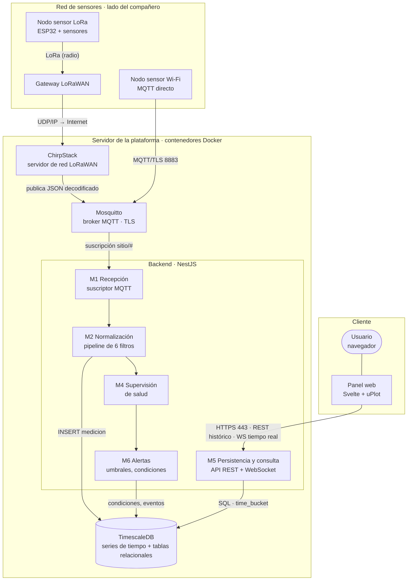
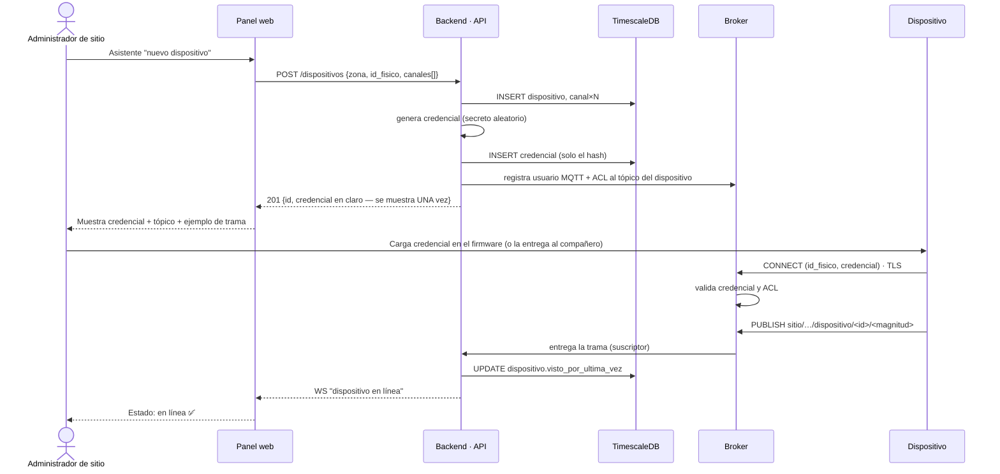
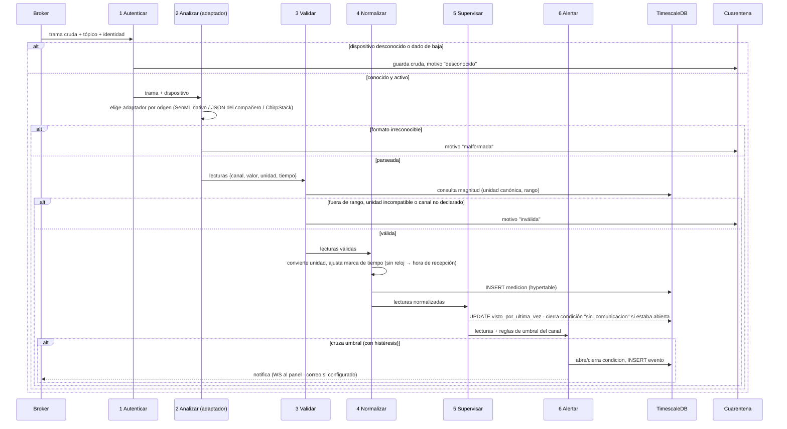
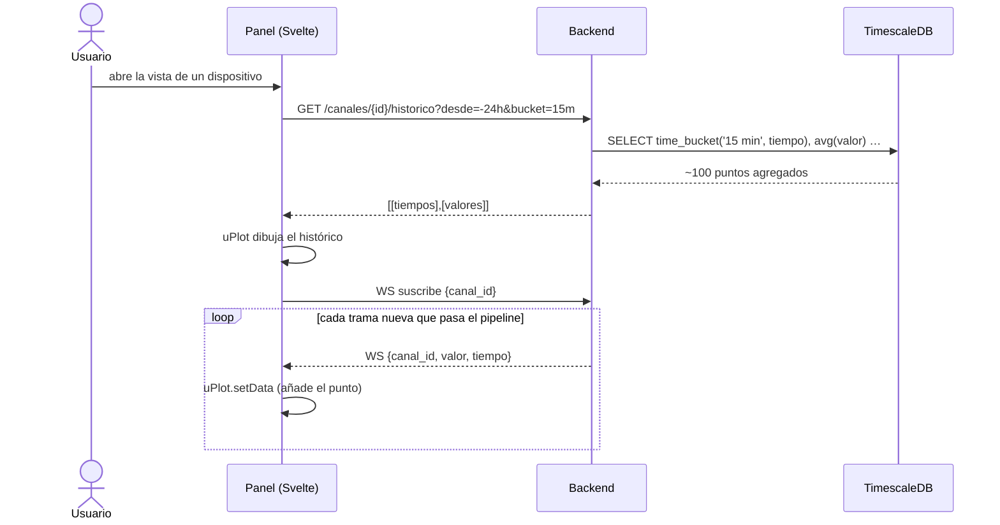
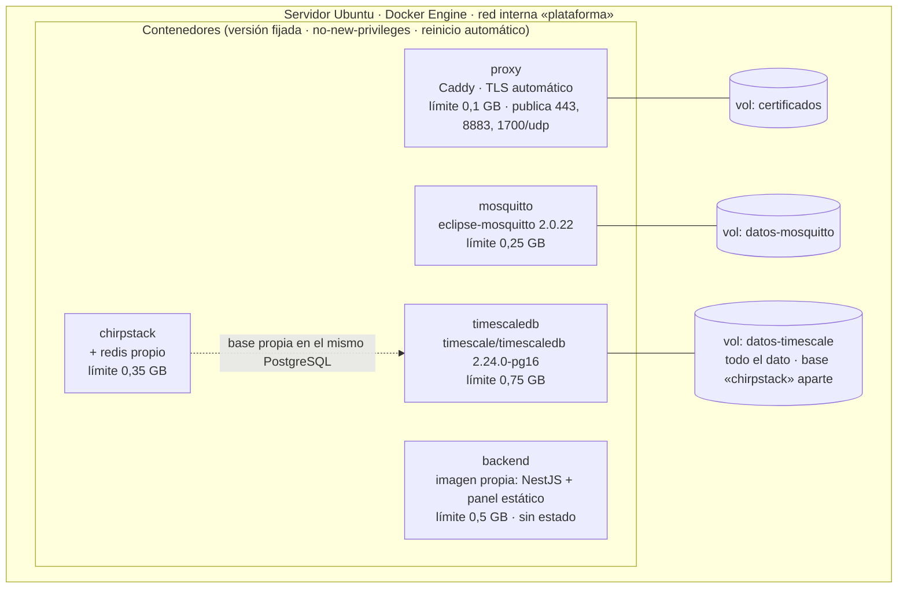

# Arquitectura del sistema (Etapa 2 — Diseño)

> **Sustenta:** OE2 y OE3 · criterio «diseña según estándares de calidad» (55 %) de la Etapa 2.
> **Notación:** vista de contenedores del modelo C4 (Brown) para la estructura; diagramas de
> secuencia UML para el comportamiento; vista de despliegue para la infraestructura. Todos son
> Mermaid: se ven en GitHub y `informe-oficial/figuras/generar-figuras.sh` los renderiza a PDF para el informe
> desde esta misma fuente (el modelo de datos se genera desde la base real). Versión: 8 de septiembre de 2026.
> **Depende de:** `docs/06` (pipeline), `docs/07` (stack y patrón B), `docs/08` (modelo de datos).

---

## 1. Vista de contenedores (C4, nivel 2)

Qué piezas ejecutables existen y cómo se hablan. La **frontera** del trabajo es el tópico MQTT: a la
izquierda está la red de sensores (lado del compañero); a la derecha, la plataforma. Los módulos M1–M8
son los del análisis de requerimientos (`docs/02` §3); M3 (aprovisionamiento), M7 (seguridad e
identidad) y M8 (interfaz) no aparecen como cajas porque son transversales o viven en el cliente.

**Decisiones visibles en el diagrama:**

- **Un solo punto de entrada para personas (443)** y **un solo punto de entrada para máquinas (8883)**.
  La base de datos y ChirpStack no se exponen a Internet.
- **El navegador nunca toca el broker** (patrón B, `docs/07`): consume la API del backend, que ya
  filtró y normalizó. Así la trama cruda jamás llega al cliente y las credenciales MQTT no viajan en
  JavaScript.
- **ChirpStack es un productor más** hacia el broker: para la plataforma, una trama LoRaWAN y una
  trama Wi-Fi son indistinguibles después del filtro 2 (adaptador). Eso es lo que resuelve la causa
  C2 (hardware atado a la plataforma).

## 2. Topología de red y segmentación

Vista de red de la solución: qué segmentos existen, qué puertos cruzan cada frontera y qué queda
aislado. Sustenta los RNF de seguridad (TLS obligatorio, mínimo privilegio, conexión saliente de los
dispositivos para no requerir NAT — RNF-10).

| Frontera | Cruza | No cruza | Por qué |
|---|---|---|---|
| Sitio → Internet | Conexiones **salientes** de nodos y gateway | Nada entrante | Los dispositivos inician la conexión: no hay que abrir puertos en el router del cliente (RNF-10) |
| Internet → servidor | 443 (personas), 8883 (dispositivos), 1700/udp (gateway) | 5432, 1883, 8080, 3000 | Solo se expone lo que necesita hablar con el exterior; todo lo demás vive en la red interna de Docker |
| Red interna | Tráfico entre contenedores por nombre de servicio | Acceso desde fuera | La base de datos solo es alcanzable desde el backend |

**Sobre las alternativas descartadas:** exponer el broker por WebSocket al navegador (patrón A)
habría abierto un puerto más y puesto credenciales en el cliente; una VPN habría exigido
configuración en cada sitio (reintroduce la causa C4, falta de personal técnico).

## 3. Secuencia: aprovisionamiento de un dispositivo (dar de alta)

Cómo un dispositivo pasa de desconocido a reconocido. Es el flujo que ataca directamente la causa
C4: debe poder hacerlo una persona sin perfil técnico, desde el panel.

**Puntos de diseño:**

- La credencial **se muestra una sola vez** y en la base solo queda su **hash** (misma política que
  una contraseña). Si se pierde, se **rota** (nueva fila en `credencial`), no se recupera.
- La **ACL del broker** limita a cada dispositivo a publicar solo en su propio tópico: un nodo
  comprometido no puede suplantar a otro.
- El estado "en línea" se deduce del **primer mensaje autenticado**, no de la alta: dar de alta un
  dispositivo que aún no transmite lo deja en "esperando primer contacto".

## 4. Secuencia: recepción de una trama (pipeline de seis filtros)

Comportamiento del núcleo del trabajo. Cada filtro tiene una salida "feliz" (sigue) y una de rechazo
(cuarentena o descarte), y ninguna trama llega a las series de tiempo sin pasar los seis.

**Por qué el orden importa:** autenticar primero evita gastar CPU en tramas de desconocidos
(resistencia a ruido); validar antes de normalizar evita convertir basura; supervisar después de
guardar garantiza que "visto por última vez" refleje una lectura real, no un intento fallido.

**Un supervisor aparte, por tiempo:** el filtro 5 solo corre cuando *llega* una trama. Para detectar
el caso contrario —un dispositivo que **dejó de** transmitir— hay una tarea periódica (cada minuto)
que compara `visto_por_ultima_vez` contra `intervalo_esperado_s` y abre la condición
`sin_comunicacion`. Sin ella, un sensor caído sería invisible.

## 5. Secuencia: panel en tiempo real (patrón B)

El histórico viene **agregado por la base de datos** (`time_bucket`), no crudo: el navegador recibe
cientos de puntos, no millones, sin importar cuánto tiempo lleve el sensor transmitiendo.

## 6. Vista de despliegue (Docker Compose)

| Servicio | Persistencia | Reinicio | Expuesto |
|---|---|---|---|
| proxy | certificados | `unless-stopped` | 443, 8883, 1700/udp |
| mosquitto | retenidos + ACL | `unless-stopped` | no (vía proxy) |
| chirpstack | base `chirpstack` en el mismo PostgreSQL (volumen datos-timescale) + redis | `unless-stopped` | no (vía proxy) |
| timescaledb | **todo el dato** | `unless-stopped` | no |
| backend | ninguna (sin estado) | `unless-stopped` | no (vía proxy) |

**Suma de límites: ~1,95 GB** — coherente con RNF-17 (operar en ≤ 2 GB en reposo; los límites son
techos, no consumo). Los límites de recursos cumplen doble función: proteger al servidor y ser el
**entorno de referencia** del banco de pruebas (`docs/09`). **ChirpStack comparte el servidor PostgreSQL** (una base y un rol propios, aislados de la base de la
plataforma) en lugar de traer un segundo PostgreSQL: ahorra ~100 MB de memoria en reposo, un
respaldo cubre todo, y la extensión TimescaleDB no interfiere (ChirpStack solo necesita `pg_trgm` y
`hstore`, presentes en la imagen). Redis sí es propio: ChirpStack lo exige y es pequeño (~10 MB).
El backend **no guarda estado**: se puede
destruir y recrear sin perder nada, lo que simplifica actualizaciones y pruebas.

## 7. Trazabilidad con los requerimientos

| Elemento de diseño | Requerimientos que materializa |
|---|---|
| Un punto de entrada TLS para máquinas (8883) y otro para personas (443) | RNF-08, RNF-09, RNF-10 |
| Adaptadores por origen (filtro 2) | RF-01, RF-02, RF-04 (recepción multiprotocolo) |
| Cuarentena separada de las series | RF-11, RF-12, RF-13 |
| Supervisor periódico de `sin_comunicacion` | RF-22, RF-24, RF-25 |
| Credencial de un solo vistazo + ACL por dispositivo | RF-40, RF-41, RF-42 |
| Histórico agregado con `time_bucket` + WS del backend | RF-29, RNF-04, RNF-17 |
| Límites de recursos por contenedor | RNF-17, protocolo de validación |

## 8. Pendiente

- [ ] Confirmar con el compañero el tópico exacto y la forma de su JSON para escribir el adaptador
      (filtro 2) — ver bitácora de acuerdos.
- [ ] Decidir el proxy inverso definitivo (Caddy por TLS automático vs. Nginx por familiaridad).
- [ ] Llevar los diagramas a TikZ para el informe de la Etapa 2 con la regla de anchos de `main.tex`.
