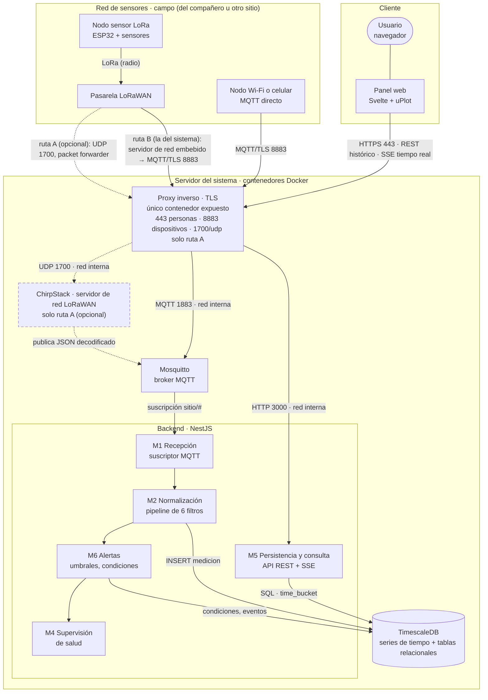
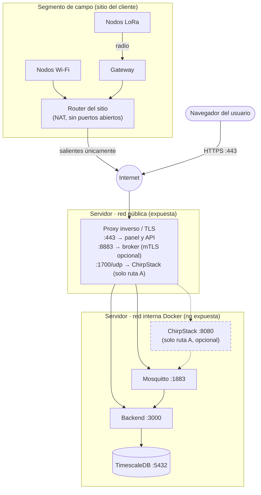
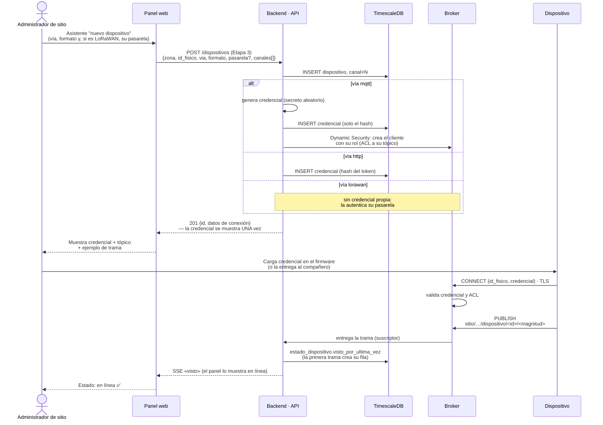
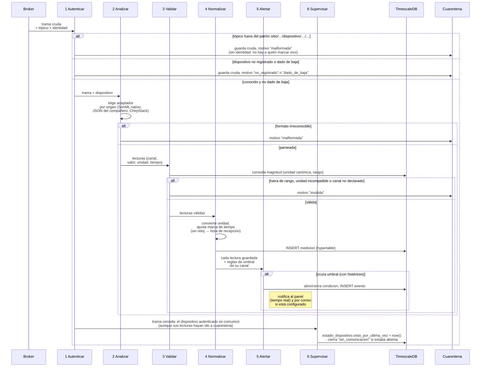
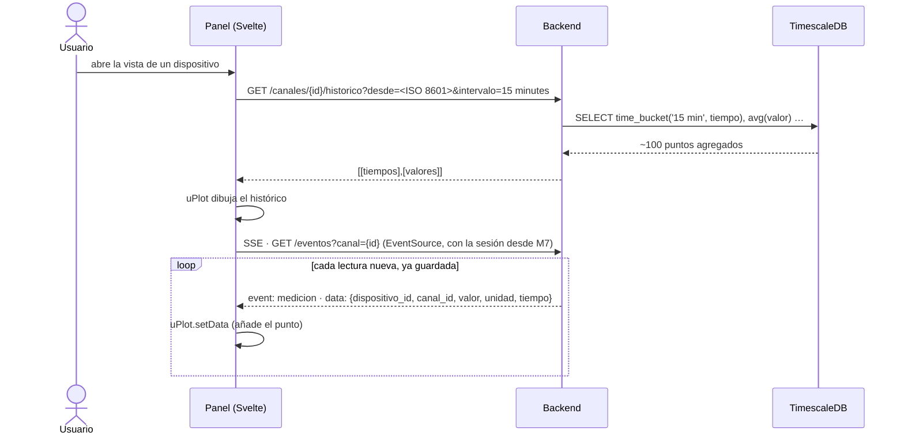
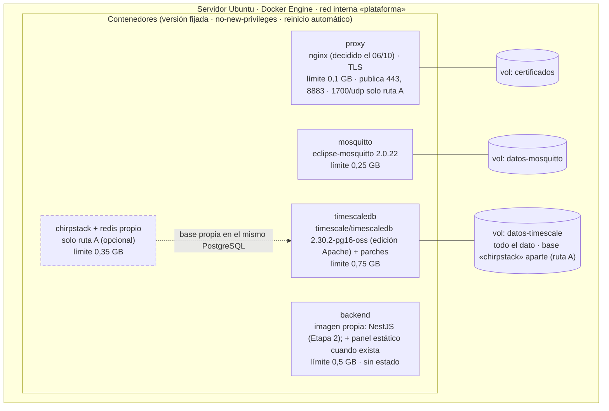

# Arquitectura del sistema (Etapa 2 — Diseño)

> **Sustenta:** OE2 y OE3 · criterio «diseña según estándares de calidad» (55 %) de la Etapa 2.
> **Notación:** vista de contenedores del modelo C4 (Brown) para la estructura; diagramas de
> secuencia UML para el comportamiento; vista de despliegue para la infraestructura. Todos son
> Mermaid: se ven en GitHub y `informe-oficial/figuras/generar-figuras.sh` los renderiza a PDF para el informe
> desde esta misma fuente (el modelo de datos se genera desde la base real). Versión: 8 de septiembre de 2026.
> **Depende de:** `docs/06` (pipeline), `docs/07` (stack y patrón B), `docs/08` (modelo de datos).

---

## 1. Vista de contenedores (C4, nivel 2)

Qué piezas ejecutables existen y cómo se hablan. La **frontera** del trabajo es el tópico MQTT: de un
lado, la red de sensores (lado del compañero: nodos, *gateway* y servidor de red LoRaWAN, que en la ruta
B, la del sistema, va embebido en la pasarela y en la ruta A, opcional, es un ChirpStack que aunque se aloja en
nuestro servidor publica al broker como un productor más); del otro, el broker y el backend. **En las figuras,
lo opcional va con borde y flecha punteados** (desde el 07/10/2026). No se
describe por posición (izquierda/derecha) porque el dibujo lo genera Mermaid y su distribución cambia
al renderizar; el 23/09/2026 la leyenda del informe decía «a la izquierda… a la derecha» y el dibujo
mostraba los sensores arriba. Se dibujan los módulos que tocan el dato (M1, M2, M4, M5, M6); M3
(aprovisionamiento), M7 (seguridad e identidad) y M8 (interfaz) no aparecen como cajas porque son
transversales o viven en el cliente (`docs/02` §3).



**Decisiones visibles en el diagrama:**

- **Un solo contenedor expuesto (el proxy) y dos puertos siempre, tres a lo sumo:** 443 para personas y
  8883 para dispositivos MQTT, ambos cifrados y siempre presentes; 1700/udp **solo en la ruta A, que es
  opcional** (ChirpStack corriendo en este servidor y pasarelas con *Semtech UDP Packet Forwarder*). En la ruta
  B, la del sistema (pasarela con servidor de red embebido, §8.4 puntos 2 y 24), o si la red usa un servidor de red
  externo, el tercer puerto no existe. Los tres los publica el proxy; ningún otro contenedor lleva `ports`. Hoy 1700/udp **no
  aplica**: ChirpStack no está desplegado (§8.3). La base de datos y la interfaz de administración de
  ChirpStack nunca se exponen; su puerto de recepción de pasarelas, cuando exista, sí, porque las pasarelas
  están en el campo, sin VPN, y deben poder alcanzarlo (RNF-10 al revés: aquí es el servidor el que necesita
  un puerto abierto, no el dispositivo).

  **Escenarios de entrada contemplados (06/10/2026):**

  | Escenario | Transporte hasta el servidor | Puerto | Pasa por el proxy | Estado |
  |---|---|---|---|---|
  | 1. Nodo Wi-Fi (ESP32 u otro) con cliente MQTT | MQTT sobre TLS | 8883 | Sí | Implementado (en desarrollo, 1883 local sin TLS) |
  | 2. Equipo que solo habla HTTP | HTTPS, `POST` con SenML | 443 | Sí | Diseñado (HU-01, Etapa 3) |
  | 3. Pasarela LoRaWAN con servidor de red embebido (Milesight UG6x) | MQTT sobre TLS; JSON decodificado en la pasarela | 8883 | Sí | Decidido el 06/10 (ruta B); ruta real por confirmar con el profesor guía |
  | 4. Pasarela LoRaWAN con *packet forwarder* y ChirpStack en este servidor | Semtech UDP → ChirpStack → MQTT interno | 1700/udp | Sí (UDP) | Ruta A, opcional; ChirpStack no desplegado |
  | 5. Servidor de red externo (TTN o ChirpStack de la red del campus) | Integración MQTT o HTTP del servidor de red hacia este sistema | 8883 o 443 | Sí | Por evaluar si la red del campus lo usa |
  | 6. Equipo celular (NB-IoT, LTE-M) con cliente MQTT | MQTT sobre TLS; trama JSON o binaria hexadecimal | 8883 | Sí | Candidato (entrevista del 05/10); adaptador binario pendiente |
  | 7. Pasarela con *Basics Station* hacia ChirpStack en este servidor | WebSocket sobre TLS (protocolo LNS), con autenticación TLS de servidor y, opcional, de cliente | 443 o puerto propio (por verificar) | Sí | Verificado el 06/10: el *Gateway Bridge* expone un manejador WebSocket para Basics Station y las pasarelas UG65/UG67 lo traen; reemplazaría el UDP sin autenticar de la ruta A |

  **¿Y «cualquier dispositivo»?** El sistema no promete entender cualquier aparato; promete dos puertas
  estándar: MQTT 3.1.1 o 5 sobre TLS 1.2 o superior, y HTTP/1.1 sobre TLS. Es lo que implementan los módulos
  IoT corrientes (ESP32, pasarelas LoRaWAN, módems celulares); lo que no lo implementa (un microcontrolador
  sin TLS, un instrumento con salida serie) entra a través de una pasarela que sí lo hace, como ocurre con
  LoRa. Lo que un dispositivo debe cumplir se escribe en una guía de conexión (nombre del servidor, puerto,
  raíz de confianza del certificado, tópico, formato) y **se prueba con la matriz de TT-32**: un emulador con
  TLS (TT-28), una pasarela real y la ruta HTTP. Lo que falle ahí se documenta, no se supone.

  **Ese puerto es una amenaza real, no solo un trámite de firewall.** El protocolo que usan los
  *gateways* para hablarle a ChirpStack (*Semtech UDP Packet Forwarder*) **no tiene autenticación ni
  cifrado**: un *gateway* se identifica con su EUI, un dato público, y cualquiera puede enviar UDP a ese
  puerto suplantándolo (Semtech/ChirpStack, documentación del *Gateway Bridge*). La defensa no puede ser
  el protocolo; tiene que ser la capa de alrededor: el contenedor de ChirpStack sin privilegios
  (`no-new-privileges`, usuario no root, igual que el resto), limitar la tasa de paquetes en el proxy, y
  no confiar en el EUI recibido para nada que no sea enrutar — la autenticación real de cada nodo sigue
  ocurriendo más adentro, en el filtro 1 del pipeline, contra el registro de dispositivos.
- **El navegador nunca toca el broker** (patrón B, `docs/07`): consume la API del backend, que ya
  filtró y normalizó. Así la trama cruda jamás llega al cliente y las credenciales MQTT no viajan en
  JavaScript.
- **La pasarela (ruta B) o ChirpStack (ruta A, si se activa) es un productor más** hacia el broker: para la
  plataforma, una trama LoRaWAN y una trama Wi-Fi son indistinguibles después del filtro 2 (adaptador). Eso es lo que resuelve la causa
  C2 (hardware atado a la plataforma).

## 2. Topología de red y segmentación

Vista de red de la solución: qué segmentos existen, qué puertos cruzan cada frontera y qué queda
aislado. Sustenta los RNF de seguridad (TLS obligatorio, mínimo privilegio, conexión saliente de los
dispositivos para no requerir NAT — RNF-10).



| Frontera | Cruza | No cruza | Por qué |
|---|---|---|---|
| Sitio → Internet | Conexiones **salientes** de nodos y gateway | Nada entrante | Los dispositivos inician la conexión: no hay que abrir puertos en el router del cliente (RNF-10) |
| Internet → servidor | 443 (personas) y 8883 (dispositivos y pasarelas de la ruta B), siempre; 1700/udp (gateway) solo en la ruta A | 5432, 1883, 8080, 3000 | Solo se expone lo que necesita hablar con el exterior; todo lo demás vive en la red interna de Docker |
| Red interna | Tráfico entre contenedores por nombre de servicio | Acceso desde fuera | La base de datos solo es alcanzable desde el backend |

**Sobre las alternativas descartadas:** exponer el broker por WebSocket al navegador (patrón A)
habría abierto un puerto más y puesto credenciales en el cliente; una VPN habría exigido
configuración en cada sitio (reintroduce la causa C4, falta de personal técnico).

## 3. Secuencia: aprovisionamiento de un dispositivo (dar de alta)

Cómo un dispositivo pasa de desconocido a reconocido. Es el flujo que ataca directamente la causa
C4: debe poder hacerlo una persona sin perfil técnico, desde el panel.



**Puntos de diseño:**

- La credencial **se muestra una sola vez** y en la base solo queda su **hash** (misma política que
  una contraseña). Si se pierde, se **rota** (nueva fila en `credencial`), no se recupera.
- La **ACL del broker** limita a cada dispositivo a publicar solo en su propio tópico: un nodo
  comprometido no puede suplantar a otro.
- **La vía se declara en el alta** (§8.4 punto 25): el pipeline usa el formato declarado en vez de adivinarlo, y un
  dispositivo LoRaWAN no tiene credencial propia: lo autentica su pasarela, que solo publica por los dispositivos
  asociados a ella. El camino dibujado después del alta es el de la vía `mqtt`; el aviso al panel va por SSE (§8.4
  punto 1).
- El estado "en línea" se deduce del **primer mensaje autenticado**, no de la alta: dar de alta un
  dispositivo que aún no transmite lo deja en "esperando primer contacto".

## 4. Secuencia: recepción de una trama (pipeline de seis filtros)

Comportamiento del núcleo del trabajo. Cada filtro tiene una salida "feliz" (sigue) y una de rechazo
(cuarentena o descarte), y ninguna lectura llega a las series de tiempo sin pasar los cuatro primeros
(el 4 la guarda; el 5 y el 6 abren o cierran condiciones).



**Por qué el orden importa:** autenticar primero evita gastar CPU en tramas de desconocidos
(resistencia a ruido); validar antes de normalizar evita convertir basura.

**Dos granularidades distintas, y por eso «vivo» significa lo que significa.** Los filtros 1 a 4
trabajan sobre la trama y sobre cada lectura que contiene; el de alertas evalúa **cada lectura
guardada**, porque un umbral se cruza por valor, no por trama. El de supervisión, en cambio, se
ejecuta **una sola vez al cerrar la trama**, porque lo que marca no es un dato sino un hecho del
enlace: *este dispositivo se comunicó*. De ahí que `estado_dispositivo.visto_por_ultima_vez` se actualice aunque las
lecturas de esa trama hayan terminado en cuarentena.

La razón es que M4 supervisa la **salud del enlace**, no la calidad del dato. Un nodo que publica
cada cinco minutos una trama malformada está vivo: su radio, su credencial y su conexión funcionan;
lo que falla es su firmware o su configuración. Si lo marcáramos «sin comunicación» estaríamos
levantando una alarma de red por un problema de formato, y el operador buscaría el fallo donde no
está. Los dos problemas se registran por separado: el silencio, como condición `sin_comunicacion`;
el formato inválido, en `cuarentena` con su motivo (ver la propuesta de §8 para convertirlo también
en condición, en lugar de acumular filas).

**Un supervisor aparte, por tiempo:** el filtro 6 solo corre cuando *llega* una trama. Para detectar
el caso contrario —un dispositivo que **dejó de** transmitir— hay una tarea periódica (cada minuto)
que compara `visto_por_ultima_vez` contra `intervalo_esperado_s` (el silencio máximo normal declarado, §8.4 punto 23) y abre la condición
`sin_comunicacion`. Sin ella, un sensor caído sería invisible.

### 4.1 Entrega «al menos una vez», caídas y duplicados (RF-06, RF-10)

**Por qué QoS 1 y no QoS 2.** MQTT ofrece tres niveles: 0 «a lo más una vez» (puede perderse), 1 «al
menos una vez» (llega, pero puede duplicarse) y 2 «exactamente una vez», con un apretón de cuatro
paquetes (PUBLISH, PUBREC, PUBREL, PUBCOMP). La garantía de QoS 2 es **por salto, entre un cliente y el
broker**, no de extremo a extremo: nada en el protocolo sabe si el backend, después de confirmar al
broker, alcanzó a escribir en la base antes de caerse. Por eso el destino tiene que ser idempotente de
todos modos (índice único `canal + instante` y `ON CONFLICT DO NOTHING`), y una vez que lo es, QoS 1 da
el mismo efecto —cada lectura cuenta una sola vez— con la mitad de paquetes por mensaje y sin exigir
QoS 2 a nodos de pocos recursos. «Exactamente una vez» se logra aquí por diseño del receptor, no por el
transporte. Fuente: OASIS, *MQTT Version 5.0*, §4.3 (`mqttoasis` en la bibliografía).

| Situación | Qué pasa | Por qué basta |
|---|---|---|
| El **backend** cae | El broker conserva en cola los mensajes QoS 1 de `sitio/#` (sesión persistente: `clientId` fijo + `clean: false`, `persistence true` en Mosquitto) y los entrega al reconectar | Nada se pierde mientras el broker viva **y la cola no pase de 1000 mensajes**: es el valor por defecto de `max_queued_messages` en Mosquitto, y los siguientes se descartan en silencio (manual de `mosquitto.conf`). Con el sensor de la demo, cada 5 s, son unos 83 min de backend caído; con 20 sensores cada 60 s, unos 50 min. Fijar el límite según el volumen del sitio queda pendiente (§8); `restart: unless-stopped` levanta el backend en segundos |
| El **broker** cae | Docker lo reinicia; el backend reintenta cada 2 s. Los nodos Wi-Fi con QoS 1 reintentan la publicación; ChirpStack reintenta según su integración | El broker es la pieza más simple y estable de la pila; su caída es corta |
| La **base** cae | El INSERT falla; el manejador reintenta el mismo mensaje (1, 2, 4 y 8 s) y, si sigue fallando, **no confirma** al broker y reconecta: con sesión persistente el broker lo reenvía al volver y el índice único absorbe la repetición. Mientras tanto, los demás mensajes esperan en la cola del broker (`max_queued_messages`). Nada se pierde en silencio: cada reintento queda en el registro (decisión 4, 07/10/2026) |
| La misma trama llega **dos veces** (reentrega QoS 1 tras reconexión; nodo que reenvía su cola) | El INSERT es idempotente: índice único `(canal_id, tiempo)` + `ON CONFLICT DO NOTHING`; la repetida se ignora y **no** vuelve a evaluar umbrales | «Al menos una vez» + operación idempotente = efecto de exactamente una |

**Probado el 08/10/2026 (`docs/16 §11`, con carga):** backend detenido 20 s y base congelada 15 s, cero lecturas perdidas;
broker reiniciado sin persistencia (banco), 84 perdidas. Falta probar el proxy, el servidor completo y el broker con persistencia.

**La cola del broker, con números** (verificado el 06/10/2026 en el manual `mosquitto.conf(5)` de la 2.0.22 y en
`plataforma/mosquitto/config/mosquitto.conf`). Mientras el backend está caído, Mosquitto guarda **por cliente**
hasta `max_queued_messages` = **1000** mensajes QoS 1 (más `max_inflight_messages` = 20 en vuelo); `max_queued_bytes`
= 0 (sin tope por tamaño). El archivo de configuración del proyecto **no fija ninguno de los dos**, así que rigen
esos valores. Al superarse el límite, los mensajes nuevos **se descartan sin aviso al emisor** (el manual lo dice
en la entrada de `max_queued_bytes`: «messages will be silently dropped»; la de `max_queued_messages` no describe
el caso) y el único rastro es el contador `$SYS/broker/publish/messages/dropped`. Con una trama cada 5 s por
dispositivo y 10 dispositivos, 1000 mensajes son **~8 min** de backend caído; con la demo (un dispositivo), ~83 min.
La persistencia a disco (`persistence true`) se escribe al cerrar y cada `autosave_interval` = **1800 s**: si el
contenedor del broker muere de golpe, se pierde lo encolado desde el último guardado. Consecuencias de diseño,
pendientes en §8.3 y en `docs/11 §4`: fijar ambos topes de forma explícita y justificada por sitio; alertar con el
contador `$SYS` antes de llenar la cola; bajar `autosave_interval` o aceptar la ventana y documentarla; y, en el
otro extremo, el tope de tamaño por mensaje (`message_size_limit`).
**Medido el 08/10/2026 (`docs/16 §10`):** a 815 tramas/s el broker descartó 10 169 mensajes, y un ataque de solo peticiones
HTTPS a `/salud` hizo descartar unos 2 800 de un tráfico que sin él se guardaba entero. La pérdida silenciosa ya no es teórica.
| La trama **no trae marca de tiempo** y llega dos veces | Se guarda dos veces: sin marca del emisor no hay forma de saber que es la misma lectura. La hora de recepción se toma en la base con `clock_timestamp()` (microsegundos), así una ráfaga de tramas en cola no colisiona entre sí | Deduplicar exige una identidad; la identidad de una lectura es «canal + instante del emisor». Limitación aceptada: los nodos que quieran «exactamente una» deben marcar `t` (SenML) |
| Dos gateways LoRaWAN reciben el **mismo uplink** | Ruta A: lo deduplica ChirpStack por contador de trama antes de publicar. Ruta B: cada pasarela es su propio servidor de red; qué ocurre si dos oyen al mismo nodo **está por verificar** en la documentación del fabricante (07/10/2026) | Es responsabilidad del servidor de red, no de la plataforma |
| El **tópico no cumple el patrón** `sitio/<sitio>/dispositivo/<id>/<magnitud>` | Cuarentena `malformada` con el detalle «tópico fuera del patrón», **antes** del filtro 1; el dispositivo **no** se marca vivo | Sin identidad no hay a quién atribuir la señal de vida; comparte el motivo `malformada` con el filtro 2 y se distingue por el detalle (decisión 23/09: no abrir un cuarto motivo por esto) |
| El tópico trae un **sitio distinto del registrado** para ese dispositivo | Cuarentena `no_registrado` con el detalle «registrado en el sitio X, no en Y»; el dispositivo **no** se marca vivo: no pasó el filtro 1 | La ACL acepta cualquier sitio en ese nivel (`+`): sin esta comparación, un dispositivo podría publicar bajo el sitio de otra sede (punto 24, migración 11) |
| **Dos lecturas del mismo canal en la misma trama**, sin marca de tiempo | Se guardan ambas, con instantes de recepción distintos (microsegundos) | Sin marca del emisor no hay identidad de lectura (fila anterior); si un nodo repite un canal por error, corregirlo es del firmware, no de la plataforma. Limitación aceptada el 23/09 |
| El broker **reentrega muchas veces** de golpe (reconexión con cola larga) | Desde la decisión 4 los mensajes se procesan **de a uno**, en orden; la cola queda en el broker, no en el backend, y el pool de 5 conexiones no se disputa. El costo es la latencia por mensaje (2–5 ms medidos en el portátil), que acota la tasa máxima a cientos por segundo: por encima de RNF-01 |
| Una trama trae **miles de lecturas** | Hoy no hay tope: se procesan todas, en serie | Pendiente (`docs/11 §4`): tope de lecturas por trama en el adaptador y `message_size_limit` en el broker; un sensor no manda miles de lecturas, un atacante sí |
| Dos **sensores distintos** miden lo mismo cerca | **No es duplicado**: son dos canales, dos series, dos evaluaciones de umbral. Correlacionarlos es una función de análisis futura, no del pipeline | La plataforma registra lo que cada sensor dijo; interpretar es otra capa |

El orden del tiempo no importa para la serie: `medicion` se indexa por `(canal_id, tiempo)`, y una lectura
que llega tarde (nodo sin cobertura que reenvía su cola) se inserta en su instante real (regla 7 de `docs/13`).

**Hallazgo al contenedorizar (23/09/2026): el barrido periódico SÍ podía tumbar el proceso.** El
pipeline normal está protegido (`BrokerService` atrapa el rechazo de cada mensaje), pero el
temporizador del supervisor (M4) no tenía quien atrapara el suyo: una consulta fallida durante el
barrido era un rechazo sin manejar y **terminaba todo el proceso**, no solo ese ciclo. Probado
plantando la caída de la base con la pila en contenedores: sin el arreglo, el backend entraba en un
ciclo de reinicios (`docker inspect` mostraba `restarts` subiendo); con `barridoSeguro()`
(`try/catch` alrededor de `barrer()`, con registro de error) el proceso sigue vivo, `GET /salud`
informa el problema con honestidad (código 500, no oculta nada) y el siguiente barrido, un minuto
después, se ejecuta normal en cuanto la base vuelve. Cero reinicios en la prueba repetida.

**Cuánto tarda en detectar un silencio (27/09/2026, medido en el ensayo de la demostración).** El
barrido abre `sin_comunicacion` cuando el silencio de un dispositivo supera **2 × su intervalo
esperado**, y corre cada `SUPERVISION_INTERVALO_S` segundos (60 por defecto). La detección tarda, por
lo tanto, entre 2 intervalos y 2 intervalos **más un período de barrido**. Con los intervalos reales
del caso (5 a 30 minutos) el exceso es de un minuto, menos de 0,2 intervalos. Con el sensor de la
demostración, que reporta cada 5 s, un barrido de 60 s tardó entre 25 y 68 s (hasta 14 intervalos):
por eso el override de desarrollo fija `SUPERVISION_INTERVALO_S=5`. El costo no depende de cuántas
mediciones haya: cada barrido es **una** consulta sobre la tabla `dispositivo` (decenas a miles de
filas), no sobre `medicion`; mil dispositivos son una consulta por período, no mil.
**Decisión pendiente:** RNF-03 dice «≤ 2 intervalos» sin tolerancia, y en rigor el diseño siempre la
excede por hasta un período de barrido. Dos salidas: declarar la tolerancia en el requerimiento
(«≤ 2 intervalos + período de barrido») o adelantar el umbral en un período. Se decide antes de la
prueba formal de la Etapa 4, no en el código de hoy.

**Límite conocido de `/salud` (mismo hallazgo).** El endpoint solo verifica la base; con el broker
caído responde `200 ok` igual, porque `BrokerService` reconecta solo y no lo consulta. No es un error:
hoy nada depende de que `/salud` refleje el broker, y `BrokerService` ya registra sus propios avisos
de conexión. Si más adelante el healthcheck del contenedor necesita reflejar también el broker, es un
cambio de diseño (qué significa «sano»), no una corrección: se decide en `docs/10` primero.

### 4.2 Camino de una consulta: de la petición HTTP a la base y de vuelta

El backend habla con **dos lados**, y cada lado usa su propia pieza:

```
cliente ──HTTP──► Express ⊂ NestJS ──► servicio ──► pg ──protocolo PostgreSQL──► TimescaleDB
(navegador, curl)  (API REST)        (consulta.service)  (SQL, puerto 5432)
```

- **Express** es la biblioteca de servidor HTTP más usada de Node.js; NestJS la usa por debajo
  (`@nestjs/platform-express`). El proceso de Node es el servidor; Express recibe cada petición y
  entrega la respuesta. Es **la API**: 6 rutas REST y el canal SSE `/eventos` (§5), descritos en el contrato OpenAPI. Express no toca la base.
- **`pg`** (node-postgres) es el conductor de la base: mantiene un *pool* de 5 conexiones
  (`db/db.module.ts`) y envía **SQL directo** con parámetros `$1, $2…`; el valor nunca se pega dentro
  del texto SQL, lo que evita la inyección. Sin ORM, por la razón de `docs/07` (series de tiempo con
  `time_bucket`).
- **El camino de `GET /dispositivos`:** Express recibe la petición → `DispositivosController` (el
  controlador, `consulta/dispositivos.controller.ts`, método `listar()`) la delega; en las rutas con
  parámetros (`/dispositivos/{id}`) antes los valida (`consulta/validacion.ts`) → `ConsultaService.dispositivos()`
  ejecuta el `SELECT` con `pg` → la base responde filas → Nest las convierte a JSON → Express responde.
- **CORS no se activa, a propósito.** Es una regla del navegador para páginas de *otro* origen; el panel
  lo servirá el mismo backend (mismo origen, `docs/11 §4`), y sin CORS el navegador bloquea por defecto
  a cualquier otro sitio. Ni los sensores, ni `curl`, ni la base están sujetos a CORS.
- **Demo y producción usan el mismo código y el mismo SQL;** solo cambia a dónde llama `pg` (`DB_HOST`):

| Entorno | Backend | Llega a la base por | Puerto 5432 |
|---|---|---|---|
| Demo (`pila.sh encender`) | contenedor | nombre `timescaledb` en la red interna | solo hacia `127.0.0.1` (override de desarrollo) |
| Desarrollo con recarga (`pnpm start`) | fuera de Docker | `127.0.0.1:5432` | ídem |
| Producción | contenedor | nombre `timescaledb` en la red interna | cerrado: el override no se copia al servidor |

## 5. Secuencia: panel en tiempo real (patrón B)



El histórico viene **agregado por la base de datos** (`time_bucket`), no crudo: el navegador recibe
cientos de puntos, no millones, sin importar cuánto tiempo lleve el sensor transmitiendo.

**El canal de tiempo real es del backend** (decidido el 23/09/2026; TT-39). **Diseño objetivo, con la sesión
(M7):** corre dentro del mismo 443 detrás del proxy (HTTPS, nunca HTTP), se abre con la misma sesión del panel y
se rechaza antes del primer evento si falta; el backend valida el origen de la petición y limita los flujos por
usuario y su tasa. Son las recomendaciones de OWASP para WebSocket,
que no trae autenticación propia (`docs/11 §4`). Como el canal es casi unidireccional —el servidor
empuja, el navegador solo elige qué canal mira—, la alternativa **SSE** (*Server-Sent Events*: HTTP
unidireccional, reconexión nativa, sin biblioteca extra) es más simple y cabe en el mismo 443.
**Decidido el 06/10/2026: SSE** (§8.4, punto 1); los diagramas lo muestran así desde esa fecha. Lo que OWASP
pide para WebSocket se traslada a SSE en lo que aplica: misma sesión (la cookie viaja sola en `EventSource`),
autorización por canal antes de abrir el flujo y límite de flujos por usuario; ninguna de las dos toca el broker.
**En la Etapa 3 el canal corre sin sesión, como la API:** solo en la red local (127.0.0.1); la sesión se le agrega con M7
(HU-18, Etapa 4, desde el corte del 08/10). Ninguno de los dos se publica en Internet antes de eso (`docs/11 §8`).
**Implementado el 09/10 (TT-39):** `GET /eventos`, con filtro opcional `?dispositivo=` o `?canal=` (un UUID; otro valor,
400). Emite `medicion`, `visto` y `condicion`, cada uno después de quedar guardado en la base, y un `latido` cada 25 s. Se
rechaza (403) la petición que el navegador marca como de otro sitio: `Sec-Fetch-Site` distinto de `same-origin` o `none`,
o un `Origin` de otro host o puerto. El panel lo sirve el propio backend y, en desarrollo, Vite le reenvía las peticiones,
así que no hace falta una lista de orígenes; el proxy reenvía el `Host` con su puerto. Eso no detiene el *DNS rebinding*,
que para el navegador es el mismo origen (`docs/11 §4`). Con 50 flujos abiertos responde 503; el límite por usuario llega
con la sesión. Pruebas: `docs/16 §14`.

> Fuentes (consultadas el 23/09/2026): OWASP, *WebSocket Security Cheat Sheet*,
> https://cheatsheetseries.owasp.org/cheatsheets/WebSocket_Security_Cheat_Sheet.html · NestJS, *Gateways*
> (los guards de HTTP aplican igual a los gateways), https://docs.nestjs.com/websockets/gateways · NestJS,
> *Authentication*, https://docs.nestjs.com/security/authentication

## 6. Vista de despliegue (Docker Compose)



| Servicio | Persistencia | Reinicio | Expuesto |
|---|---|---|---|
| proxy (nginx) | certificados | `unless-stopped` | 443, 8883; 1700/udp solo ruta A |
| mosquitto | retenidos + ACL | `unless-stopped` | no (vía proxy) |
| chirpstack (solo ruta A, opcional) | base `chirpstack` en el mismo PostgreSQL (volumen datos-timescale) + redis | `unless-stopped` | no (vía proxy) |
| timescaledb (edición Apache, `-oss`) | **todo el dato** | `unless-stopped` | no |
| backend | ninguna (sin estado) | `unless-stopped` | no (vía proxy) |

**Suma de límites: ~1,6 GB en la ruta B (proxy, broker, backend y base) y ~1,95 GB si se activa la ruta A
(más ChirpStack con su Redis)** — ambas coherentes con RNF-17 (consumo ≤ 2 GB de RAM en reposo y bajo carga; los límites son
techos, no consumo). Los límites de recursos cumplen doble función: proteger al servidor y ser el
**entorno de referencia** del banco de pruebas (`docs/09`). **ChirpStack, si se activa, comparte el servidor PostgreSQL** (una base y un rol propios, aislados de la base de la
plataforma) en lugar de traer un segundo PostgreSQL: ahorra ~100 MB de memoria en reposo, un
respaldo cubre todo, y la extensión TimescaleDB no interfiere (ChirpStack solo necesita `pg_trgm` y
`hstore`, presentes en la imagen). Redis sí es propio: ChirpStack lo exige y es pequeño (~10 MB).
El backend **no guarda estado**: se puede
destruir y recrear sin perder nada, lo que simplifica actualizaciones y pruebas.

**Imagen del backend (23/09/2026; base y limpieza actualizadas el 08/10, `docs/16 §12`).** *Multi-stage*: una etapa `build` con Node 22 y las herramientas de desarrollo compila
TypeScript a JavaScript (`pnpm build`); la imagen final parte de la variante *slim* de Node 22, copia
solo `dist/` y las dependencias de producción (`pnpm install --prod --frozen-lockfile`), y no lleva
compilador, `devDependencies` ni el código fuente. Así la imagen que corre es más chica y no puede
usarse para reconstruir nada por dentro. Corre como usuario **sin privilegios** (`USER node`, ya en la
imagen oficial), con `security_opt: no-new-privileges` en el compose. El `HEALTHCHECK` llama a
`GET /salud` (ya implementado, `src/salud`): confirma que el proceso responde y que su conexión a la
base está viva, no solo que el proceso existe. El **panel Svelte no existe aún en el código** (Etapa
3): la imagen de hoy sirve solo la API; cuando el panel exista, una etapa adicional lo compila y el
backend estático lo sirve, sin cambiar esta estructura.

**Dónde escucha el backend** (decidido el 23/09/2026; el código sigue a este texto). Fuera de Docker,
en desarrollo, escucha solo en `127.0.0.1` (variable `HTTP_INTERFAZ`, valor por defecto). Dentro del
contenedor escucha en todas las interfaces **del contenedor** (`HTTP_INTERFAZ=0.0.0.0`), que es la
única forma de que el proxy lo alcance por la red interna. Eso no lo expone: el servicio no lleva
`ports`, y Docker solo hace alcanzables los puertos de un contenedor desde el anfitrión y desde los
contenedores de su misma red; desde fuera del servidor esa dirección no existe. La conexión a la base
y al broker usa el nombre del servicio (`DB_HOST=timescaledb`, `MQTT_URL=mqtt://mosquitto:1883`,
`.env.example`). **La documentación interactiva `/docs` se sirve solo con `HTTP_DOCS=si`** (en
desarrollo la fija el override de Compose y el `.env`); ausente o vacía, queda apagada: en Internet
enumeraría las rutas y exige scripts en línea que la política de contenido del backend prohíbe. El
contrato que se cita es el `openapi.json` versionado (`docs/11 §3`).

**Chequeos de salud (27/09/2026, se documenta lo que ya existía).** Cada servicio declara cómo se sabe
que está vivo de verdad, no solo que su proceso existe, y Docker lo pregunta periódicamente: así
`docker compose ps` muestra `healthy` y el backend **no arranca hasta que la base y el broker lo estén**
(`depends_on: condition: service_healthy`). La base: `pg_isready` cada 10 s. El broker: el usuario
interno `sonda` se suscribe cada 15 s a `$SYS/#` (las estadísticas del propio broker) y se desconecta;
si el broker no responde en 3 s, cuenta como caído. `sonda` tiene el mínimo privilegio posible: solo
lee `$SYS/#`, no puede publicar ni leer ningún tópico de datos (`acl`, `docs/11 §7`). El backend: su
imagen llama a `GET /salud`, que confirma también la conexión con la base. Esas conexiones de `sonda`
son las que aparecen cada 15 s en el registro del broker; `pila.sh logs` las oculta de la vista.

**Apagado ordenado (27/09/2026, hallazgo del ensayo).** Al recibir `SIGTERM` (lo que envía `docker compose
stop` o un redespliegue) el backend cierra en orden: detiene el supervisor, se desconecta del broker
—conservando su sesión persistente y su cola— y cierra el pool de la base. Hasta el 27/09 no lo hacía:
Nest no escucha señales salvo que se active (`enableShutdownHooks()` en `main.ts`), el contenedor
ignoraba la señal, Docker esperaba 10 s y lo mataba (código 137), y los cierres de cada módulo nunca
corrían aunque el código los declaraba. Medido: parada en 10,0 s con código 137 antes; en 0,3 s con
código 0 después, y el broker registra la despedida del cliente. **Desde el 09/10 (TT-39)** además corta las
conexiones del canal en vivo: un flujo SSE no termina solo y el cierre esperaba a que el navegador se fuera. Corta
solo esas: una petición normal en curso termina y responde, porque el servidor la espera (`docs/16 §14`).

**Registros (27/09/2026).** El backend escribe **un evento por línea en JSON** cuando corre en
contenedor (`LOG_FORMATO=json`, fijado en el archivo base de Compose): cada línea trae nivel,
contexto (`recepcion`, `broker`, `supervision`…), mensaje e instante, sin códigos de color, de modo
que se filtra con `jq` o `grep` sin adivinar formatos y cualquier recolector futuro la entiende sin
configurarlo. Fuera de Docker, en desarrollo, el valor por defecto es texto con color, legible en la
terminal. Los registros de la pila se guardan con `plataforma/pruebas/pila.sh logs`, que los sigue en
vivo, los muestra en una línea legible y los copia sin tocar a `privado/logs/` (ignorado por git);
`pila.sh buscar` y `pila.sh resumen` los consultan. **Un solo backend a la vez**, y no solo por el
puerto 3000: dos procesos con el mismo `MQTT_CLIENT_ID` se echan mutuamente del broker (lo hace el
propio protocolo con identificadores duplicados), y si comparten la sesión persistente se reparten los
mensajes en cola.

**Escalado.** Una sola instancia del backend, a propósito. Con `clientId` fijo y sesión persistente el
broker conserva la cola mientras el backend está caído (§4.1); dos instancias con el mismo
identificador se desconectarían mutuamente, y con identificadores distintos recibirían ambas todas las
tramas. Dentro del servidor no hace falta más: Node delega la entrada y salida al núcleo del sistema,
que sí es multihilo, y la carga de RNF-01 (50 eventos/s) se medirá en el banco de pruebas de `docs/09`
sobre esta única instancia. Si algún día hiciera falta repartir carga entre varias, el camino
documentado es: suscripciones compartidas de MQTT 5 (`$share/<grupo>/sitio/#`, admitidas por
Mosquitto) para que las instancias se repartan las tramas, y `cluster` o `worker_threads` de Node para
ocupar más núcleos. No está en el alcance de esta etapa: RNF-14 fija un único servidor y RNF-17 acota el consumo a
2 GB de RAM; el camino completo de crecimiento, con su orden y sus criterios, está en §9.

> Fuentes (consultadas el 23/09/2026): Docker, *Networking overview* («ports are not accessible from
> outside the host» sin `--publish`), https://docs.docker.com/engine/network/ · Node.js, *The Node.js
> Event Loop*, https://nodejs.org/en/learn/asynchronous-work/event-loop-timers-and-nexttick · Node.js,
> *Cluster*, https://nodejs.org/api/cluster.html · Eclipse Mosquitto, *mosquitto.conf(5)*
> (`max_queued_messages`, por defecto 1000 por cliente), https://mosquitto.org/man/mosquitto-conf-5.html

## 7. Trazabilidad con los requerimientos

| Elemento de diseño | Requerimientos que materializa |
|---|---|
| Un solo contenedor expuesto (proxy): 8883 máquinas, 443 personas, 1700/udp pasarelas (solo ruta A) | RNF-08, RNF-09, RNF-10 |
| Adaptadores por origen (filtro 2) | RF-01, RF-02, RF-04 (recepción multiprotocolo) |
| Cuarentena separada de las series | RF-05, RF-07 |
| Supervisor periódico de `sin_comunicacion` | RF-24, RF-25, RF-26 |
| Credencial de un solo vistazo + ACL por dispositivo | RF-40, RF-41, RF-42 |
| Histórico agregado con `time_bucket` + SSE del backend | RF-33, RNF-04 |
| Límites de recursos por contenedor | RNF-17, protocolo de validación |

> **Pendiente:** RF-29 (keep-alive y *Last Will* de MQTT) no está trazado porque el cliente MQTT del
> backend aún no publica testamento (`will`); queda como brecha declarada hasta implementarlo (Etapa 3).

## 8. Propuestas abiertas y pendientes

### 8.1 Un dispositivo que comunica pero no entrega datos válidos (propuesta, 23/09/2026)

**El problema.** Hoy un nodo mal configurado que publica cada cinco minutos una trama inválida queda
«vivo» (correcto: su enlace funciona) pero genera una fila de `cuarentena` cada vez: 288 filas al día,
105 000 al año, con el mismo motivo y la misma carga cruda. Ensucia la tabla, encarece el diagnóstico
y hace que lo importante —*este dispositivo lleva días sin entregar un dato usable*— quede enterrado
entre miles de filas idénticas.

**Por qué no es un estado nuevo del dispositivo.** `dispositivo.estado` (`activo`,
`mantenimiento`, `baja`) describe la **decisión administrativa** sobre el equipo, no lo que está
ocurriendo con él. Lo que ocurre se modela como **condición**, igual que `sin_comunicacion` y
`umbral`: tiene apertura, cierre y duración. Meter «manda basura» dentro de `estado` obligaría a
responder qué pasa cuando además está en mantenimiento, o cuando manda basura *y* se calla: dos
hechos ortogonales en un solo campo. La regla del modelo (una sola casa por hecho) dice que van
separados.

**Propuesta, en tres partes:**

1. **Condición nueva `datos_invalidos`**: se abre cuando un dispositivo acumula *N* tramas
   consecutivas rechazadas (propuesta: 3) sin ninguna aceptada en medio; se cierra con la primera
   lectura válida. El panel la muestra junto a las otras condiciones y el operador ve *un* problema,
   no diez mil filas. Es el mismo patrón que ya se usa para el silencio, así que no agrega conceptos.
2. **Cuarentena con muestreo, no con acumulación**: guardar íntegras las primeras *k* tramas
   (propuesta: 5) de cada par (dispositivo, motivo) dentro de una ventana (propuesta: 1 hora) y, a
   partir de ahí, solo incrementar un contador con la primera y última aparición. Se conserva la
   evidencia —que es para lo que existe la cuarentena— sin pagar el volumen. Si la ventana se cierra
   sin tramas nuevas, el ciclo vuelve a empezar.
3. **Retención**: borrado de `cuarentena` a los 30 días con `drop_chunks`, desde la misma tarea programada
   que retiene `trama` y `medicion` (edición Apache: sin políticas automáticas). Una trama basura de hace dos meses no diagnostica nada.

4. **Avisar a quien puede arreglarlo, con lo que necesita para arreglarlo.** Detectar sin notificar
   no sirve: hoy la evidencia queda en una tabla que solo mira quien sabe SQL. La condición
   `datos_invalidos` debe aparecer en el panel como las demás (RF-47, RF-48) y notificar (RF-36,
   RF-37), y el aviso debe ser **accionable**, no un código de error. Tres datos, que la plataforma
   ya tiene:
   - **Qué llegó y qué se esperaba**: el motivo (`malformada`, `invalida`, `no_registrado`, `dado_de_baja`) y su `detalle`, una
     muestra de la trama cruda y la regla que no se cumplió —«se esperaba un número o un pack SenML;
     llegó `{"temp":"alto"}`», «la unidad `furlongs` no es convertible a `Cel`», «el canal
     `presion` no está declarado para este dispositivo»—. Con eso, quien administra el sensor sabe
     qué tocar en su firmware o en su configuración sin pedirle ayuda a nadie.
   - **Cuánto lleva costando**: «este dispositivo lleva 3 días enviando 288 tramas diarias que no se
     guardan». Un contador hace visible un desperdicio que hoy es invisible, y convierte «algún día
     lo reviso» en una tarea con tamaño.
   - **Qué se gana al corregirlo**: la medición vuelve a las series y la condición se cierra sola con
     la primera trama válida.

**Un límite honesto de esta idea.** Recibir y analizar la trama es un costo inevitable: hay que
autenticarla y tratar de interpretarla para saber que es inválida. Lo que la propuesta ahorra es el
**almacenamiento y el ruido** —miles de filas idénticas y un índice que crece— no el cómputo de los
filtros 1 y 2. Si un dispositivo mal configurado llegara a ser un problema de carga y no solo de
ruido, el instrumento correcto es el limitador de tasa por dispositivo ya previsto para la Etapa 3,
y aun así nunca se descarta en silencio: el contador y la condición siguen registrando lo que se
dejó de guardar. Y se asume la posibilidad contraria: que el formato esté bien y el equivocado sea
nuestro adaptador. Por eso la muestra cruda se conserva siempre, aunque el resto se cuente.

**Qué decidir antes de implementar:** los tres números (*N* tramas para abrir, *k* muestras por
ventana, días de retención), el texto exacto del aviso al operador y si notifica por correo o solo
en el panel. Entra en la Etapa 3, después del Dockerfile y del proxy. Al aprobarse: primero este
documento y el diagrama, después el código (regla de concordancia).

### 8.2 Numeración de los filtros 5 y 6 (decidido el 23/09/2026)

Hasta el 23/09 el diagrama numeraba *5 supervisar* y *6 alertar*, pero la ejecución es la inversa: las
alertas se evalúan por cada lectura guardada, dentro del bucle, y la supervisión cierra la trama una
sola vez al final (§4). **Decisión: intercambiar los números —5 alertar, 6 supervisar— para que el
diagrama describa la secuencia real**, manteniendo los seis filtros y los módulos M4 y M6 sin cambio.
Aplicado en este documento y su diagrama, el capítulo de diseño (vía la figura generada), los
comentarios del backend, su README y la evaluación de comunicación (`docs/06`). En la misma revisión se
detectó que el código **no** marcaba vivo al dispositivo cuando la trama caía en cuarentena por formato
(el filtro 2 cortaba el pipeline), en contra de lo que dice §4; se corrigió el código para que siga al
diseño (regla de concordancia): tras autenticar, el filtro 6 corre siempre.

### 8.3 Pendientes

- [ ] Confirmar con el compañero el tópico exacto y la forma de su JSON para escribir el adaptador
      (filtro 2) — ver bitácora de acuerdos.
- [x] Decidir el proxy inverso definitivo: **nginx**, 06/10/2026 (§8.4 punto 10). Candidatos: Caddy, nginx, Traefik, HAProxy y Envoy; se evalúan con
      registro de evidencia (licencia, TLS automático, proxy TCP para 8883 y UDP para 1700, límite de tasa, SSE
      sin búfer, mTLS, memoria, imagen oficial) completado y verificado el 06/10/2026; nada se elige sin ese registro.
      Tres hechos que cambian el planteo anterior: nginx ya trae ACME nativo en su imagen oficial (el argumento «Caddy
      por TLS automático» quedó viejo); Caddy solo hace TCP/UDP con un módulo externo no oficial que exige compilar
      la imagen; HAProxy comunitario no hace proxy UDP (solo su edición de pago). Falta además decidir dónde termina
      TLS para 8883: en el proxy (ve la IP del proxy, sin identidad por certificado) o en Mosquitto (passthrough por
      SNI; hay que copiarle los certificados). La comparación (opciones, criterios, razón) se registra en el anexo C
      del informe, como las demás decisiones de infraestructura.
- [x] Dockerfile del backend y su servicio en el compose — hecho el 23/09 (§6; `bitacora/2026-09-23-dockerfile-backend.md`).
- [x] Decidir WebSocket o SSE para el canal de tiempo real (§5): **SSE**, decidido el 06/10/2026 (§8.4).
- [ ] Proponer una **unidad de visualización por usuario** (Etapa 3): la base guarda siempre la unidad
      canónica y el panel convierte al mostrar; no está diseñado todavía.
- [ ] Fijar `max_queued_messages`, `max_queued_bytes` y `autosave_interval` del broker de forma explícita y
      justificada por sitio (hoy rigen los defectos: 1000 mensajes, sin tope de bytes, guardado cada 1800 s; §4.1)
      y alertar cuando la cola se acerque al límite o `$SYS/broker/publish/messages/dropped` deje de ser cero.
- [ ] Emulador (TT-28) con tráfico irregular: periodo propio por dispositivo, variación de latencia, pérdidas, ráfaga
      con marcas antiguas tras una caída y deriva de reloj (§9.6), para probar picos y no promedios.
- [ ] Decidir con el usuario la pérdida aceptable (RPO) y el tiempo de recuperación (RTO) antes de datos reales, y
      montar el respaldo diario con restauración probada (§9.5).

### 8.4 Decisiones de la Etapa 3 (desde el 06/10/2026)

**Decisiones del 06/10/2026** (tras la entrevista y el acceso a la nube de Milesight). Fuentes: `bitacora/2026-10-05-entrevista-academico-geologia.md`; evidencia verificada en la documentación oficial
del fabricante de la pasarela (137 afirmaciones, en un registro del autor que no se incluye en el repositorio). El código sigue a estas decisiones, no al revés.

1. **Canal de tiempo real: SSE (Server-Sent Events), no WebSocket.** El flujo es unidireccional (servidor →
   navegador), de pocos datos y poco frecuente (el usuario entrevistado mira los datos «un par de veces por
   semana»). SSE va por HTTP sobre la misma sesión y el mismo proxy que la API, reconecta solo por norma
   («Clients will reconnect if the connection is closed», HTML Living Standard §9.2.3) y en NestJS es una ruta
   con `@Sse()` que devuelve un `Observable`. WebSocket queda reservado para cuando el navegador deba enviar
   órdenes a dispositivos (no está en el catálogo). Límite conocido: con HTTP/1.1 el navegador limita las
   conexiones por dominio; con HTTP/2 tras el proxy no aplica. TT-39 se implementa como SSE.
2. **Segunda ruta de entrada LoRaWAN: pasarela con servidor de red embebido → MQTT/TLS 8883 → Mosquitto.**
   Las pasarelas Milesight UG6x traen servidor de red LoRaWAN y publican a un broker propio (host, puerto,
   usuario, clave, TLS con CA propia, tópico configurable). ChirpStack deja de ser obligatorio: queda como ruta
   alternativa si la red del campus usa TTN o un servidor de red externo. La pasarela se autentica en el broker
   como un dispositivo más (usuario = su identificador, ACL por patrón; precisado el 08/10 en el punto 24: con credencial propia de pasarela y solo por sus dispositivos asociados). Las figuras de contenedores y despliegue
   se actualizan cuando el profesor guía confirme la ruta real.
   **Precisión del 07/10/2026.** Si la red del campus usa TTN o un servidor de red externo, eso es el escenario 5 de
   §2 y tampoco hay ChirpStack en este servidor; la ruta A solo hace falta si las pasarelas no traen servidor de red
   propio o si se quiere administrar nodos y claves de varias pasarelas desde un solo punto. Desde esa fecha las
   figuras de contenedores, red y despliegue dibujan la ruta B continua y la ruta A y ChirpStack punteados
   (opcionales), y el informe lo dice en el marco teórico, en la arquitectura y en el despliegue; si el profesor guía
   confirma otra ruta, se vuelven a ajustar.
3. **Adaptador «milesight» sobre JSON decodificado en la pasarela.** La pasarela aplica su «Payload Codec» y
   publica `{"battery":92,"temperature":30.8,"humidity":50.5}` más EUI y nombre si se activa «Metadata». El
   adaptador traduce ese JSON al modelo interno (`temperature`→temperatura/Cel, `humidity`→humedad/%RH,
   `battery`→bateria/%EL). **No se copian los decodificadores oficiales** (`Milesight-IoT/SensorDecoders`,
   GPL-3.0): la decodificación corre en la pasarela. Candidato posterior: adaptador para tramas binarias
   hexadecimales de equipos celulares (UC300, UC50x) que publican MQTT sin pasarela.
4. **Confirmación al broker después de persistir — implementado el 07/10/2026.** Hasta entonces el cliente MQTT
   confirmaba al recibir; si la base caía, el mensaje confirmado se perdía (§4.1). El pipeline corre ahora dentro de
   `handleMessage` de la librería (un mensaje a la vez: la librería no toma el siguiente paquete hasta que se llama su
   callback) y la confirmación (PUBACK) se emite **después del COMMIT**; si el pipeline falla, se reintenta el mismo
   mensaje (1, 2, 4 y 8 s) y, agotados, no se confirma y se reconecta para que el broker lo reenvíe. Medido en el banco
   (`docs/16 §3–4`): misma tasa (59,7 tramas/s), pico 81, p95 1 ms; la prueba de carrera «una sola trama cruda» pasó. Con QoS 1 y sesión persistente,
   un mensaje no confirmado se reentrega al volver; el índice único `(canal, instante)` evita duplicarlo. Esto
   habilita lotes transaccionales si la carga lo exige (se mide con el emulador, TT-28).
5. **Trama cruda aceptada, con retención corta.** Además de la cuarentena, se guarda la trama original de
   cada mensaje aceptado (tabla `trama`, `docs/08 §8`) con retención configurable (variable de entorno,
   30 días por defecto) para auditoría y re-decodificación si un adaptador tuvo un error.
6. **Vista pública de solo lectura por enlace, no un tercer rol.** Lo que pide el entrevistado (dashboard
   simplificado para estudiantes, sin datos crudos) se resuelve con un dashboard publicable: enlace con
   token, solo lectura, magnitudes y agregación que elige el administrador. Es el patrón de los referentes
   (por verificar en el registro de patrones) y evita crear cuentas para cada estudiante.
7. **Unidades propias en el catálogo.** SenML no registra `Bq/m3`; RFC 8428 §4.5.2 deja la interpretación al
   «application context». El catálogo `magnitud` es ese contexto: una fila por magnitud con su unidad canónica,
   aunque no esté en el registro IANA. Nuevas magnitudes del caso de uso: radón (`Bq/m3`), hidrógeno (`ppm`),
   temperatura y humedad del suelo. Agregar una magnitud = una fila + (si hace falta) una conversión en
   `unidades.ts`, documentada en `docs/13`.
8. **Entidad pasarela y ubicación geográfica** en el modelo (`docs/08 §8`): el caso de terreno tiene una
   pasarela por estación y un mapa.
9. **El proxy entra en la vista de contenedores y los puertos quedan fijados: dos siempre (443 y 8883), 1700/udp
   solo en la ruta A.** Hasta hoy el proxy aparecía en las vistas de red y de despliegue, pero el diagrama de
   contenedores mostraba a los dispositivos y al navegador llegando directo al broker y al backend. Los siete
   escenarios de entrada contemplados y la respuesta a «¿cualquier dispositivo?» están en §2. El proxy se elige
   con registro de evidencia (§8.3); la decisión se escribe aquí y en el anexo C del informe. Las leyendas del
   informe que aún dicen «WebSocket» o «ChirpStack correrá en el servidor» se corrigen con la próxima entrega.

**Decisiones de la noche del 06/10/2026** (tras el registro de proxies, el laboratorio de la edición Apache y la
revisión del kit de método). Fuentes: registros de evidencia del autor, no incluidos en el
repositorio: proxies (111 filas verificadas), laboratorio de TimescaleDB (8 observaciones) y brokers (258 filas).

10. **Proxy inverso: nginx, variante A.** Termina TLS en 443 y 8883 y reenvía al backend por HTTP y al broker por
    TCP en claro (`stream`) dentro de la red interna; `ssl_preread` queda disponible para pasar a la variante B
    (passthrough por SNI y TLS en Mosquitto) si algún día se exige certificado de cliente. Hechos que decidieron:
    la imagen oficial trae `stream`, UDP, ACME nativo y `limit_req` sin compilar nada; licencia BSD-2; Caddy solo
    hace TCP/UDP con un módulo externo no oficial; HAProxy comunitario no hace UDP; Traefik no declara servidor de
    archivos estáticos. Lo que la variante A pierde (el broker ve la IP del proxy, no la del dispositivo; sin
    identidad por certificado) queda documentado. La comparación va al anexo C del informe.
11. **Base de datos: edición Apache 2.0 de TimescaleDB** (`timescale/timescaledb:2.24.0-pg16-oss`; desde el 08/10/2026, `2.30.2-pg16-oss` con parches de seguridad: `docs/16 §12`). Probado con el
    esquema real: fallan solo la compresión y su política, `add_retention_policy` y los agregados continuos; todo lo
    que el sistema usa (hypertable, `time_bucket` con zona, `drop_chunks`) funciona. Se quitan las líneas de
    compresión del esquema, la retención de `medicion` (2 años; **corregido por el punto 19: no vence por defecto**), `trama` y `cuarentena` (30 días) la ejecuta una
    tarea programada del backend con `drop_chunks`, y los agregados se materializan por tarea. En desarrollo se
    recrea el volumen (datos de demo); no hay datos reales que migrar. RNF-15 vuelve a cumplirse literalmente
    (`docs/02`, `docs/14 §2`).
12. **Hora de recepción junto a la de medición:** `medicion.recibido_en` y `medicion.origen_tiempo`
    (`dispositivo` | `pasarela` | `recepcion`), en la migración 08; los adaptadores declaran el origen; la deriva
    por dispositivo se muestra en la vista de salud (`docs/08 §8`).
13. **RNF-17 se mantiene** como requisito; la memoria es criterio ponderado, no veto. Si la evolución exige
    superarlo se renegocia con el profesor guía antes de cambiar OE5 (`docs/02`).
14. **Despliegue comparativo** contra ThingsBoard CE, OpenRemote y Magistrala con el mismo emulador y las mismas
    métricas: tarea TT-40 en la Etapa 4 (`docs/04`), con una cata de dos horas en la Etapa 3 (levantar ThingsBoard
    CE y medir su memoria) porque el informe hoy cita el «≥ 4 GB» de terceros.
15. **Del kit de método (06/10):** toda migración lleva `SET LOCAL lock_timeout = '5s'`; cada barrido del supervisor
    deja una línea de resumen; las marcas que escribe el sistema sobre `dispositivo` no deben parecer una edición
    humana (decidido el 08/10: tabla `estado_dispositivo`, punto 27); «valor congelado» entra como condición candidata.
16. **Sección §9 (crecimiento, resiliencia y respaldo) aprobada y escrita el 06/10/2026**, con la corrección de
    RNF-17 (es RAM consumida, no disco) propagada a `docs/02`, `docs/07`, `docs/14`, `docs/15` y al informe.

**Decisiones del 07/10/2026** (al implementar los puntos 11 y 12; probadas en una base desechable con la imagen `-oss`).

17. **`cuarentena` es hypertable** por `recibido_en` (fragmentos de 1 día; clave `(id, recibido_en)`), como `trama`:
    las dos vencen a los 30 días con `drop_chunks`, que borra archivos enteros sin filas muertas aunque un nodo
    mal configurado la inunde. Se descartó el `DELETE` por fecha (más simple, pero genera WAL y vacuum) y unificarla
    con `trama` (cambio mayor del modelo; queda como candidato). Además: **una fila por trama** con todos los
    porqués en `detalle` (antes, una por lectura mala y el payload repetido; el porqué solo iba al log, que rota);
    `dispositivo_id` opcional (FK a la clave sustituta, no a la MAC: buscar por dispositivo usa un índice en vez de
    analizar el texto del tópico fila por fila; un dado de baja queda identificado, señal de que su credencial
    sigue viva); `origen` con `CHECK`. Lo que no trae credencial no llega a la cuarentena: lo corta el broker.
18. **TimescaleDB sin trabajos de fondo ni telemetría** (`command` del compose: `max_background_workers=0`,
    `telemetry_level=off`). En la edición Apache el programador solo corre dos jobs internos: la retención de su
    propio historial falla con ERROR de licencia en cada corrida, y la telemetría envía a Timescale un informe
    anónimo de uso. No se pueden apagar uno a uno (`alter_job` y `delete_job` son de la otra licencia). La
    retención del sistema es la tarea del backend (`RetencionService`); `drop_chunks` es una función y no
    necesita el programador.
19. **Tres decisiones del estudiante (07/10, noche).** (a) **Las mediciones no vencen por defecto**: diez años ocupan
    ≈ 4,6 GB (`docs/14`) y el historial largo es el dato valioso del caso de uso; `RETENCION_MEDICION_DIAS` solo
    las recorta si se define (mínimo 30). Cada corrida de retención deja una fila en `evento` (tipo `retencion`):
    borrar es destructivo y su registro no puede vencer antes que los datos. (b) **Tope de 64 KiB por mensaje en
    el broker** (`max_packet_size`): sin él, Mosquitto 2.0.22 aceptó y entregó 50 MiB (observado); al excederlo
    corta la conexión y registra «oversize packet». (c) **Motivos que se entienden solos**: `desconocido` se leía
    como «motivo desconocido» y se separa en `no_registrado` y `dado_de_baja` (migración 09).
20. **Pruebas iniciales en un banco desechable (07/10/2026; `docs/16`).** Emulador TT-28 con el tráfico de §9.6,
    carga de 120 nodos (59,7 tramas/s sostenidas, cero pérdidas, 174 MiB en total) y dos pruebas de carrera. La
    carrera al abrir condiciones existía: dos lecturas sobre el umbral a la vez hacían que la segunda rompiera con
    23505 y abortara el pipeline a mitad. Se corrige con `ON CONFLICT … DO NOTHING` sobre el índice único parcial
    (alertas y supervisión): la guarda es el índice, no el `SELECT` previo. Lo que la carrera deja a la vista y no
    se arregla aquí: con procesamiento en paralelo, duplicados simultáneos pueden dejar dos tramas crudas; lo
    resuelve el punto 4, que desde hoy tiene prueba de aceptación (`banco.sh carrera`, trama única).
21. **RF-22 implementado (07/10/2026):** un dispositivo en `mantenimiento` sigue entregando lecturas (se guardan y lo
    marcan vivo) pero el filtro 5 **no abre** condiciones de umbral; una ya abierta sí se cierra al volver a rango. El
    silencio ya excluía a los no activos. El registro del período de mantenimiento llega con M3 (cambio de estado por
    API → `evento`). Coherente con §8.1: `estado` es la decisión administrativa; lo que ocurre son condiciones.
22. **Capa del proxy implementada y probada (07/10/2026; `plataforma/proxy/`).** nginx `1.30.5-alpine` (versión fijada; desde el 08/10/2026 con parches de Alpine en `plataforma/proxy/Dockerfile`, `docs/16 §12`),
    variante A: TLS 1.2+ en 443 → backend y en 8883 (`stream`) → broker; HSTS lo pone el proxy; registro JSON por
    petición y por conexión (ahí queda la IP real del dispositivo); resolución del nombre del servicio en cada conexión
    (`resolver 127.0.0.11`), para que recrear un contenedor no deje al proxy apuntando a una IP vieja. Probado de punta a
    punta en el banco (`banco.sh proxy`, `docs/16 §9`). Por defecto escucha solo en 127.0.0.1 y usa una CA de desarrollo
    (`proxy/ca-desarrollo.sh`, fuera del repositorio); exponerlo y el certificado real son decisiones del despliegue
    (por decidir: Let's Encrypt por ACME si hay DNS público y puerto 80, CA propia si el servidor es solo de campus).
23. **`intervalo_esperado_s` es el silencio máximo normal del dispositivo, no su periodo (decisión del estudiante,
    07/10/2026).** Con 1 % de pérdida, declararlo igual al periodo produjo 108 alarmas de silencio falsas en
    90 s; declarado como 2 × periodo, 3 (`docs/16 §3 y §6.1`). RNF-03 y el código no cambian: cambia qué número se pone al
    dar de alta (migración 10 fija la semántica en la base; la ayuda del alta la repetirá). Evolución si algún medio pierde
    más: tolerancia por dispositivo (opción B).

**Decisiones del 08/10/2026** (del estudiante, con evidencia y mediciones: `docs/16 §10–11`, `docs/11 §4`).

24. **LoRaWAN es obligatorio y entra por la ruta B** (pasarela con servidor de red embebido → MQTT/TLS 8883). La ruta B
    deja de ser «la prevista» y pasa a ser la vía LoRaWAN del sistema: entidad `pasarela` (`docs/08 §8`); la pasarela se
    autentica en el broker con su propia credencial y publica solo bajo su tópico, `sitio/<sitio>/pasarela/<id>/<tipo>`
    (el tópico se configura en la pasarela, uno por tipo de dato: guía de usuario del UG65, v2.14, pp. 34-35), y la ACL
    de su rol la limita a él con el patrón de usuario `%u`, que Dynamic Security admite en `publishClientSend`
    (https://mosquitto.org/documentation/dynamic-security/). El DevEUI de cada nodo viaja en el cuerpo; el filtro 1 toma
    la pasarela del tópico (no del cuerpo) y solo acepta los nodos asociados a ella en el alta, así que una pasarela
    comprometida no puede publicar como un dispositivo de vía `mqtt`, que tiene su propio tópico. Dos reglas más (08/10):
    la ACL usa `+` en el nivel del sitio, así que el filtro 1 exige que el sitio del tópico sea el registrado
    (implementado para los dispositivos en la migración 11; para la pasarela llega con HU-02); y el identificador del
    broker es único entre dispositivos y pasarelas y usa la lista blanca `[a-z0-9-]` de `clave-dispositivo.sh`, porque se
    sustituye dentro del tópico con `%u` (la base lo exige desde la migración 11; el alta, HU-11, dará el mensaje claro).
    Al implementarlo, el
    patrón de tópicos de la recepción (§4.1, casos anormales) suma esta forma. Adaptador de su JSON (punto 3). Se prueba
    primero con un emulador que publica exactamente el JSON documentado por Milesight y, en terreno, apenas haya una
    pasarela que alcance al servidor (red del campus o dirección pública). La ruta A (ChirpStack) sigue opcional;
    investigarla a fondo, con un simulador, sigue siendo prioridad. Las horas de HU-02 se reestiman al planificar esa
    semana.
25. **La vía de envío se declara en el alta.** `dispositivo.via` (`mqtt`, `http`, `lorawan`), `dispositivo.formato` (el
    adaptador: `senml`, `plano`, `milesight`…) y `dispositivo.pasarela_id` (obligatoria si la vía es `lorawan`; la
    identidad del nodo es su DevEUI en `id_fisico`). El pipeline usa el formato declarado en vez de adivinarlo; si la
    trama no calza, va a cuarentena con un motivo que se entiende solo. La credencial depende de la vía: `mqtt`, usuario
    y clave en el broker (punto 26); `http`, un token; `lorawan`, ninguna propia (la autentica su pasarela). El alta y la
    carga masiva ofrecen la vía en palabras simples y entregan los datos de conexión listos para copiar. El modelo
    interno sigue siendo único (`docs/08 §1`): cambia cómo se identifica y autentica un dispositivo, no cómo se guarda
    lo que envía. Modelo en `docs/08 §8`; secuencia en §3. Esquema aplicado en la migración 11 (08/10); el filtro 2 todavía
    prueba los adaptadores en orden: usar el formato declarado llega con HU-02.
26. **Credenciales del broker administradas por el backend con el plugin Dynamic Security de Mosquitto 2.x**,
    condicionado a una prueba en un contenedor desechable (instalación, administrador inicial y ACL por rol). El backend
    crea, deshabilita y borra clientes por `$CONTROL/dynamic-security/v1` sin reiniciar el broker: el alta y la baja
    quedan en un solo flujo y un dispositivo dado de baja pierde su credencial en el acto. Se descartó autenticar
    contra la base con `mosquitto-go-auth` (archivado en 2025). Si la prueba falla, se vuelve a decidir (`docs/11 §7`).
27. **Lo que escribe el sistema se separa de lo que edita una persona: tabla `estado_dispositivo`.** El instante de la
    última trama y lo que anote el supervisor van a una fila por dispositivo, sin disparador de `actualizado_en`;
    `dispositivo` queda con la configuración humana. Así el bloqueo optimista del punto 28 no da «otro usuario lo
    cambió» falsos (cada trama movía `actualizado_en`) y las escrituras de cada trama dejan de caer sobre la fila que
    se edita. Implementado en la migración 11 (08/10): el pipeline escribe ahí y `dispositivo.visto_por_ultima_vez` queda
    DEPRECADA (`docs/08 §8`).
28. **Panel configurable con bloqueo optimista.** Desde el panel se configuran umbrales e histéresis por canal, e
    intervalo esperado, estado y nombre por dispositivo. El formulario guarda el `actualizado_en` que leyó y el cambio
    es `UPDATE … WHERE id = $1 AND actualizado_en = $2`: si otra persona cambió el dato entretanto, responde 409 y el
    panel pide recargar; nunca se retiene una fila mientras alguien piensa. La validación vive en la misma función que
    la vista previa. Cada cambio deja un `evento` con quién, qué, antes y después; el «antes» se lee con
    `SELECT … FOR UPDATE` dentro de la misma transacción (sin eso, dos ediciones simultáneas registran el mismo
    «antes»). Una condición abierta se reevalúa con la trama siguiente. Va en la segunda pantalla del panel.
29. **Picos y ataques: nunca una pérdida silenciosa.** Medido (`docs/16 §10`): sin pérdida hasta 409 tramas/s; por
    encima de unas 490/s, o con un aluvión de peticiones a `/salud`, el broker descartaba sin aviso. Se implementan:
    límites por IP en el proxy (`limit_req`, `limit_conn`) y un `/salud` público que no consulta la base; topes de cola
    explícitos en el broker y una alarma (evento y correo) cuando descarta; un tope de tramas por minuto por
    dispositivo en el filtro 1, con revocación de su credencial (punto 26); y, al desplegar, un cortafuegos con solo
    443 y 8883 abiertos y bloqueo automático de IP. Escribir en lote, solo si la medición del punto 31 lo pide. Suman
    robustez si caben: tiempos máximos y un grupo de conexiones propio para la API (la lectura no debe quitarle
    recursos a la recepción), `max_connections` en el broker, guardado a disco del broker más frecuente y vigilancia
    externa de `/salud`. Cada medida se vuelve a medir con `capacidad.sh`.
30. **Observabilidad: toda pérdida hace ruido.** La alarma de descartes del punto 29 (una sola), un resumen de la cola y
    de los descartes en la API (sin abrir una terminal) y un catálogo de errores (código, causa, qué se registra y qué ve
    el usuario). La vista por dispositivo, con su historial de eventos y rechazos, llega con el panel. Prometheus y
    Grafana no entran sin un problema medido que los pida.
31. **Rendimiento: medir antes de optimizar.** `pg_stat_statements` en el banco con el emulador y
    `EXPLAIN (ANALYZE, BUFFERS)` de cada consulta de la API con un año de datos, con una ficha por operación (alcance,
    consultas por petición, volumen, índices, escritura y concurrencia). El resultado va a `docs/16`; si señala dónde se
    pierde el tiempo, se escribe en lote (punto 29).
32. **Respaldos: RPO de 24 horas y RTO de una hora** (§9.5): volcado diario cifrado fuera del servidor y una
    restauración de prueba al mes. Falta confirmar con el académico que perder hasta un día de lecturas es aceptable. El
    archivado continuo del WAL o una réplica quedan como evolución.
33. **Licencia del código propio: AGPL-3.0-only.** Quien lo modifique y lo ofrezca por red debe publicar su versión. Las
    dependencias de producción son todas permisivas y el guardián lo vigila (`docs/02`, RNF-15), así que no imponen
    otra. Queda por confirmar con la universidad quién es el titular del código.
34. **Pruebas de caída (TT-30): primera ronda adelantada a la Etapa 3** en `docs/16 §11` (backend y base caídos sin
    pérdida; el broker reiniciado sin persistencia perdió lo encolado). Falta: proxy, servidor completo y broker con
    persistencia; TT-30 sigue planificado en la Etapa 4 (`docs/04`) para la ronda completa.
35. **Vulnerabilidades de dependencias e imágenes corregidas y probadas (08/10/2026):** cifras y residuos
    en `docs/16 §12`, controles y la excepción en `docs/11 §4`; licencias vigiladas por el guardián (`docs/02`, RNF-15).
36. **Roles y permisos con un guardia central.** Verificado en el código de ThingsBoard, OpenRemote y Magistrala: la identidad y
    el alcance salen de la sesión, nunca de la petición; el permiso se comprueba en el servidor antes de escribir; y el alcance
    va en el WHERE de cada consulta. Tres ejemplos, con el commit revisado: el guardia central de ThingsBoard
    (https://github.com/thingsboard/thingsboard/blob/0439df09f31b0e8101b9f0a6be556c087d86818d/application/src/main/java/org/thingsboard/server/service/security/permission/DefaultAccessControlService.java#L67),
    el alcance dentro del SQL de OpenRemote
    (https://github.com/openremote/openremote/blob/26b1692c69ea28a7bf3df54badb138c6fe07029e/manager/src/main/java/org/openremote/manager/asset/AssetStorageService.java#L2095)
    y el alcance tomado de la sesión en Magistrala
    (https://github.com/absmach/magistrala/blob/05bc359e5e0c0b1343a963155a87a3d17c641b21/bootstrap/middleware/atom_authorization.go#L28).
    Aquí: roles por sitio (`usuario_sitio`) con una tabla de permisos por acción comprobada en un
    solo guardia del backend; el sitio sale de la sesión y entra al WHERE de cada consulta; las ediciones usan bloqueo optimista
    con 409 (punto 28) y dejan su `evento` con quién. Se prueba con una sesión de cada rol, no solo de administrador. Se
    implementa con la autenticación (M7).
37. **Exportación en CSV, XLSX y JSON** (RF-34, HU-08). El académico la pidió «crítica y no negociable» en CSV o XLSX para
    trabajar en Python, R, MATLAB o QGIS. JSON sale de la misma consulta; XLSX necesita una biblioteca, que se elige con licencia
    permisiva y sin avisos de seguridad (los revisan el guardián y la auditoría). Solo datos del sitio de quien exporta (RF-41).
38. **Imágenes fijadas por digest y actualizadas con Dependabot.** Cada `FROM`, la imagen de registro del compose y las que
    usan los guiones llevan su etiqueta legible y su `@sha256` (paso 2u del guardián). El digest fija la base; la capa de
    parches (`apk upgrade`) se resuelve al construir, así que se escanea la imagen construida y se despliega esa misma
    (`docs/11 §8`). Dependabot propone por pull request las versiones nuevas de imágenes y de acciones del CI, con 7 días
    de espera desde su publicación; el estudiante revisa y fusiona (`.github/dependabot.yml`, `docs/11 §4`). El CI prueba
    los de acciones, que usa, pero no los de imágenes, que no construye: antes de fusionar uno de imágenes,
    `escanear-imagenes.sh` y el banco en local.
39. **Mudar un dispositivo de zona o de sitio, con historial de ubicaciones** (decidido el 09/10/2026). Hoy, cambiar
    `dispositivo.zona_id` muda el dispositivo, pero las mediciones no guardan dónde estaba: toda su historia pasaría a
    verla el sitio nuevo, y eso choca con el aislamiento entre sitios (RF-41). Se agrega `ubicacion_dispositivo`
    (`dispositivo_id`, `zona_id`, `desde`, `hasta`), con una sola ubicación vigente por dispositivo: mudar cierra la
    vigente, abre otra y deja un `evento`. Las consultas por sitio filtran la historia por período, así cada sitio ve solo
    lo medido mientras el equipo estuvo con él. Si el equipo cambia de sitio, también cambia su tópico
    (`sitio/<nuevo>/…`, punto 24), y la pantalla de mudanza lo entrega listo para copiar. Esquema en una migración
    posterior, junto con esa pantalla (HU-12, Etapa 4).

## 9. Crecimiento, resiliencia y respaldo (aprobado el 06/10/2026)

Esta sección responde a tres preguntas del estudiante: qué pasa si hay que guardar más, cómo y en qué orden
crece el sistema, y qué guardas evitan perder datos. Está dimensionada para el alcance del trabajo (un sitio,
decenas de dispositivos, un servidor de 4 GB) y dice qué se haría después, con el criterio para decidirlo, sin
construirlo por anticipado. Cada afirmación sobre una herramienta tiene su fuente al final.

### 9.1 Qué puede crecer y qué se hace

| Recurso | Señal de que falta | Primero: vertical (misma máquina) | Después: horizontal (más piezas) | Hoy |
|---|---|---|---|---|
| **Disco** | El volumen `datos-timescale` se acerca al tope | Disco o partición más grande, sin cambiar nada del sistema; un segundo disco como *tablespace* de PostgreSQL (la función de TimescaleDB que dirige los fragmentos nuevos a otro disco no pasa por el módulo de licencia; la que mueve fragmentos viejos sí es Timescale License y no se usa) | No aplica mientras haya un solo primario; antes se exporta y se borra lo antiguo (`docs/14 §2`) | ≈ 0,46 GB por año en el escenario de 50 canales cada 5 min |
| **RAM** | `docker stats` cerca de los techos; PostgreSQL con poca caché | Más RAM a la máquina; subir los techos del `compose` y `shared_buffers` | Una réplica de lectura saca del primario las consultas del panel y las exportaciones | ≈ 120 MB en reposo; techo 1,95 GB; límite RNF-17: 2 GB |
| **CPU del backend** | Latencia de la API sube; la cola del broker crece aunque la base responda | `cluster` o `worker_threads` de Node para usar más núcleos (un proceso de Node ejecuta JavaScript en un solo hilo) | Varias instancias con suscripciones compartidas de MQTT 5 (`$share/<grupo>/sitio/#`) y el barrido del supervisor en una sola (cerrojo en la base) | Una instancia, a propósito (§6) |
| **Broker** | Conexiones o mensajes por segundo | Más recursos al contenedor | Un broker por sitio enlazados con puentes; la edición abierta de Mosquitto no declara clúster | Un broker, techo 0,25 GB |
| **Consultas** (panel, vista pública, exportación) | Historial de 30 días tarda más de 3 s (RNF-04) | Índices, agregados materializados por tarea | Réplicas de lectura con la replicación en flujo de PostgreSQL | Sin réplica; agregados pendientes |
| **Escrituras** | Tramas por segundo sobre RNF-01 (50/s) | Lotes transaccionales (decisión 4), más CPU | No hay particionado entre servidores en TimescaleDB (el modo multinodo se eliminó en la 2.14); el camino sería una base por sitio decidida por la aplicación, o Citus | El caso real (5 a 10 sensores cada minutos) está dos órdenes de magnitud por debajo |

### 9.2 Por qué escala así

1. **El backend no guarda estado**: todo vive en la base. Copiar instancias es trivial. Lo único «con dueño» es
   la suscripción MQTT (una sesión persistente por `clientId`), el barrido del supervisor y, desde el 09/10, el bus
   del canal en vivo (§5), que vive en la memoria del proceso: el broker reparte con `$share`, el barrido corre en
   una sola instancia mediante un cerrojo (`pg_advisory_lock`) y el bus pasaría a `LISTEN/NOTIFY` de PostgreSQL,
   porque con varias instancias cada una solo avisaría a los navegadores conectados a ella. El orden entre
   tramas del mismo dispositivo deja de estar garantizado entre instancias; la clave única `(canal, tiempo)` sigue
   evitando duplicados, y la hora de la medición viene en la trama, no del orden de llegada.
2. **El broker es un punto único por decisión**: RNF-14 pide un servidor y RNF-15 excluye los brokers con clúster
   (de pago o BSL). Su capacidad sobra para el caso; la cifra de Mosquitto no está declarada por el fabricante y se
   mide en TT-29.
3. **La base tiene un solo escritor**: la atomicidad y la clave única dependen de un primario; las lecturas sí se
   reparten. Es igual en todas las bases SQL evaluadas; las que reparten escrituras entre nodos (ClickHouse,
   VictoriaMetrics en clúster) piden 8 GB y abandonan SQL o el protocolo de PostgreSQL.

### 9.3 Vertical y horizontal se combinan, en este orden

- **Primero vertical**: no cambia código ni operación; se agota en el tope del servidor o del presupuesto.
- «Varias réplicas de Docker en la misma máquina» **no es vertical**: es horizontal dentro de la caja. Sirve para que
  Node use más núcleos y para desplegar sin corte; no da más RAM ni más disco.
- **Criterio**: cada paso horizontal agrega una pieza que puede fallar (reparto, cerrojo, réplica, conmutación). Se
  da solo cuando una medición lo pide (RNF-01, RNF-04, RNF-18), nunca por anticipado.
- **Orden si llegara**: (1) más RAM y CPU; (2) instancias del backend con `$share`; (3) réplica de lectura de
  PostgreSQL para consultas y exportaciones; (4) un broker por sitio con puentes; (5) una base por sitio.

### 9.4 CAP aplicado: coherente, disponible, tolerante a particiones

- Un solo servidor **no tiene particiones de red internas**: es coherente y está disponible mientras el servidor
  viva. Su disponibilidad la dan el reinicio automático (RNF-18: 99 % en 72 h) y la cola del broker, que cubre la
  caída del backend (§4.1).
- En cuanto hay una réplica aparece la elección. **Síncrona**: la escritura espera a la réplica; coherencia total,
  pero si la réplica cae, las escrituras se frenan. **Asíncrona**: siempre disponible, pero al fallar el primario se
  pierden las últimas transacciones no replicadas. **Decisión del estudiante (06/10/2026): asíncrona**, si algún día
  se agrega una réplica: con la confirmación al broker después del COMMIT (decisión 4), lo no confirmado sigue en la
  cola del broker y se reentrega, así que la ventana perdida en una conmutación se recupera desde el broker.
- **RAID** es redundancia de discos del mismo servidor: capa del proveedor del VPS o del hardware propio
  (alternativa C de `docs/14`). Protege de un disco roto; no de borrar una tabla, de un error del programa ni de un
  incendio. No reemplaza al respaldo.

### 9.5 Respaldos: qué pérdida se acepta y qué se protege

- **Qué garantiza cada cosa.** RNF-05 («ningún evento aceptado y confirmado se pierde ante un reinicio») lo cumplen la
  transacción, la confirmación al broker tras el COMMIT y la cola del broker: cubre caídas del backend, de la base
  o del servidor **mientras el disco sobreviva**. El respaldo cubre lo otro: el disco que muere, el proveedor que
  pierde la máquina, un borrado por error. Ahí lo único que existe es la copia más reciente, y lo que haya entrado
  después de ella se pierde. Ese tramo es el **RPO** (cuánto dato se acepta perder); el **RTO** es cuánto tiempo sin
  servicio. «No perder nada» ante la pérdida del disco exige copiar cada escritura a otro lugar en el momento, y
  eso tiene costo: por eso el número lo decide el usuario antes de recibir datos reales. Las mediciones no se
  regeneran, así que aquí el RPO importa más que el RTO; atenúa el daño que algunos sensores guardan historial y lo
  reenvían (los Milesight EM300 traen un arreglo `history` con marcas de tiempo; cómo se solicita, por verificar).
- PostgreSQL documenta tres métodos: volcado SQL (`pg_dump`), copia a nivel de archivos y archivado continuo del
  WAL con recuperación a un punto en el tiempo.
- **Plan**: en la Etapa 3, `pg_dump` diario comprimido desde un contenedor de tareas, retención de 30 días y una
  **restauración probada** cada mes con guardia (restaurar en un contenedor desechable y contar filas). RPO = 24 h.
  **Decidido el 08/10/2026: RPO de 24 h y RTO de una hora** (§8.4 punto 32); falta confirmar con el académico que
  perder hasta un día de lecturas es aceptable.
  Si el usuario no acepta perder un día de mediciones: archivado del WAL con pgBackRest o Barman (código abierto;
  verificar licencia y RAM antes), RPO de minutos; o una réplica asíncrona en otra máquina, que acorta el RTO pero
  no protege de errores lógicos.
- **Seguridad del respaldo**: contiene lo mismo que la base: hashes de contraseñas y de credenciales de
  dispositivos, correos de usuarios y las mediciones crudas que el entrevistado pidió no publicar antes de su
  publicación científica. Por eso: cifrado en reposo (`age` o `gpg`, con la clave fuera del servidor), copia fuera
  del servidor, permisos 600 y acceso restringido. Depende del dato solo en lo legal: con datos personales rige la
  ley chilena de protección de datos (citar el texto vigente antes de escribirlo en el informe); el cifrado es
  barato siempre.
- Un respaldo que no se restauró no es respaldo (`docs/11`, lista de despliegue).

### 9.6 Tramas irregulares: periodos distintos, latencia, ráfagas

- La realidad del campo: cada dispositivo tiene su periodo; las tramas llegan con latencia variable; se pierden; un
  nodo sin cobertura envía su cola con marcas antiguas; los relojes derivan.
- Lo que el diseño ya contempla: silencio con tolerancia por dispositivo (RF-24; hoy el factor 2 es fijo, pendiente
  de ser configurable), marca del emisor si es plausible (`docs/13`, regla 7), idempotencia por `(canal, tiempo)`,
  y la cola del broker como amortiguador de ráfagas (§4.1).
- Lo que falta: el emulador (TT-28) con parámetros por dispositivo: periodo, variación de latencia, probabilidad de
  pérdida, ráfaga tras caída con marcas pasadas, deriva de reloj y dispositivos no sincronizados. Con eso se prueban
  RNF-01 en picos y no en promedios, los falsos positivos de silencio (RF-24) y el llenado de la cola.
- Para dimensionar: los promedios de `docs/14` sirven para el disco; los picos, para la cola y la CPU. El pico es la
  suma de dispositivos cuyos periodos coinciden en el mismo segundo: con periodos distintos la coincidencia es
  ocasional, pero existe.
- **Medido el 07/10/2026 (`docs/16`):** con 120 nodos de periodos 1–3 s, jitter ± 0,3 s y 1 % de pérdida, el pico fue
  74 tramas/s sobre una media de 59,7, la cola del broker no pasó de 52 mensajes y no hubo pérdidas. El factor fijo
  2 de RF-24 produjo **126 alarmas de silencio falsas en 90 s** (una sola trama perdida ya supera dos intervalos cuando
  el intervalo es el periodo redondeado hacia arriba) frente a 4 caídas reales detectadas. Decisión pendiente con el
  profesor guía porque toca RNF-03: factor 3, tolerancia por dispositivo o alarma solo si persiste un barrido.
- **Medido después, mismo tráfico, con `intervalo_esperado_s = 2 × periodo` (`docs/16 §3`, corrida 4): 5 caídas detectadas y
  3 alarmas falsas** (antes 108). Sin tocar el código ni RNF-03: el intervalo esperado es el **silencio normal** del
  dispositivo (periodo más las pérdidas que admite el medio), no su periodo. **Decidido el 07/10/2026** (punto 23 de §8.4;
  migración 10; `docs/08 §5`).

### 9.7 Compresión con licencia abierta: registrado, no crítico

Se evalúa en la Etapa 4 con datos del emulador, solo si el disco medido lo exige (umbral propuesto: más de 50 GB
por año). Candidatos: compresión del sistema de archivos bajo el volumen (btrfs o ZFS con zstd, transparente para
PostgreSQL; QuestDB documenta ZFS como su vía), tipos más angostos (`real` de 4 bytes si la precisión del sensor lo
permite), agregados materializados con retención corta del crudo (ya planificado) y extensiones columnares con
licencia OSI (verificar licencia y memoria).

> Fuentes (consultadas el 06/10/2026): Eclipse Mosquitto, *mosquitto(8)*, suscripciones compartidas («only one
> client out of the group will receive each message»), https://mosquitto.org/man/mosquitto-8.html · Eclipse
> Mosquitto, *mosquitto.conf(5)*, puentes («Multiple bridges (connections to other brokers) can be configured») ·
> PostgreSQL 16, *High Availability, Load Balancing, and Replication* («Streaming replication allows a standby
> server to stay more up-to-date than is possible with file-based log shipping»),
> https://www.postgresql.org/docs/16/high-availability.html · PostgreSQL 16, *Backup and Restore* («three
> fundamentally different approaches… SQL dump, File system level backup, Continuous archiving»),
> https://www.postgresql.org/docs/16/backup.html · PostgreSQL 16, *Continuous Archiving and Point-in-Time Recovery*,
> https://www.postgresql.org/docs/16/continuous-archiving.html · TimescaleDB, `CHANGELOG.md` («Multi-node is no
> longer supported starting with TimescaleDB 2.14») y `src/cross_module_fn.c` (`move_chunk` y las políticas pasan
> por el módulo con licencia; `attach_tablespace` no), https://github.com/timescale/timescaledb · `docs/14 §2`
> para los volúmenes; registro de evidencia del autor, no incluido en el repositorio (bases de series de tiempo: QuestDB y ZFS).

