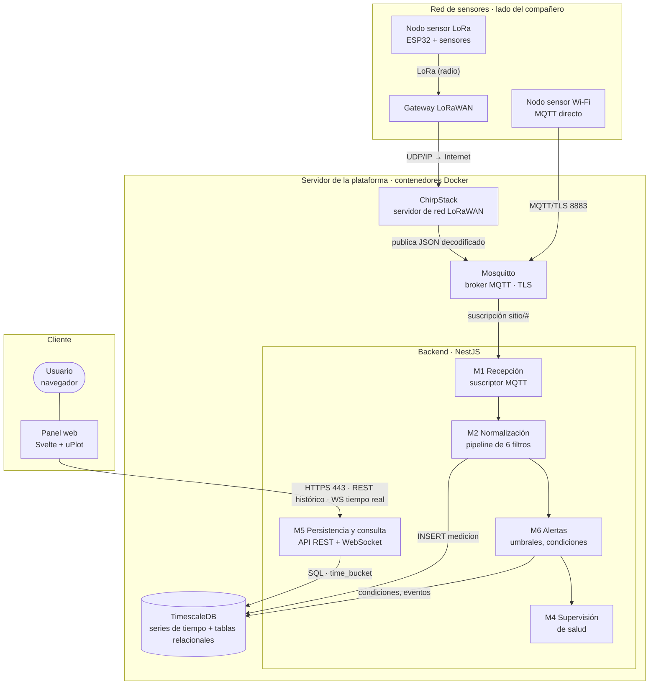
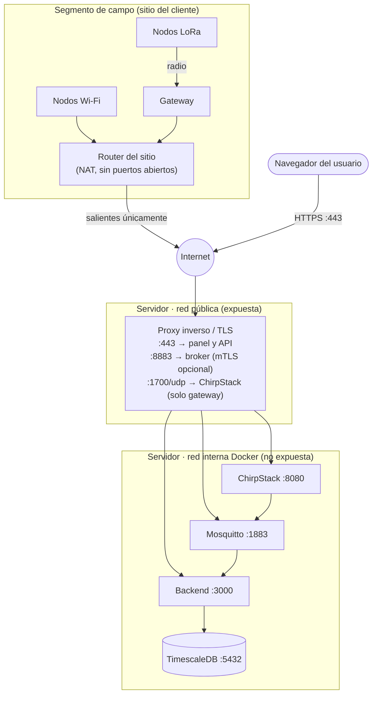
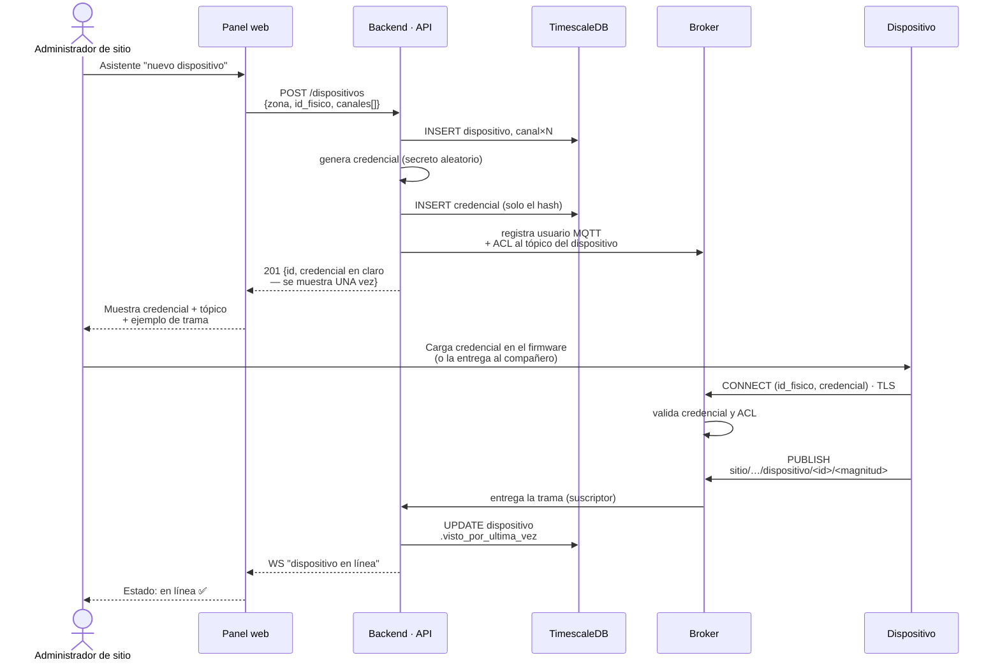
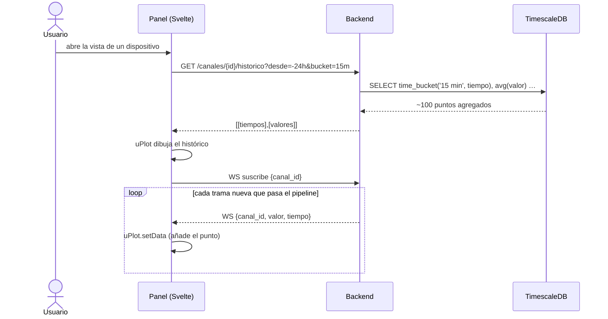
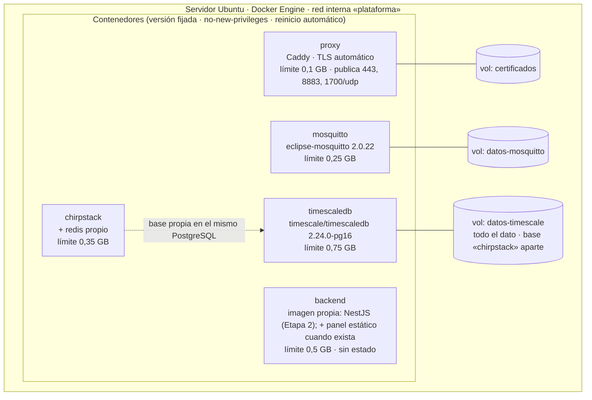

# Arquitectura del sistema (Etapa 2 — Diseño)

> **Sustenta:** OE2 y OE3 · criterio «diseña según estándares de calidad» (55 %) de la Etapa 2.
> **Notación:** vista de contenedores del modelo C4 (Brown) para la estructura; diagramas de
> secuencia UML para el comportamiento; vista de despliegue para la infraestructura. Todos son
> Mermaid: se ven en GitHub y `informe-oficial/figuras/generar-figuras.sh` los renderiza a PDF para el informe
> desde esta misma fuente (el modelo de datos se genera desde la base real). Versión: 8 de septiembre de 2026.
> **Depende de:** `docs/06` (pipeline), `docs/07` (stack y patrón B), `docs/08` (modelo de datos).

---

## 1. Vista de contenedores (C4, nivel 2)

Qué piezas ejecutables existen y cómo se hablan. La **frontera** del trabajo es el tópico MQTT: de un
lado, la red de sensores (lado del compañero: nodos, *gateway* y ChirpStack, que aunque se aloja en
nuestro servidor publica al broker como un productor más); del otro, el broker y el backend. No se
describe por posición (izquierda/derecha) porque el dibujo lo genera Mermaid y su distribución cambia
al renderizar; el 23/09/2026 la leyenda del informe decía «a la izquierda… a la derecha» y el dibujo
mostraba los sensores arriba. Se dibujan los módulos que tocan el dato (M1, M2, M4, M5, M6); M3
(aprovisionamiento), M7 (seguridad e identidad) y M8 (interfaz) no aparecen como cajas porque son
transversales o viven en el cliente (`docs/02` §3).

**Decisiones visibles en el diagrama:**

- **Tres puntos de entrada, ninguno más:** 443 para personas, 8883 para dispositivos MQTT, y
  1700/udp para los *gateways* LoRaWAN — este último **hoy no aplica**: ChirpStack no está desplegado
  en esta etapa (§8.3), y ese puerto no existe hasta que se agregue. La base de datos y la interfaz de
  administración de ChirpStack nunca se exponen; su puerto de recepción de *gateways*, cuando exista,
  sí, porque los *gateways* están en el campo, sin VPN, y deben poder alcanzarlo (RNF-10 al revés: aquí
  es el servidor el que necesita un puerto abierto, no el dispositivo).

  **Ese puerto es una amenaza real, no solo un trámite de firewall.** El protocolo que usan los
  *gateways* para hablarle a ChirpStack (*Semtech UDP Packet Forwarder*) **no tiene autenticación ni
  cifrado**: un *gateway* se identifica con su EUI, un dato público, y cualquiera puede enviar UDP a ese
  puerto suplantándolo (Semtech/ChirpStack, documentación del *Gateway Bridge*). La defensa no puede ser
  el protocolo; tiene que ser la capa de alrededor: el contenedor de ChirpStack sin privilegios
  (`no-new-privileges`, usuario no root, igual que el resto), limitar la tasa de paquetes en el proxy, y
  no confiar en el EUI recibido para nada que no sea enrutar — la autenticación real de cada nodo sigue
  ocurriendo más adentro, en el filtro 1 del pipeline, contra el registro de dispositivos.
- **El navegador nunca toca el broker** (patrón B, `docs/07`): consume la API del backend, que ya
  filtró y normalizó. Así la trama cruda jamás llega al cliente y las credenciales MQTT no viajan en
  JavaScript.
- **ChirpStack es un productor más** hacia el broker: para la plataforma, una trama LoRaWAN y una
  trama Wi-Fi son indistinguibles después del filtro 2 (adaptador). Eso es lo que resuelve la causa
  C2 (hardware atado a la plataforma).

## 2. Topología de red y segmentación

Vista de red de la solución: qué segmentos existen, qué puertos cruzan cada frontera y qué queda
aislado. Sustenta los RNF de seguridad (TLS obligatorio, mínimo privilegio, conexión saliente de los
dispositivos para no requerir NAT — RNF-10).

| Frontera | Cruza | No cruza | Por qué |
|---|---|---|---|
| Sitio → Internet | Conexiones **salientes** de nodos y gateway | Nada entrante | Los dispositivos inician la conexión: no hay que abrir puertos en el router del cliente (RNF-10) |
| Internet → servidor | 443 (personas), 8883 (dispositivos), 1700/udp (gateway) | 5432, 1883, 8080, 3000 | Solo se expone lo que necesita hablar con el exterior; todo lo demás vive en la red interna de Docker |
| Red interna | Tráfico entre contenedores por nombre de servicio | Acceso desde fuera | La base de datos solo es alcanzable desde el backend |

**Sobre las alternativas descartadas:** exponer el broker por WebSocket al navegador (patrón A)
habría abierto un puerto más y puesto credenciales en el cliente; una VPN habría exigido
configuración en cada sitio (reintroduce la causa C4, falta de personal técnico).

## 3. Secuencia: aprovisionamiento de un dispositivo (dar de alta)

Cómo un dispositivo pasa de desconocido a reconocido. Es el flujo que ataca directamente la causa
C4: debe poder hacerlo una persona sin perfil técnico, desde el panel.

**Puntos de diseño:**

- La credencial **se muestra una sola vez** y en la base solo queda su **hash** (misma política que
  una contraseña). Si se pierde, se **rota** (nueva fila en `credencial`), no se recupera.
- La **ACL del broker** limita a cada dispositivo a publicar solo en su propio tópico: un nodo
  comprometido no puede suplantar a otro.
- El estado "en línea" se deduce del **primer mensaje autenticado**, no de la alta: dar de alta un
  dispositivo que aún no transmite lo deja en "esperando primer contacto".

## 4. Secuencia: recepción de una trama (pipeline de seis filtros)

Comportamiento del núcleo del trabajo. Cada filtro tiene una salida "feliz" (sigue) y una de rechazo
(cuarentena o descarte), y ninguna trama llega a las series de tiempo sin pasar los seis.

**Por qué el orden importa:** autenticar primero evita gastar CPU en tramas de desconocidos
(resistencia a ruido); validar antes de normalizar evita convertir basura.

**Dos granularidades distintas, y por eso «vivo» significa lo que significa.** Los filtros 1 a 4
trabajan sobre la trama y sobre cada lectura que contiene; el de alertas evalúa **cada lectura
guardada**, porque un umbral se cruza por valor, no por trama. El de supervisión, en cambio, se
ejecuta **una sola vez al cerrar la trama**, porque lo que marca no es un dato sino un hecho del
enlace: *este dispositivo se comunicó*. De ahí que `visto_por_ultima_vez` se actualice aunque las
lecturas de esa trama hayan terminado en cuarentena.

La razón es que M4 supervisa la **salud del enlace**, no la calidad del dato. Un nodo que publica
cada cinco minutos una trama malformada está vivo: su radio, su credencial y su conexión funcionan;
lo que falla es su firmware o su configuración. Si lo marcáramos «sin comunicación» estaríamos
levantando una alarma de red por un problema de formato, y el operador buscaría el fallo donde no
está. Los dos problemas se registran por separado: el silencio, como condición `sin_comunicacion`;
el formato inválido, en `cuarentena` con su motivo (ver la propuesta de §8 para convertirlo también
en condición, en lugar de acumular filas).

**Un supervisor aparte, por tiempo:** el filtro 6 solo corre cuando *llega* una trama. Para detectar
el caso contrario —un dispositivo que **dejó de** transmitir— hay una tarea periódica (cada minuto)
que compara `visto_por_ultima_vez` contra `intervalo_esperado_s` y abre la condición
`sin_comunicacion`. Sin ella, un sensor caído sería invisible.

### 4.1 Entrega «al menos una vez», caídas y duplicados (RF-06, RF-10)

**Por qué QoS 1 y no QoS 2.** MQTT ofrece tres niveles: 0 «a lo más una vez» (puede perderse), 1 «al
menos una vez» (llega, pero puede duplicarse) y 2 «exactamente una vez», con un apretón de cuatro
paquetes (PUBLISH, PUBREC, PUBREL, PUBCOMP). La garantía de QoS 2 es **por salto, entre un cliente y el
broker**, no de extremo a extremo: nada en el protocolo sabe si el backend, después de confirmar al
broker, alcanzó a escribir en la base antes de caerse. Por eso el destino tiene que ser idempotente de
todos modos (índice único `canal + instante` y `ON CONFLICT DO NOTHING`), y una vez que lo es, QoS 1 da
el mismo efecto —cada lectura cuenta una sola vez— con la mitad de paquetes por mensaje y sin exigir
QoS 2 a nodos de pocos recursos. «Exactamente una vez» se logra aquí por diseño del receptor, no por el
transporte. Fuente: OASIS, *MQTT Version 5.0*, §4.3 (`mqttoasis` en la bibliografía).

| Situación | Qué pasa | Por qué basta |
|---|---|---|
| El **backend** cae | El broker conserva en cola los mensajes QoS 1 de `sitio/#` (sesión persistente: `clientId` fijo + `clean: false`, `persistence true` en Mosquitto) y los entrega al reconectar | Nada se pierde mientras el broker viva; `restart: unless-stopped` levanta el backend en segundos |
| El **broker** cae | Docker lo reinicia; el backend reintenta cada 2 s. Los nodos Wi-Fi con QoS 1 reintentan la publicación; ChirpStack reintenta según su integración | El broker es la pieza más simple y estable de la pila; su caída es corta |
| La **base** cae | El INSERT falla, el manejador registra el error y el mensaje ya fue confirmado al broker: **se pierde**. Limitación conocida; en la Etapa 3 se confirma al broker solo después del INSERT (`manualAck`) | Hoy la base y el backend comparten servidor: si cae una, cae todo; el caso relevante es la Etapa 3 |
| La misma trama llega **dos veces** (reentrega QoS 1 tras reconexión; nodo que reenvía su cola) | El INSERT es idempotente: índice único `(canal_id, tiempo)` + `ON CONFLICT DO NOTHING`; la repetida se ignora y **no** vuelve a evaluar umbrales | «Al menos una vez» + operación idempotente = efecto de exactamente una |
| La trama **no trae marca de tiempo** y llega dos veces | Se guarda dos veces: sin marca del emisor no hay forma de saber que es la misma lectura. La hora de recepción se toma en la base con `clock_timestamp()` (microsegundos), así una ráfaga de tramas en cola no colisiona entre sí | Deduplicar exige una identidad; la identidad de una lectura es «canal + instante del emisor». Limitación aceptada: los nodos que quieran «exactamente una» deben marcar `t` (SenML) |
| Dos gateways LoRaWAN reciben el **mismo uplink** | Lo deduplica ChirpStack por contador de trama antes de publicar | Es responsabilidad del servidor de red, no de la plataforma |
| El **tópico no cumple el patrón** `sitio/<sitio>/dispositivo/<id>/<magnitud>` | Cuarentena `malformada` con el detalle «tópico fuera del patrón», **antes** del filtro 1; el dispositivo **no** se marca vivo | Sin identidad no hay a quién atribuir la señal de vida; comparte el motivo `malformada` con el filtro 2 y se distingue por el detalle (decisión 23/09: no abrir un cuarto motivo por esto) |
| **Dos lecturas del mismo canal en la misma trama**, sin marca de tiempo | Se guardan ambas, con instantes de recepción distintos (microsegundos) | Sin marca del emisor no hay identidad de lectura (fila anterior); si un nodo repite un canal por error, corregirlo es del firmware, no de la plataforma. Limitación aceptada el 23/09 |
| El broker **reentrega muchas veces** de golpe (reconexión con cola larga) | Cada mensaje dispara su propio recorrido del pipeline, sin esperar al anterior; compiten por las 5 conexiones del pool | El INSERT idempotente evita duplicar; lo que falta es *backpressure* (confirmar al broker solo tras escribir, `manualAck`), la misma limitación declarada en «la base cae»: Etapa 3 |
| Una trama trae **miles de lecturas** | Hoy no hay tope: se procesan todas, en serie | Pendiente (`docs/11 §4`): tope de lecturas por trama en el adaptador y `message_size_limit` en el broker; un sensor no manda miles de lecturas, un atacante sí |
| Dos **sensores distintos** miden lo mismo cerca | **No es duplicado**: son dos canales, dos series, dos evaluaciones de umbral. Correlacionarlos es una función de análisis futura, no del pipeline | La plataforma registra lo que cada sensor dijo; interpretar es otra capa |

El orden del tiempo no importa para la serie: `medicion` se indexa por `(canal_id, tiempo)`, y una lectura
que llega tarde (nodo sin cobertura que reenvía su cola) se inserta en su instante real (regla 7 de `docs/13`).

**Hallazgo al contenedorizar (23/09/2026): el barrido periódico SÍ podía tumbar el proceso.** El
pipeline normal está protegido (`BrokerService` atrapa el rechazo de cada mensaje), pero el
temporizador del supervisor (M4) no tenía quien atrapara el suyo: una consulta fallida durante el
barrido era un rechazo sin manejar y **terminaba todo el proceso**, no solo ese ciclo. Probado
plantando la caída de la base con la pila en contenedores: sin el arreglo, el backend entraba en un
ciclo de reinicios (`docker inspect` mostraba `restarts` subiendo); con `barridoSeguro()`
(`try/catch` alrededor de `barrer()`, con registro de error) el proceso sigue vivo, `GET /salud`
informa el problema con honestidad (código 500, no oculta nada) y el siguiente barrido, un minuto
después, se ejecuta normal en cuanto la base vuelve. Cero reinicios en la prueba repetida.

**Límite conocido de `/salud` (mismo hallazgo).** El endpoint solo verifica la base; con el broker
caído responde `200 ok` igual, porque `BrokerService` reconecta solo y no lo consulta. No es un error:
hoy nada depende de que `/salud` refleje el broker, y `BrokerService` ya registra sus propios avisos
de conexión. Si más adelante el healthcheck del contenedor necesita reflejar también el broker, es un
cambio de diseño (qué significa «sano»), no una corrección: se decide en `docs/10` primero.

## 5. Secuencia: panel en tiempo real (patrón B)

El histórico viene **agregado por la base de datos** (`time_bucket`), no crudo: el navegador recibe
cientos de puntos, no millones, sin importar cuánto tiempo lleve el sensor transmitiendo.

**El canal de tiempo real es del backend y está autenticado** (decidido el 23/09/2026; TT-39). Corre
dentro del mismo 443 detrás del proxy (`wss`, nunca `ws`), se abre con la misma sesión del panel y se
rechaza en el apretón de manos si falta; el backend valida la cabecera `Origin` contra el dominio del
panel y limita el tamaño y la tasa de lo que recibe. Son las recomendaciones de OWASP para WebSocket,
que no trae autenticación propia (`docs/11 §4`). Como el canal es casi unidireccional —el servidor
empuja, el navegador solo elige qué canal mira—, la alternativa **SSE** (*Server-Sent Events*: HTTP
unidireccional, reconexión nativa, sin biblioteca extra) es más simple y cabe en el mismo 443.
**WebSocket frente a SSE queda como decisión abierta para la Etapa 3** (§8.3; los diagramas muestran
WebSocket como opción por defecto); ninguna de las dos toca el broker.

> Fuentes (consultadas el 23/09/2026): OWASP, *WebSocket Security Cheat Sheet*,
> https://cheatsheetseries.owasp.org/cheatsheets/WebSocket_Security_Cheat_Sheet.html · NestJS, *Gateways*
> (los guards de HTTP aplican igual a los gateways), https://docs.nestjs.com/websockets/gateways · NestJS,
> *Authentication*, https://docs.nestjs.com/security/authentication

## 6. Vista de despliegue (Docker Compose)

| Servicio | Persistencia | Reinicio | Expuesto |
|---|---|---|---|
| proxy | certificados | `unless-stopped` | 443, 8883, 1700/udp |
| mosquitto | retenidos + ACL | `unless-stopped` | no (vía proxy) |
| chirpstack | base `chirpstack` en el mismo PostgreSQL (volumen datos-timescale) + redis | `unless-stopped` | no (vía proxy) |
| timescaledb | **todo el dato** | `unless-stopped` | no |
| backend | ninguna (sin estado) | `unless-stopped` | no (vía proxy) |

**Suma de límites: ~1,95 GB** — coherente con RNF-17 (operar en ≤ 2 GB en reposo; los límites son
techos, no consumo). Los límites de recursos cumplen doble función: proteger al servidor y ser el
**entorno de referencia** del banco de pruebas (`docs/09`). **ChirpStack comparte el servidor PostgreSQL** (una base y un rol propios, aislados de la base de la
plataforma) en lugar de traer un segundo PostgreSQL: ahorra ~100 MB de memoria en reposo, un
respaldo cubre todo, y la extensión TimescaleDB no interfiere (ChirpStack solo necesita `pg_trgm` y
`hstore`, presentes en la imagen). Redis sí es propio: ChirpStack lo exige y es pequeño (~10 MB).
El backend **no guarda estado**: se puede
destruir y recrear sin perder nada, lo que simplifica actualizaciones y pruebas.

**Imagen del backend (23/09/2026).** *Multi-stage*: una etapa `build` con Node 22 completo compila
TypeScript a JavaScript (`pnpm build`); la imagen final parte de la variante *slim* de Node 22, copia
solo `dist/` y las dependencias de producción (`pnpm install --prod --frozen-lockfile`), y no lleva
compilador, `devDependencies` ni el código fuente. Así la imagen que corre es más chica y no puede
usarse para reconstruir nada por dentro. Corre como usuario **sin privilegios** (`USER node`, ya en la
imagen oficial), con `security_opt: no-new-privileges` en el compose. El `HEALTHCHECK` llama a
`GET /salud` (ya implementado, `src/salud`): confirma que el proceso responde y que su conexión a la
base está viva, no solo que el proceso existe. El **panel Svelte no existe aún en el código** (Etapa
3): la imagen de hoy sirve solo la API; cuando el panel exista, una etapa adicional lo compila y el
backend estático lo sirve, sin cambiar esta estructura.

**Dónde escucha el backend** (decidido el 23/09/2026; el código sigue a este texto). Fuera de Docker,
en desarrollo, escucha solo en `127.0.0.1` (variable `HTTP_INTERFAZ`, valor por defecto). Dentro del
contenedor escucha en todas las interfaces **del contenedor** (`HTTP_INTERFAZ=0.0.0.0`), que es la
única forma de que el proxy lo alcance por la red interna. Eso no lo expone: el servicio no lleva
`ports`, y Docker solo hace alcanzables los puertos de un contenedor desde el anfitrión y desde los
contenedores de su misma red; desde fuera del servidor esa dirección no existe. La conexión a la base
y al broker usa el nombre del servicio (`DB_HOST=timescaledb`, `MQTT_URL=mqtt://mosquitto:1883`,
`.env.example`). **La documentación interactiva `/docs` se sirve solo con `HTTP_DOCS=si`** (en
desarrollo la fija el override de Compose y el `.env`); ausente o vacía, queda apagada: en Internet
enumeraría las rutas y exige scripts en línea que la política de contenido del backend prohíbe. El
contrato que se cita es el `openapi.json` versionado (`docs/11 §3`).

**Registros (27/09/2026).** El backend escribe **un evento por línea en JSON** cuando corre en
contenedor (`LOG_FORMATO=json`, fijado en el archivo base de Compose): cada línea trae nivel,
contexto (`recepcion`, `broker`, `supervision`…), mensaje e instante, sin códigos de color, de modo
que se filtra con `jq` o `grep` sin adivinar formatos y cualquier recolector futuro la entiende sin
configurarlo. Fuera de Docker, en desarrollo, el valor por defecto es texto con color, legible en la
terminal. Los registros de la pila se guardan con `plataforma/pruebas/pila.sh logs`, que los sigue en
vivo, los muestra en una línea legible y los copia sin tocar a `privado/logs/` (ignorado por git);
`pila.sh buscar` y `pila.sh resumen` los consultan. **Un solo backend a la vez**, y no solo por el
puerto 3000: dos procesos con el mismo `MQTT_CLIENT_ID` se echan mutuamente del broker (lo hace el
propio protocolo con identificadores duplicados), y si comparten la sesión persistente se reparten los
mensajes en cola.

**Escalado.** Una sola instancia del backend, a propósito. Con `clientId` fijo y sesión persistente el
broker conserva la cola mientras el backend está caído (§4.1); dos instancias con el mismo
identificador se desconectarían mutuamente, y con identificadores distintos recibirían ambas todas las
tramas. Dentro del servidor no hace falta más: Node delega la entrada y salida al núcleo del sistema,
que sí es multihilo, y la carga de RNF-01 (50 eventos/s) se medirá en el banco de pruebas de `docs/09`
sobre esta única instancia. Si algún día hiciera falta repartir carga entre varias, el camino
documentado es: suscripciones compartidas de MQTT 5 (`$share/<grupo>/sitio/#`, admitidas por
Mosquitto) para que las instancias se repartan las tramas, y `cluster` o `worker_threads` de Node para
ocupar más núcleos. No está en el alcance: RNF-17 fija un servidor de 2 GB y RNF-14 un único servidor.

> Fuentes (consultadas el 23/09/2026): Docker, *Networking overview* («ports are not accessible from
> outside the host» sin `--publish`), https://docs.docker.com/engine/network/ · Node.js, *The Node.js
> Event Loop*, https://nodejs.org/en/learn/asynchronous-work/event-loop-timers-and-nexttick · Node.js,
> *Cluster*, https://nodejs.org/api/cluster.html · Eclipse Mosquitto, *mosquitto.conf(5)*
> (`max_queued_messages`, por defecto 1000 por cliente), https://mosquitto.org/man/mosquitto-conf-5.html

## 7. Trazabilidad con los requerimientos

| Elemento de diseño | Requerimientos que materializa |
|---|---|
| Tres puntos de entrada TLS/UDP: 8883 máquinas, 443 personas, 1700/udp *gateways* (pendiente) | RNF-08, RNF-09, RNF-10 |
| Adaptadores por origen (filtro 2) | RF-01, RF-02, RF-04 (recepción multiprotocolo) |
| Cuarentena separada de las series | RF-05, RF-07 |
| Supervisor periódico de `sin_comunicacion` | RF-24, RF-25, RF-26 |
| Credencial de un solo vistazo + ACL por dispositivo | RF-40, RF-41, RF-42 |
| Histórico agregado con `time_bucket` + WS del backend | RF-33, RNF-04 |
| Límites de recursos por contenedor | RNF-17, protocolo de validación |

> **Pendiente:** RF-29 (keep-alive y *Last Will* de MQTT) no está trazado porque el cliente MQTT del
> backend aún no publica testamento (`will`); queda como brecha declarada hasta implementarlo (Etapa 3).

## 8. Propuestas abiertas y pendientes

### 8.1 Un dispositivo que comunica pero no entrega datos válidos (propuesta, 23/09/2026)

**El problema.** Hoy un nodo mal configurado que publica cada cinco minutos una trama inválida queda
«vivo» (correcto: su enlace funciona) pero genera una fila de `cuarentena` cada vez: 288 filas al día,
105 000 al año, con el mismo motivo y la misma carga cruda. Ensucia la tabla, encarece el diagnóstico
y hace que lo importante —*este dispositivo lleva días sin entregar un dato usable*— quede enterrado
entre miles de filas idénticas.

**Por qué no es un estado nuevo del dispositivo.** `dispositivo.estado` (`activo`,
`mantenimiento`, `baja`) describe la **decisión administrativa** sobre el equipo, no lo que está
ocurriendo con él. Lo que ocurre se modela como **condición**, igual que `sin_comunicacion` y
`umbral`: tiene apertura, cierre y duración. Meter «manda basura» dentro de `estado` obligaría a
responder qué pasa cuando además está en mantenimiento, o cuando manda basura *y* se calla: dos
hechos ortogonales en un solo campo. La regla del modelo (una sola casa por hecho) dice que van
separados.

**Propuesta, en tres partes:**

1. **Condición nueva `datos_invalidos`**: se abre cuando un dispositivo acumula *N* tramas
   consecutivas rechazadas (propuesta: 3) sin ninguna aceptada en medio; se cierra con la primera
   lectura válida. El panel la muestra junto a las otras condiciones y el operador ve *un* problema,
   no diez mil filas. Es el mismo patrón que ya se usa para el silencio, así que no agrega conceptos.
2. **Cuarentena con muestreo, no con acumulación**: guardar íntegras las primeras *k* tramas
   (propuesta: 5) de cada par (dispositivo, motivo) dentro de una ventana (propuesta: 1 hora) y, a
   partir de ahí, solo incrementar un contador con la primera y última aparición. Se conserva la
   evidencia —que es para lo que existe la cuarentena— sin pagar el volumen. Si la ventana se cierra
   sin tramas nuevas, el ciclo vuelve a empezar.
3. **Retención**: política de borrado de `cuarentena` a los 30 días, igual que la compresión de
   `medicion`. Una trama basura de hace dos meses no diagnostica nada.

4. **Avisar a quien puede arreglarlo, con lo que necesita para arreglarlo.** Detectar sin notificar
   no sirve: hoy la evidencia queda en una tabla que solo mira quien sabe SQL. La condición
   `datos_invalidos` debe aparecer en el panel como las demás (RF-47, RF-48) y notificar (RF-36,
   RF-37), y el aviso debe ser **accionable**, no un código de error. Tres datos, que la plataforma
   ya tiene:
   - **Qué llegó y qué se esperaba**: el motivo (`malformada`, `invalida`, `desconocido`), una
     muestra de la trama cruda y la regla que no se cumplió —«se esperaba un número o un pack SenML;
     llegó `{"temp":"alto"}`», «la unidad `furlongs` no es convertible a `Cel`», «el canal
     `presion` no está declarado para este dispositivo»—. Con eso, quien administra el sensor sabe
     qué tocar en su firmware o en su configuración sin pedirle ayuda a nadie.
   - **Cuánto lleva costando**: «este dispositivo lleva 3 días enviando 288 tramas diarias que no se
     guardan». Un contador hace visible un desperdicio que hoy es invisible, y convierte «algún día
     lo reviso» en una tarea con tamaño.
   - **Qué se gana al corregirlo**: la medición vuelve a las series y la condición se cierra sola con
     la primera trama válida.

**Un límite honesto de esta idea.** Recibir y analizar la trama es un costo inevitable: hay que
autenticarla y tratar de interpretarla para saber que es inválida. Lo que la propuesta ahorra es el
**almacenamiento y el ruido** —miles de filas idénticas y un índice que crece— no el cómputo de los
filtros 1 y 2. Si un dispositivo mal configurado llegara a ser un problema de carga y no solo de
ruido, el instrumento correcto es el limitador de tasa por dispositivo ya previsto para la Etapa 3,
y aun así nunca se descarta en silencio: el contador y la condición siguen registrando lo que se
dejó de guardar. Y se asume la posibilidad contraria: que el formato esté bien y el equivocado sea
nuestro adaptador. Por eso la muestra cruda se conserva siempre, aunque el resto se cuente.

**Qué decidir antes de implementar:** los tres números (*N* tramas para abrir, *k* muestras por
ventana, días de retención), el texto exacto del aviso al operador y si notifica por correo o solo
en el panel. Entra en la Etapa 3, después del Dockerfile y del proxy. Al aprobarse: primero este
documento y el diagrama, después el código (regla de concordancia).

### 8.2 Numeración de los filtros 5 y 6 (decidido el 23/09/2026)

Hasta el 23/09 el diagrama numeraba *5 supervisar* y *6 alertar*, pero la ejecución es la inversa: las
alertas se evalúan por cada lectura guardada, dentro del bucle, y la supervisión cierra la trama una
sola vez al final (§4). **Decisión: intercambiar los números —5 alertar, 6 supervisar— para que el
diagrama describa la secuencia real**, manteniendo los seis filtros y los módulos M4 y M6 sin cambio.
Aplicado en este documento y su diagrama, el capítulo de diseño (vía la figura generada), los
comentarios del backend, su README y la evaluación de comunicación (`docs/06`). En la misma revisión se
detectó que el código **no** marcaba vivo al dispositivo cuando la trama caía en cuarentena por formato
(el filtro 2 cortaba el pipeline), en contra de lo que dice §4; se corrigió el código para que siga al
diseño (regla de concordancia): tras autenticar, el filtro 6 corre siempre.

### 8.3 Pendientes

- [ ] Confirmar con el compañero el tópico exacto y la forma de su JSON para escribir el adaptador
      (filtro 2) — ver bitácora de acuerdos.
- [ ] Decidir el proxy inverso definitivo (Caddy por TLS automático vs. Nginx por familiaridad y por
      traer limitador de tasa nativo; Caddy no hace TLS para MQTT sin módulo externo).
- [x] Dockerfile del backend y su servicio en el compose — hecho el 23/09 (§6; `bitacora/2026-09-23-dockerfile-backend.md`).
- [ ] Decidir WebSocket o SSE para el canal de tiempo real (§5) antes de implementar TT-39 (Etapa 3).
